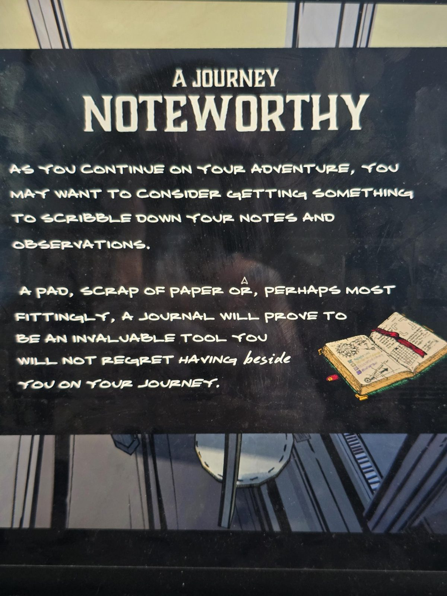

# Табличка: «Путешествие, достойное записей»
Табличка в Nook.

ПУТЕШЕСТВИЕ, **ДОСТОЙНОЕ ЗАПИСЕЙ** (игра слов: noteworthy — «примечательный» и «стоит записать»)

ПРОДОЛЖАЯ ПРИКЛЮЧЕНИЕ, ПОДУМАЙ О ТОМ, ЧТОБЫ ЗАВЕСТИ ЧТО-НИБУДЬ ДЛЯ ЗАМЕТОК И НАБЛЮДЕНИЙ.

БЛОКНОТ, КЛОЧОК БУМАГИ ИЛИ, ПОЖАЛУЙ, ЛУЧШЕ ВСЕГО **ДНЕВНИК** СТАНЕТ БЕСЦЕННЫМ ИНСТРУМЕНТОМ, И ТЫ НЕ ПОЖАЛЕЕШЬ, ЧТО ОН БЫЛ *рядом* С ТОБОЙ В ПУТИ.

## Заметка
- Совет игроку вести записи. Этот репозиторий как раз для этого 🙂
- Слово *beside* написано другим, рукописным шрифтом.

## Photos / Фото

