# Книга «The Red Prince» (Красный принц)
Детская книжка в Nursery. Автор: **Marion Marigold**.

*Обложка:* красная, маленький принц в короне и красном плаще.
*Титул:* **КРАСНЫЙ ПРИНЦ**. Автор Марион Мэриголд.

Жил-был красный принц,
Он сидел на красном троне.
Носил красную корону из рубинов
И жил в красном замке из камня.

Принц любил
Всё красное.
«Это единственный *истинный* цвет», —
Часто говорил принц.

Он не выносил вида
Канарейки или вороны.
Не выносил белизны
Лебедя на снегу.

И он никогда не смотрел вверх…
Боясь того, что увидит.
Он слышал, что небо
Вовсе не красного цвета!

Поэтому у него всегда была книга,
Чтобы опускать глаза,
Если он оказывался на улице,
Когда не было облаков.

А знаешь ли ты, какая книга
Всегда была у принца?
Та, что делала его счастливым,
Когда ему было грустно?

История, которую он читал
И в ванне, и в постели.
Может, ты угадаешь
По подсказкам, что мы дали.

Это была история мальчика,
Который тоже носил красное!
И он был похож на нашего принца
С ног до головы.

И как ты, мой читатель,
Уже, наверное, догадался:
Эта книга совсем рядом с тобой,
Да что там, в той же комнате!

История о тебе,
Если уж говорить прямо.
О красном принце и его книге.
О красной книге, которую мы только что прочли.

## Заметка
- Рекурсивная сказка: книга о принце, который читает эту же книгу.
- **Marigold** (ноготок): Герберт в красном письме называет Мэри «my marigold». Возможно, Marion Marigold — это псевдоним Мэри, матери Саймона (моя догадка).
- «Красный — единственный истинный цвет» перекликается с «красными флагами» из письма Герберта и с названием игры (Blue Prince).

## Photos / Фото
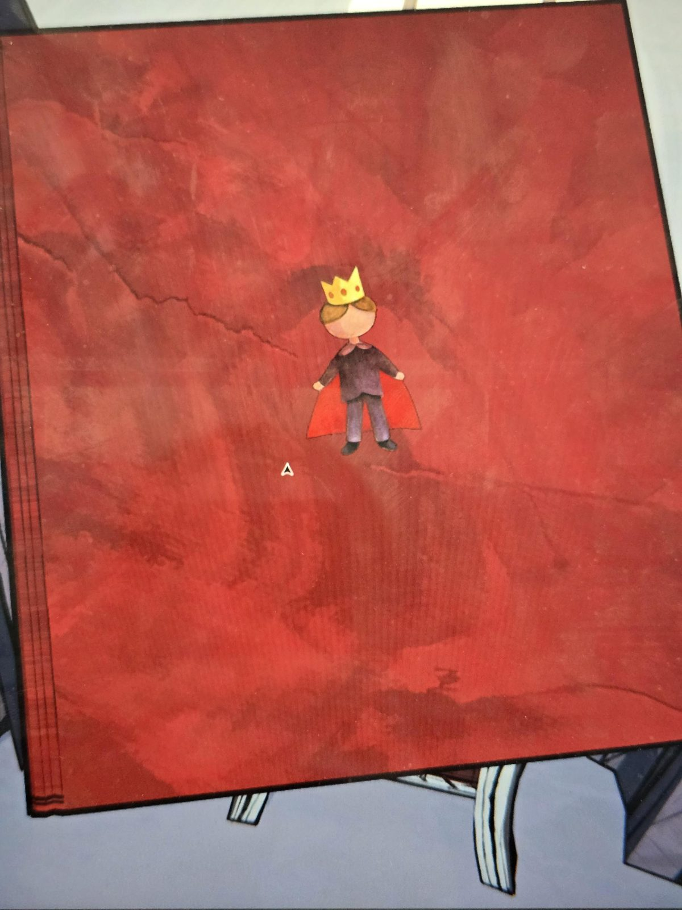
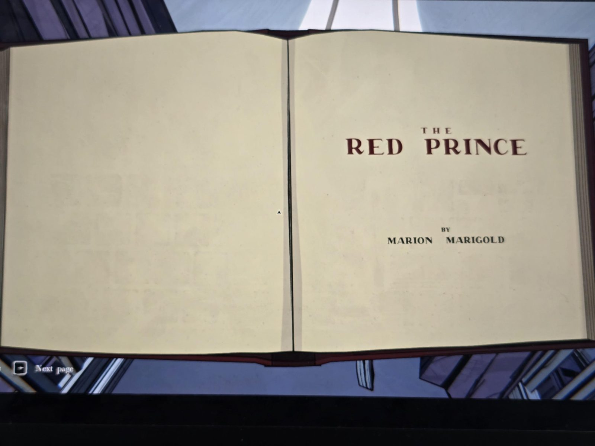
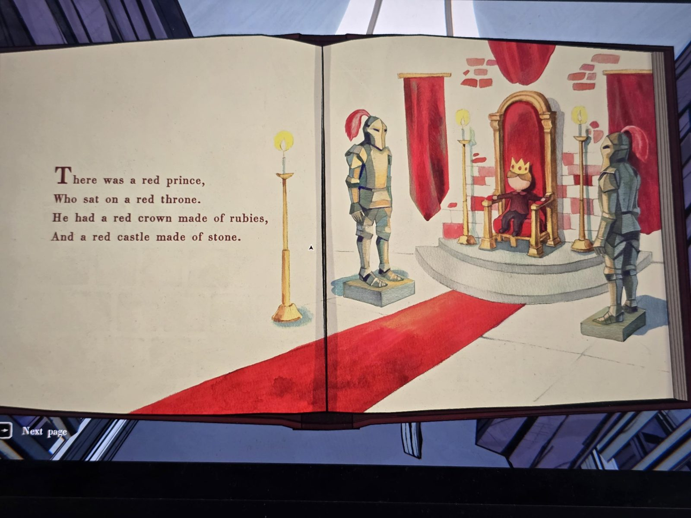
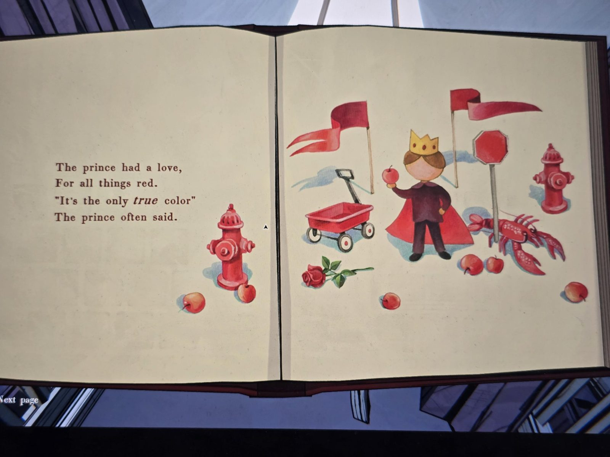
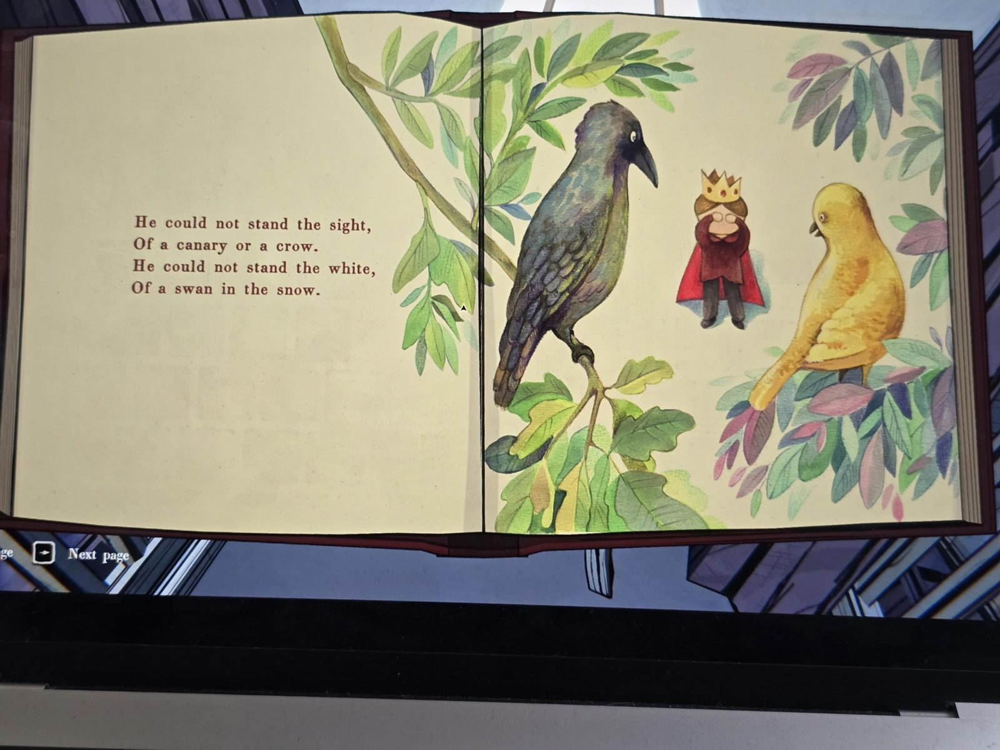
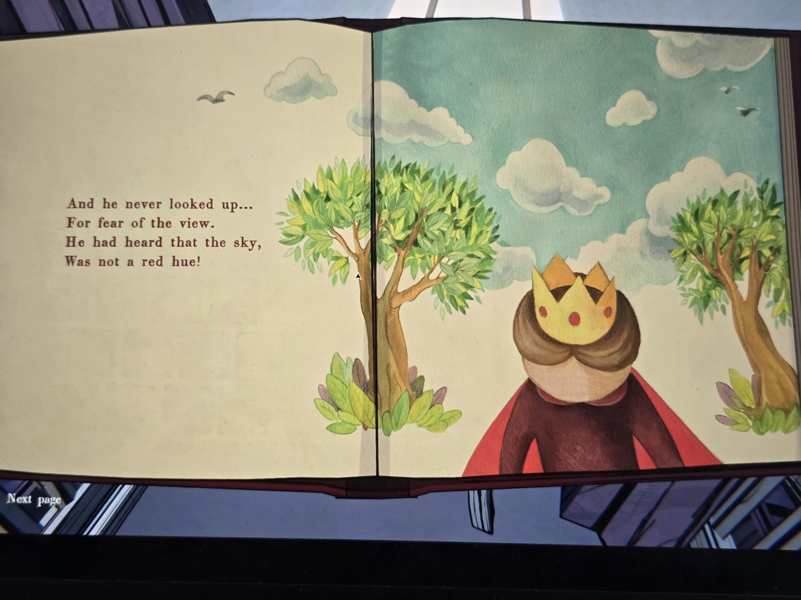
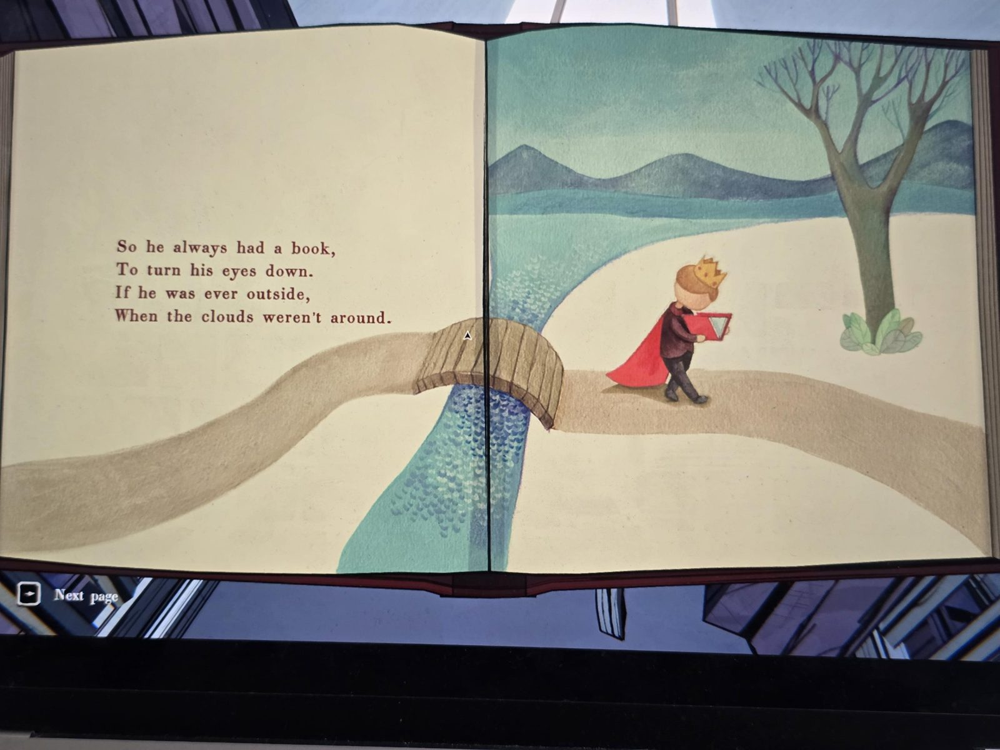
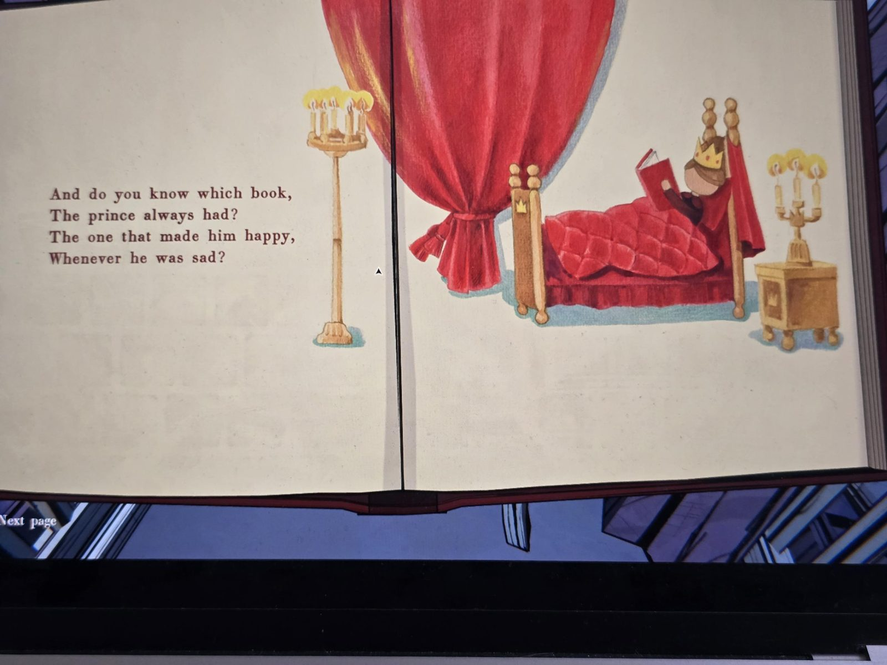
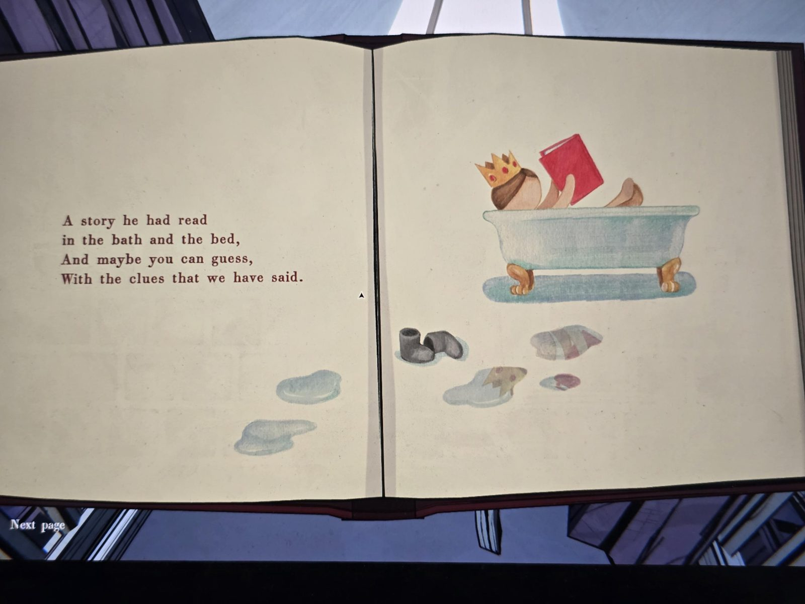
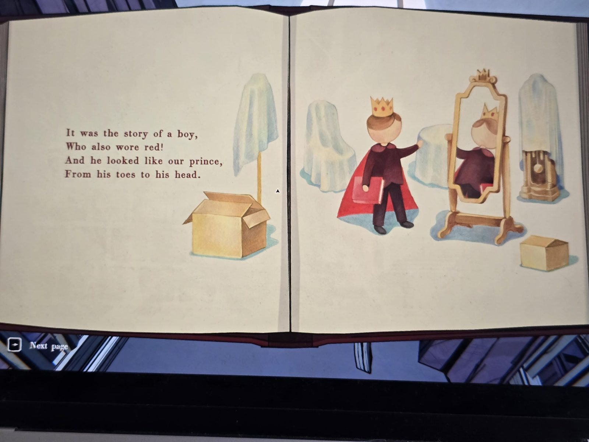
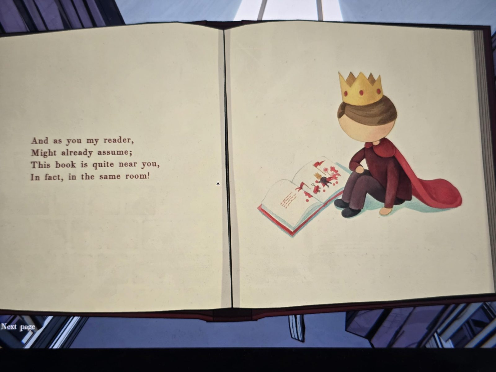
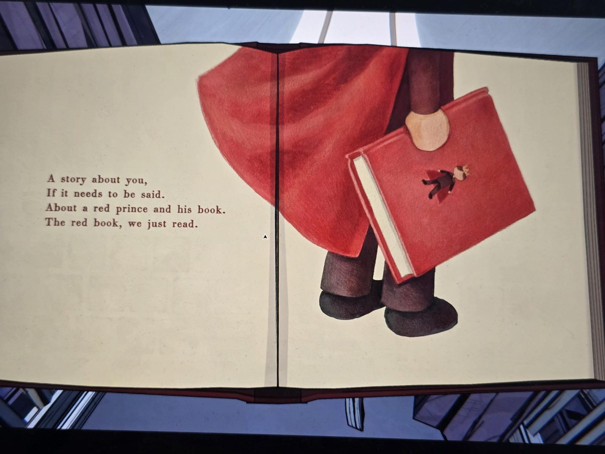
