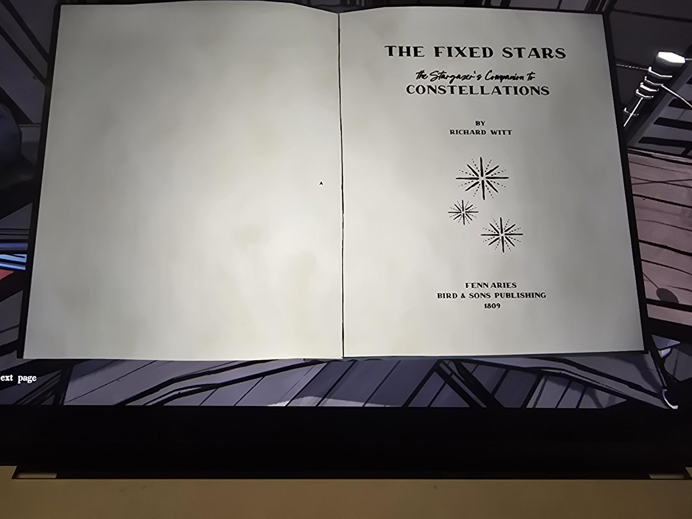
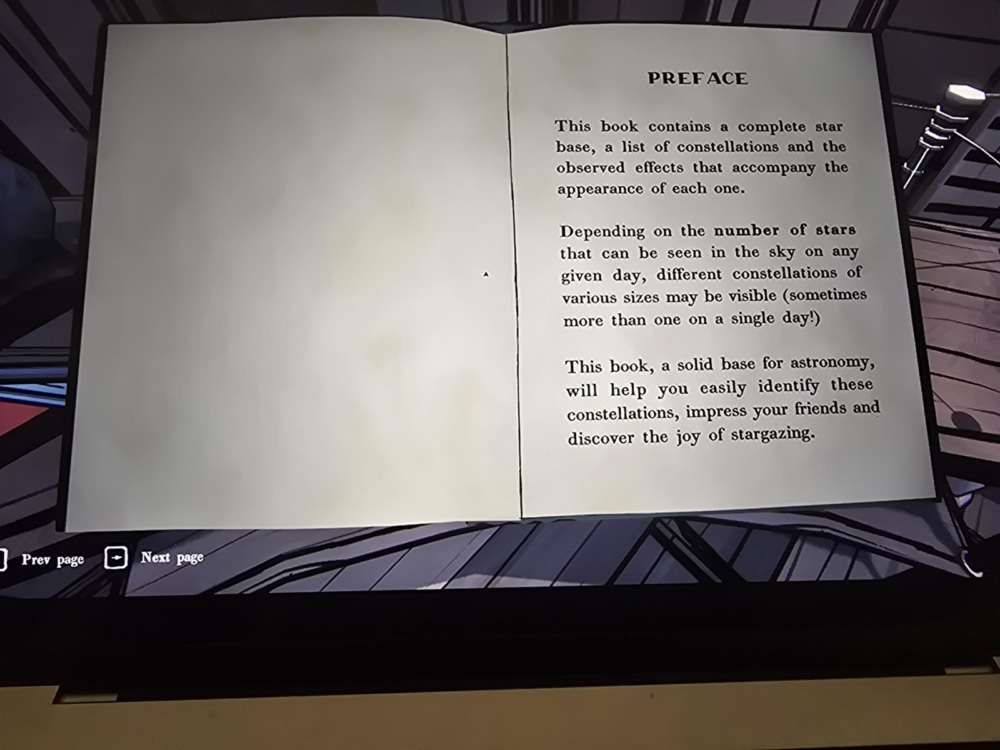
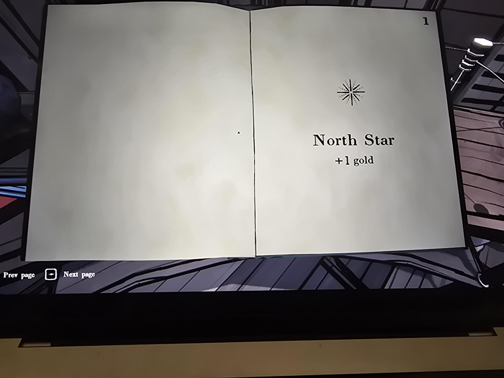
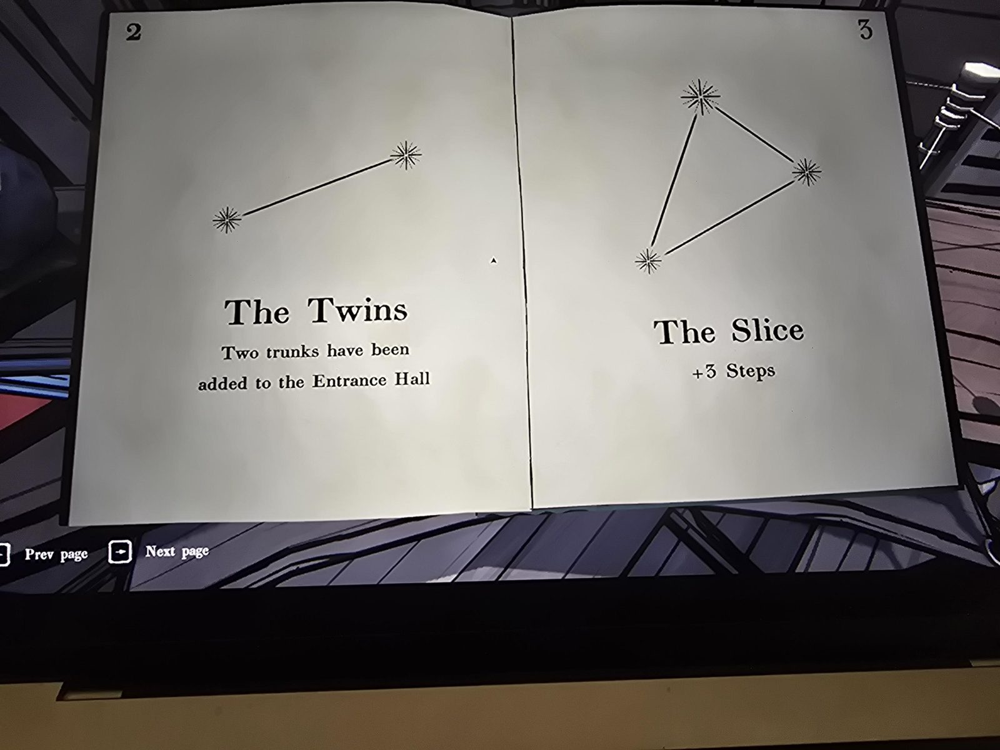
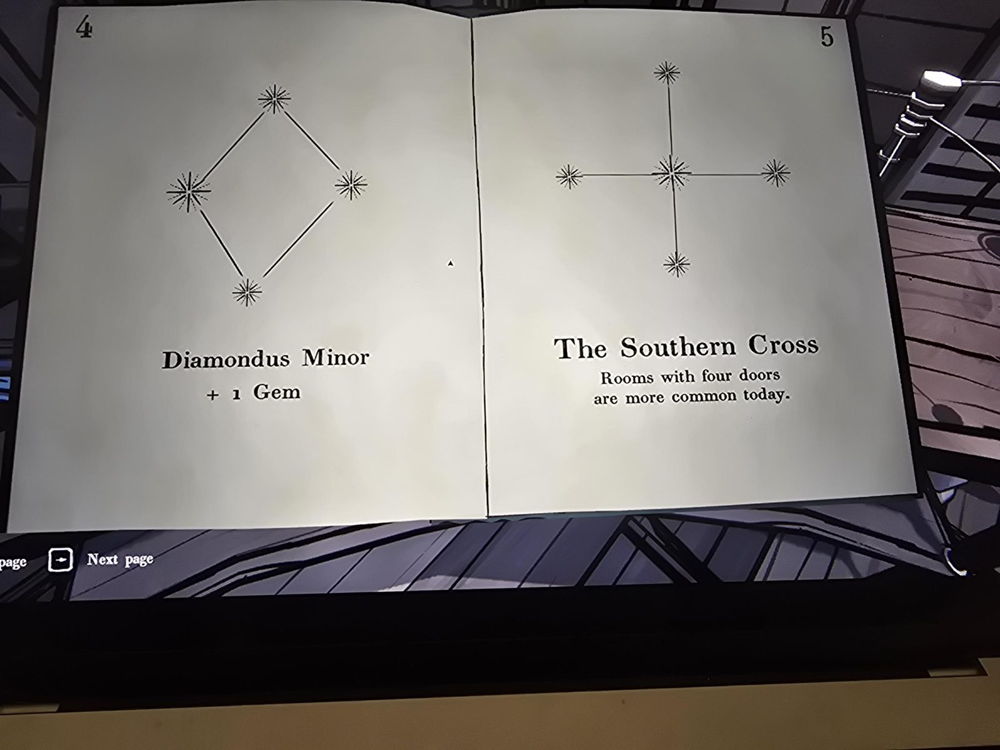
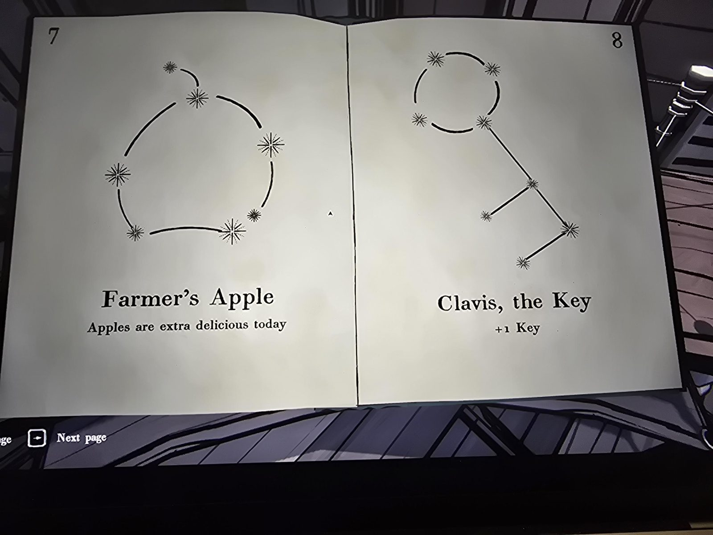
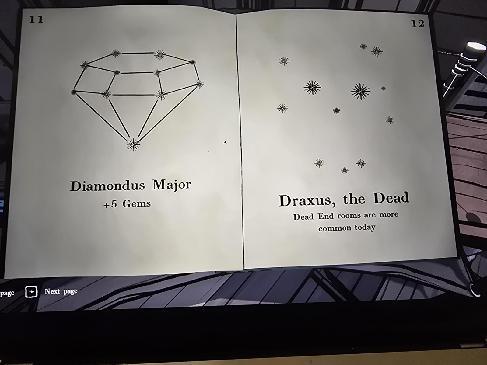
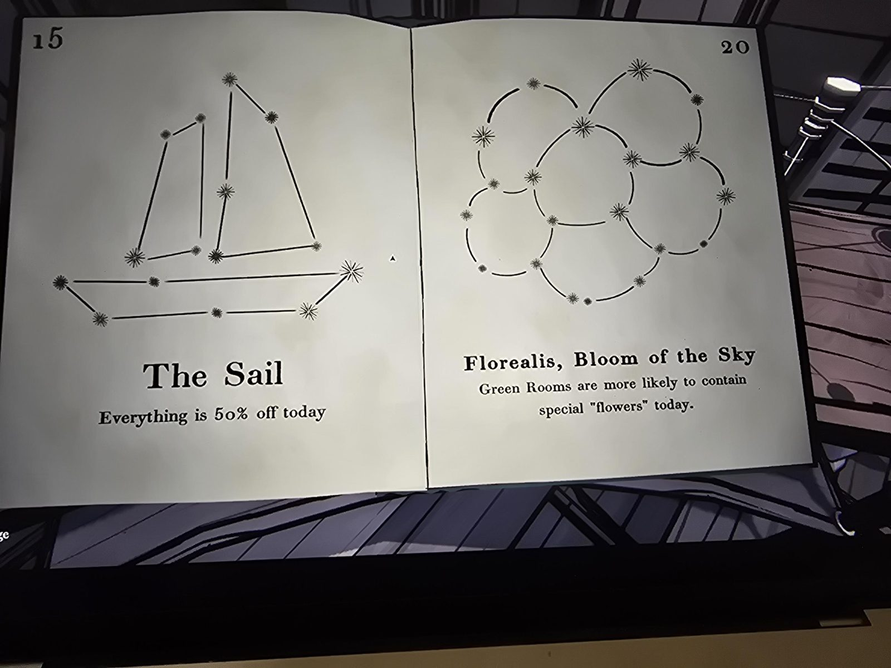

# Книга «The Fixed Stars» (Неподвижные звёзды)
Книга в Observatory. Ричард Витт, «Спутник звездочёта: созвездия», Fenn Aries, Bird & Sons Publishing, **1809**.

**Предисловие:** в книге — список созвездий и эффектов, которые сопровождают их появление. В зависимости от **числа звёзд**, видимых в небе в этот день, видны разные созвездия (иногда несколько сразу!).

| Звёзд | Созвездие | Эффект на день |
|---|---|---|
| 1 | North Star (Полярная звезда) | +1 золото |
| 2 | The Twins (Близнецы) | в Entrance Hall добавлены 2 сундука |
| 3 | The Slice (Ломтик) | +3 шага |
| 4 | Diamondus Minor | +1 самоцвет |
| 5 | The Southern Cross (Южный Крест) | комнаты с 4 дверями чаще |
| 7 | Farmer's Apple (Яблоко фермера) | яблоки особенно вкусные |
| 8 | Clavis, the Key (Ключ) | +1 ключ |
| 11 | Diamondus Major | +5 самоцветов |
| 12 | Draxus, the Dead (Мёртвый) | тупиковые комнаты чаще |
| 15 | The Sail (Парус) | всё со скидкой 50% |
| 20 | Florealis, Bloom of the Sky | в зелёных комнатах чаще особые «цветы» |

## Заметка
- Число звёзд, видимо, меняется от дня к дню (или можно увеличить в Observatory). Для чисел 6, 9, 10, 13, 14, 16–19 созвездий нет. Объяснение: это **суммы** (6 = 2 + 4 и т. д.), см. [Star Schedule](../../../planetarium/docs/star-schedule/ru.md) в Planetarium.
- Год 1809 и адрес «1809 Alice Dr.» на конверте от папы — совпадение? (заметил)

## Photos / Фото

