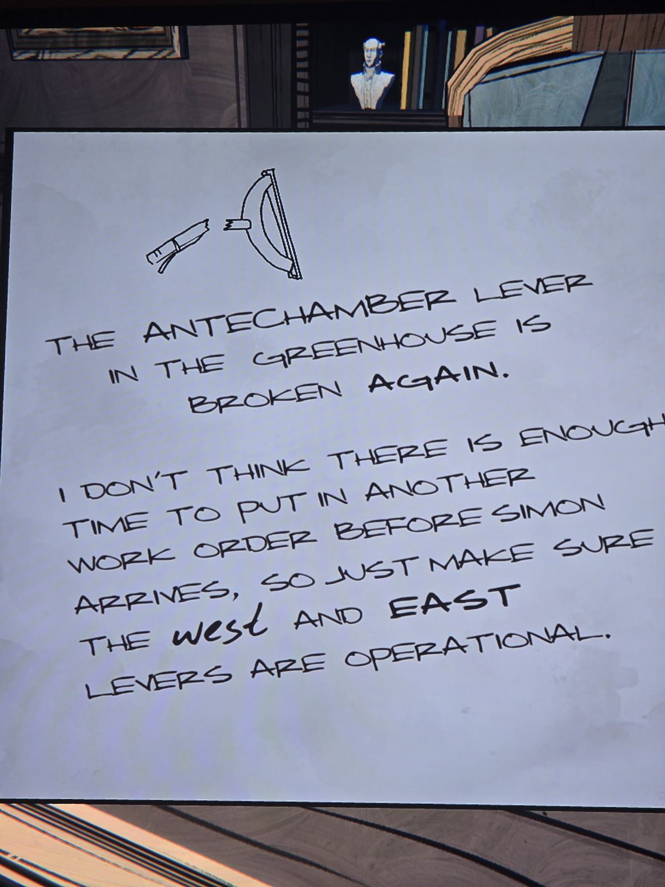

# Записка: сломанный рычаг Antechamber
Лист в Office с наброском сломанного рычага.

РЫЧАГ ANTECHAMBER В **GREENHOUSE** (оранжерее) **ОПЯТЬ** СЛОМАН.

ВРЯД ЛИ УСПЕЕМ ПОДАТЬ ЕЩЁ ОДНУ ЗАЯВКУ НА РЕМОНТ ДО ПРИЕЗДА САЙМОНА, ТАК ЧТО ПРОСТО ПРОСЛЕДИ, ЧТОБЫ **ЗАПАДНЫЙ** И **ВОСТОЧНЫЙ** РЫЧАГИ РАБОТАЛИ.

## Заметка
- Рычаги Antechamber: в Greenhouse (сломан), западный и восточный (работают). Где именно западный и восточный, пока неизвестно.
- Слово *west* написано другим почерком (как *beside* на табличке в Nook). Возможно, это тоже что-то значит.

## Photos / Фото

