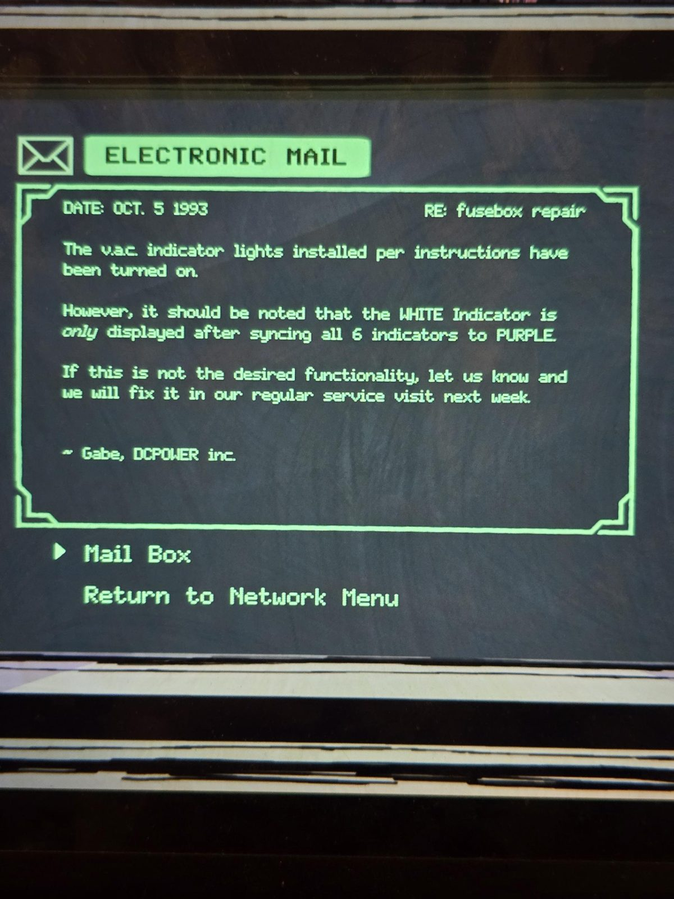
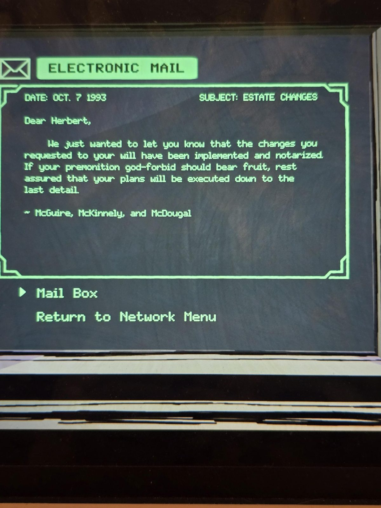
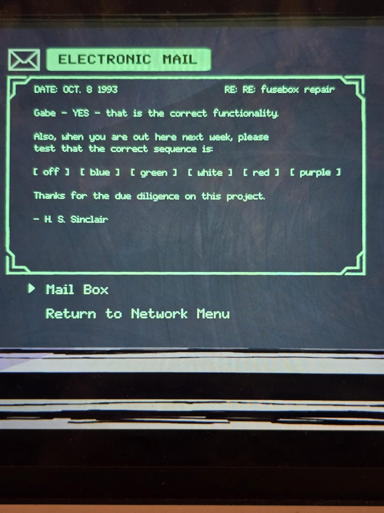
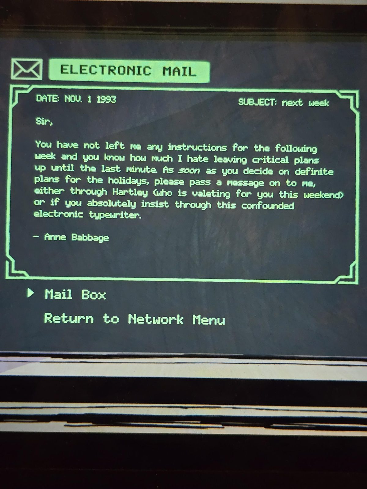

# Электронная почта на терминале Office (октябрь–ноябрь 1993)
Терминал в Office, пароль **SWANSONG**. Письма в порядке дат.

### 1. 5 окт. 1993 — RE: ремонт щитка
Индикаторы v.a.c., установленные по инструкции, включены.

Однако обратите внимание: **БЕЛЫЙ** индикатор появляется **только** после того, как **все 6 индикаторов** переведены в **ФИОЛЕТОВЫЙ**.

Если это не то, что нужно, сообщите — исправим при плановом визите на следующей неделе.

~ **Гейб, DCPOWER inc.**

### 2. 7 окт. 1993 — ИЗМЕНЕНИЯ В ЗАВЕЩАНИИ
Дорогой Герберт,

сообщаем, что запрошенные вами **изменения в завещании** внесены и нотариально заверены. Если ваше **предчувствие**, не дай бог, сбудется, будьте уверены: ваши планы будут исполнены до мельчайших деталей.

~ **Макгуайр, Маккиннели и Макдугал** (юристы)

### 3. 8 окт. 1993 — RE: RE: ремонт щитка
Гейб, ДА, всё работает правильно.

И когда будете здесь на следующей неделе, проверьте, пожалуйста, что правильная последовательность такая:

**[ выкл ] [ синий ] [ зелёный ] [ белый ] [ красный ] [ фиолетовый ]**

Спасибо за тщательность.

— **Х. С. Синклер**

### 4. 1 нояб. 1993 — на следующей неделе
Сэр,

вы не оставили мне никаких указаний на следующую неделю, а вы знаете, как я не люблю откладывать важные планы на последний момент. Как **только** определитесь с планами на праздники, передайте мне, пожалуйста, весточку — либо через **Хартли (он на этих выходных служит у вас камердинером)**, либо, если уж настаиваете, через эту треклятую электронную пишущую машинку.

— **Энн Бэббидж**

## Заметка
- **Щиток Utility Room**: цель — выставить 6 индикаторов в порядке **выкл · синий · зелёный · белый · красный · фиолетовый**. Белый появляется только после того, как все 6 станут фиолетовыми. См. [решение](../../solutions.md).
- **Хартли** — камердинер (valet) Герберта. Ср. [Darkroom](../../../darkroom/docs/developed-prints/ru.md): «…een memos found in **Hartley's room** are always false».
- Завещание изменено **7 октября 1993**, за месяц до смерти. Герберт умер в начале ноября 1993 (по датам писем).

## Photos / Фото

