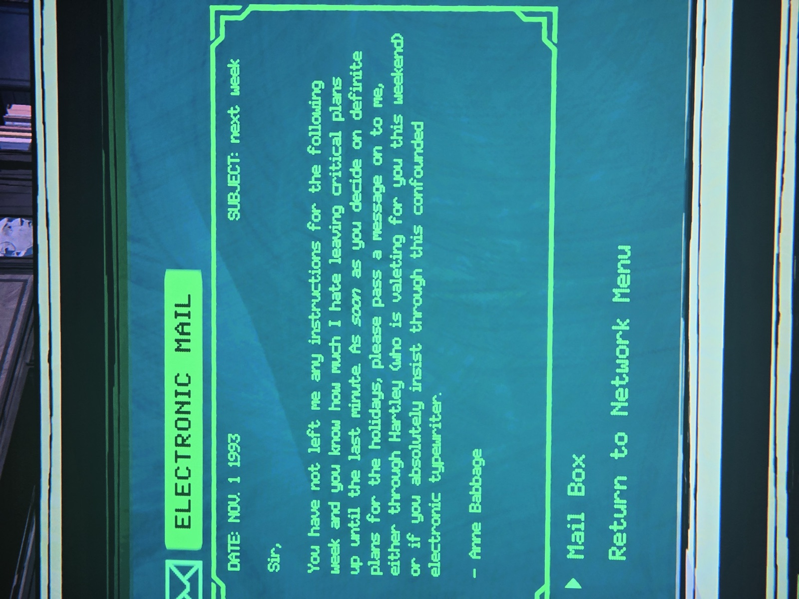
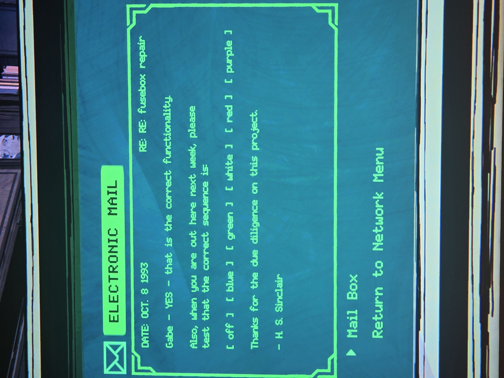
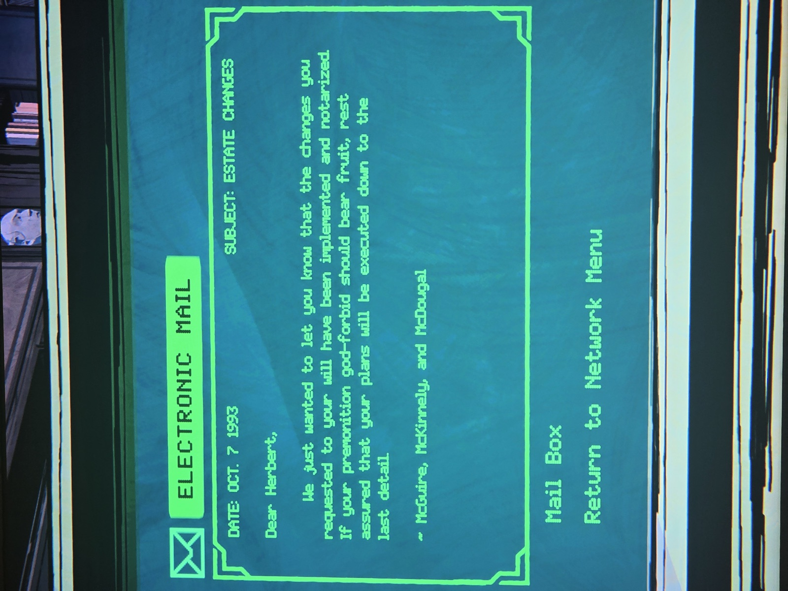
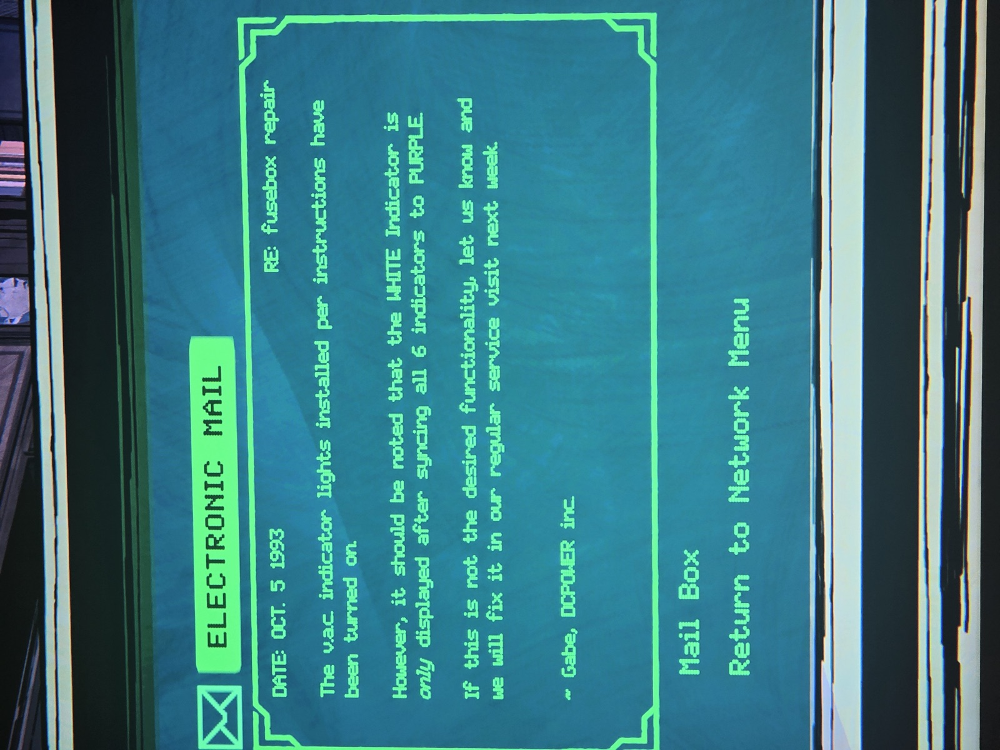

Почта терминала в Office (над экраном виден бюст графа):
1. **1.11.1993, «следующая неделя»** — Энн Бэббидж: «Сэр, вы не оставили указаний на следующую неделю… решите насчёт праздников и передайте мне через Хартли (он на этих выходных ваш камердинер) или через эту проклятую электронную машинку».
2. **8.10.1993, RE: RE: ремонт щитка** — Х. С. Синклер → Гейбу: «ДА, так и должно работать. В следующий визит проверьте правильную последовательность: **[выкл] [синий] [зелёный] [белый] [красный] [фиолетовый]**».
3. **7.10.1993, «Изменения в наследстве»** — юристы McGuire, McKinnely & McDougal: изменения в завещании внесены и заверены; «если ваше предчувствие, не дай бог, сбудется — всё будет исполнено до мелочей».
4. **5.10.1993, RE: ремонт щитка** — Гейб, DCPOWER: индикаторы V.A.C. включены; **белый индикатор появляется только после того, как все 6 станут фиолетовыми**.

*Заметка: это «подробные инструкции по почте» к щитку V.A.C. в Utility Closet (см. rooms/utility-closet/docs/fusebox-vac-indicators). Последовательность off → blue → green → white → red → purple — вероятно, порядок переключения/цветов для решения.*

## Photos / Фото

