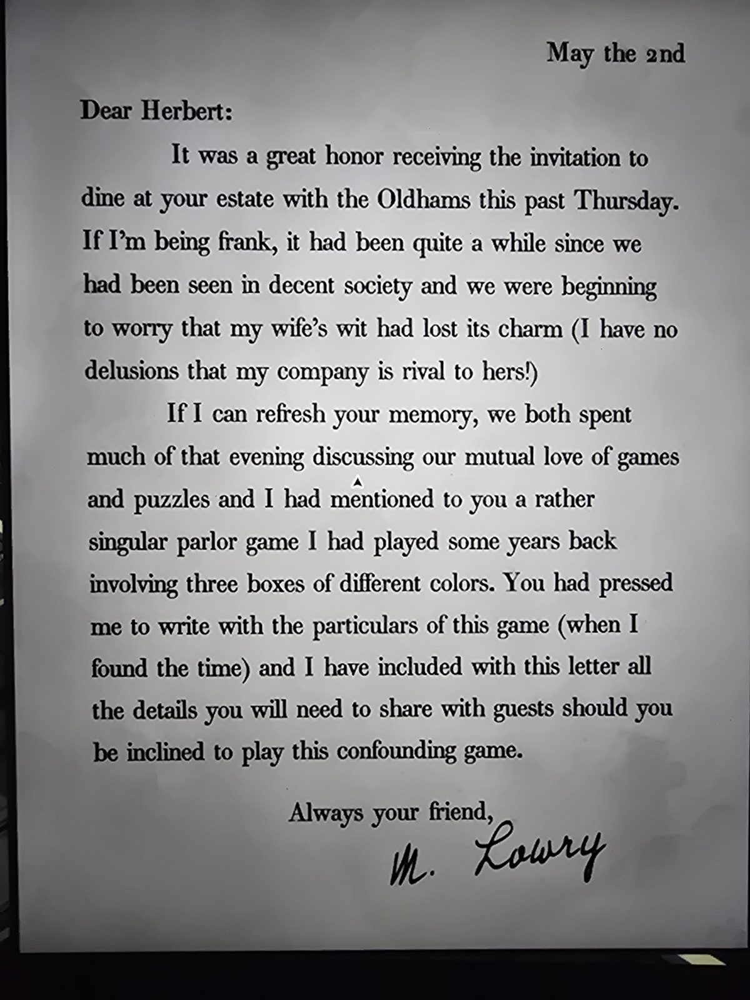
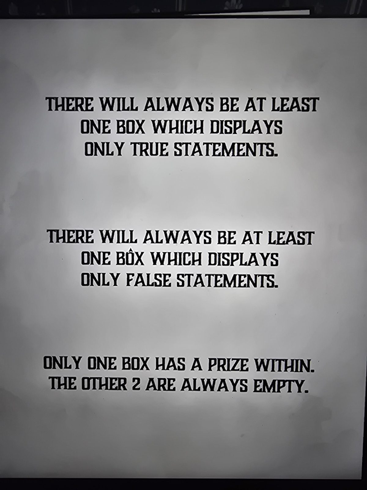

# Письмо М. Лоури: игра с тремя коробками
Письмо Герберту и лист с правилами. Лежат в Parlor.

2 мая

Дорогой Герберт,

для нас было большой честью получить приглашение отужинать в твоём поместье вместе с Олдхэмами в прошлый четверг. Честно говоря, мы давно не появлялись в приличном обществе и уже начали опасаться, что остроумие моей жены утратило своё очарование (я не питаю иллюзий, что моё общество может с ним соперничать!).

Если позволишь освежить твою память: большую часть вечера мы обсуждали нашу общую любовь к играм и головоломкам, и я упомянул довольно необычную салонную игру с **тремя коробками разных цветов**, в которую играл несколько лет назад. Ты настоял, чтобы я описал её подробности (когда найду время), и к этому письму я приложил всё, что нужно объяснить гостям, если захочешь сыграть в эту головоломную игру.

Всегда твой друг,
*М. Лоури*

---

*Лист с правилами:*

- **Всегда есть хотя бы одна коробка, на которой написаны только истинные утверждения.**
- **Всегда есть хотя бы одна коробка, на которой написаны только ложные утверждения.**
- **Приз только в одной коробке. Две другие всегда пусты.**

## Заметка
- Это правила загадки Parlor: три цветные коробки с надписями, нужно логикой вычислить, в какой приз. Надписи на коробках каждый день новые.
- Персонажи: **М. Лоури** (друг Герберта, любитель головоломок), его жена, семья **Олдхэм** (гости на ужине).

## Photos / Фото

