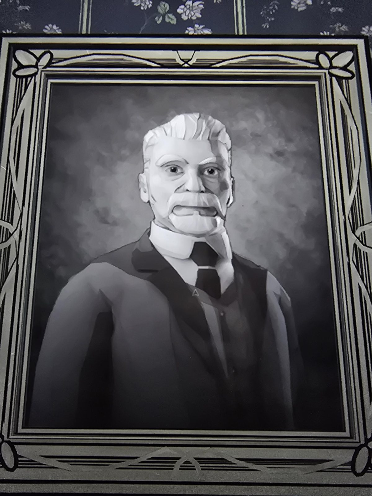

# Портрет пожилого мужчины
Портрет в раме на стене Parlor, без подписи: пожилой мужчина с седыми волосами и пышными белыми усами, тёмный костюм, галстук.

## Заметка
- Кто это, пока неизвестно. Возможно, сам Герберт С. Синклер (моя догадка, не проверено). Сравнить с другими портретами и семейным древом, когда найдутся.

## Photos / Фото

