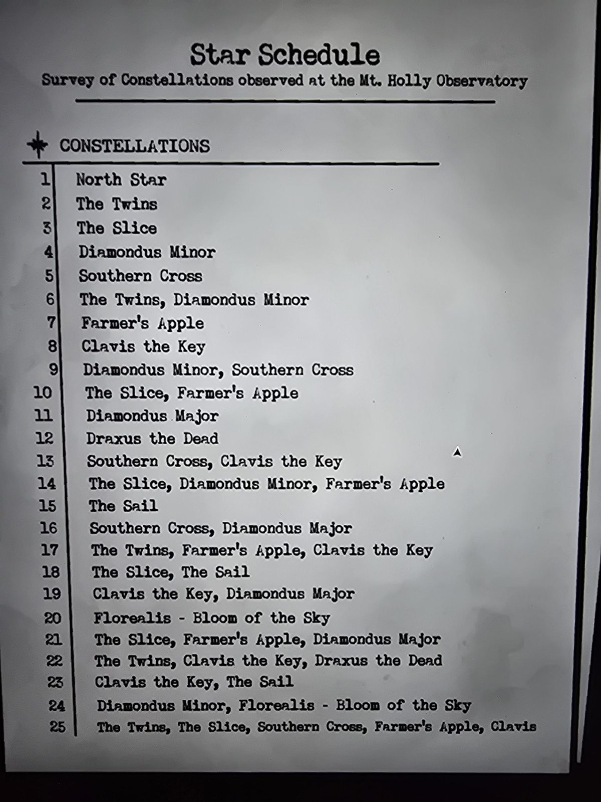
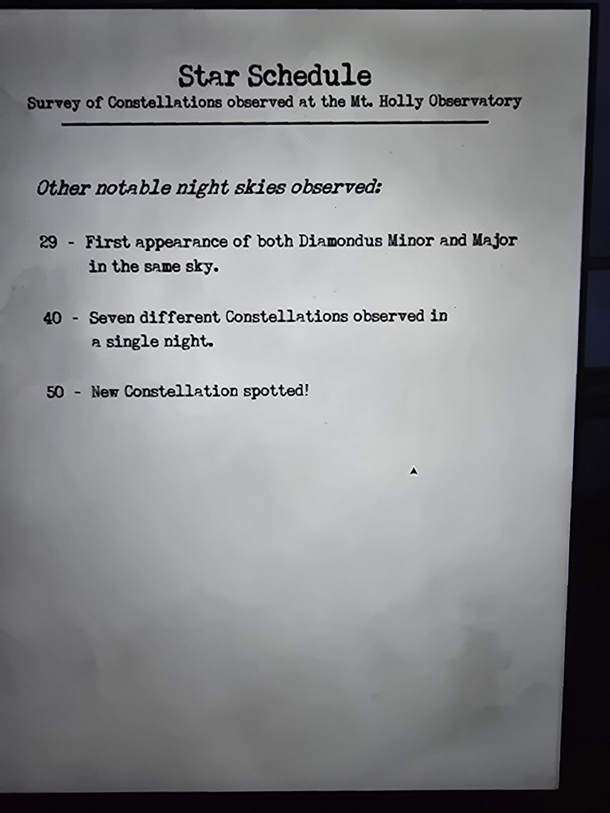

# Расписание звёзд (Star Schedule)
«Обзор созвездий, наблюдавшихся в обсерватории Маунт-Холли». Лист в Planetarium, две страницы. Номер = **число звёзд** (см. книгу [The Fixed Stars](../../../observatory/docs/the-fixed-stars-book/ru.md) в Observatory).

## Созвездия по числу звёзд
| Звёзд | Что в небе |
|---|---|
| 1 | North Star |
| 2 | The Twins |
| 3 | The Slice |
| 4 | Diamondus Minor |
| 5 | Southern Cross |
| 6 | The Twins + Diamondus Minor |
| 7 | Farmer's Apple |
| 8 | Clavis the Key |
| 9 | Diamondus Minor + Southern Cross |
| 10 | The Slice + Farmer's Apple |
| 11 | Diamondus Major |
| 12 | Draxus the Dead |
| 13 | Southern Cross + Clavis the Key |
| 14 | The Slice + Diamondus Minor + Farmer's Apple |
| 15 | The Sail |
| 16 | Southern Cross + Diamondus Major |
| 17 | The Twins + Farmer's Apple + Clavis the Key |
| 18 | The Slice + The Sail |
| 19 | Clavis the Key + Diamondus Major |
| 20 | Florealis (Bloom of the Sky) |
| 21 | The Slice + Farmer's Apple + Diamondus Major |
| 22 | The Twins + Clavis the Key + Draxus the Dead |
| 23 | Clavis the Key + The Sail |
| 24 | Diamondus Minor + Florealis |
| 25 | The Twins + The Slice + Southern Cross + Farmer's Apple + Clavis (в оригинале «Clavis» без «the Key») |

## Другие примечательные ночи
- **29**: впервые Diamondus Minor и Major в одном небе.
- **40**: семь разных созвездий за одну ночь.
- **50**: **замечено новое созвездие!**

## Заметка
- Правило: число звёзд в составных строках равно **сумме чисел созвездий**. Например 6 = 2 + 4, 14 = 3 + 4 + 7, 25 = 2 + 3 + 5 + 7 + 8. Значит эффекты созвездий, видимо, **складываются** в такие ночи (по книге из Observatory).
- Строки 26–28, 30–39, 41–49 не перечислены.

## Photos / Фото

