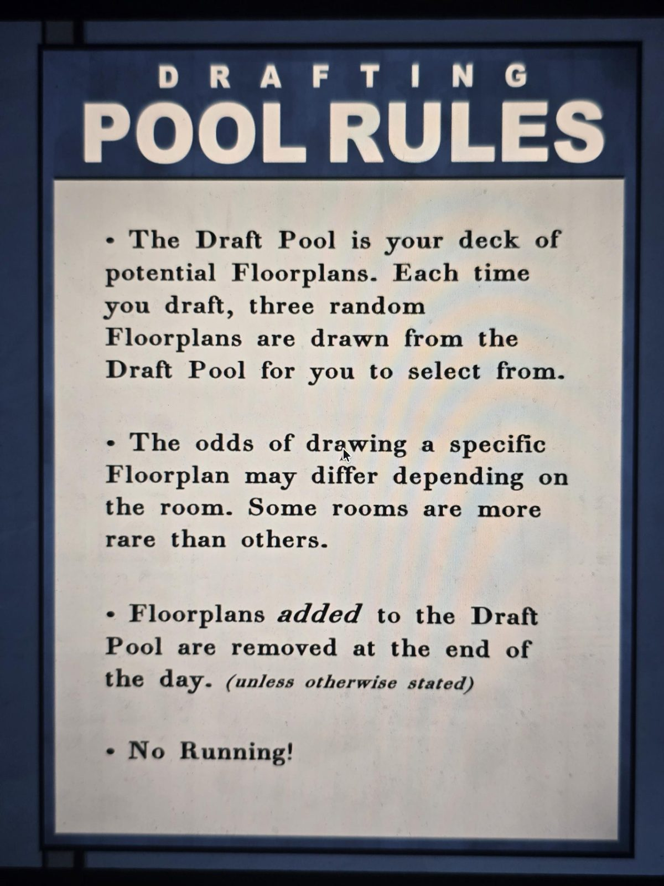

# Табличка: правила пула планов (Drafting Pool Rules)
Табличка в Pool (игра слов: pool — и «бассейн», и «пул»).

**ПРАВИЛА ПУЛА ПЛАНОВ**

• Пул планов (Draft Pool) — это твоя колода возможных планов комнат. Каждый раз, когда ты выбираешь комнату, из пула случайно вытягиваются три плана, из которых нужно выбрать один.

• Шанс вытянуть конкретный план зависит от комнаты. Некоторые комнаты встречаются реже других.

• Планы, **добавленные** в пул, убираются в конце дня. *(если не сказано иное)*

• Не бегать! *(шутка про бассейн)*

## Заметка
- Комнаты, которые добавляют планы в пул (например, Pool добавляет связанные комнаты), действуют только до конца дня, если не сказано иное.

## Photos / Фото

