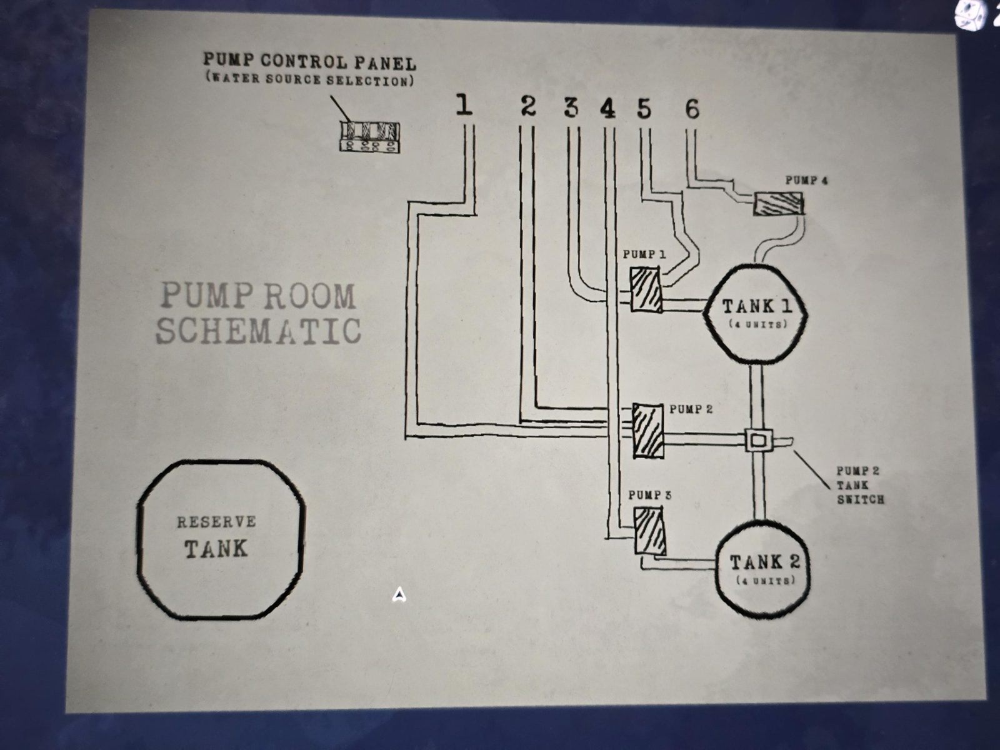

**PUMP ROOM SCHEMATIC**

PUMP CONTROL PANEL (WATER SOURCE SELECTION) — outputs 1, 2, 3, 4, 5, 6

*(Diagram:)* PUMP 1 → TANK 1 (4 UNITS); PUMP 2 with PUMP 2 TANK SWITCH (between Tank 1 and Tank 2); PUMP 3 → TANK 2 (4 UNITS); PUMP 4 → Tank 1 from above; RESERVE TANK (separate, not connected on the diagram).

## Photos / Фото

