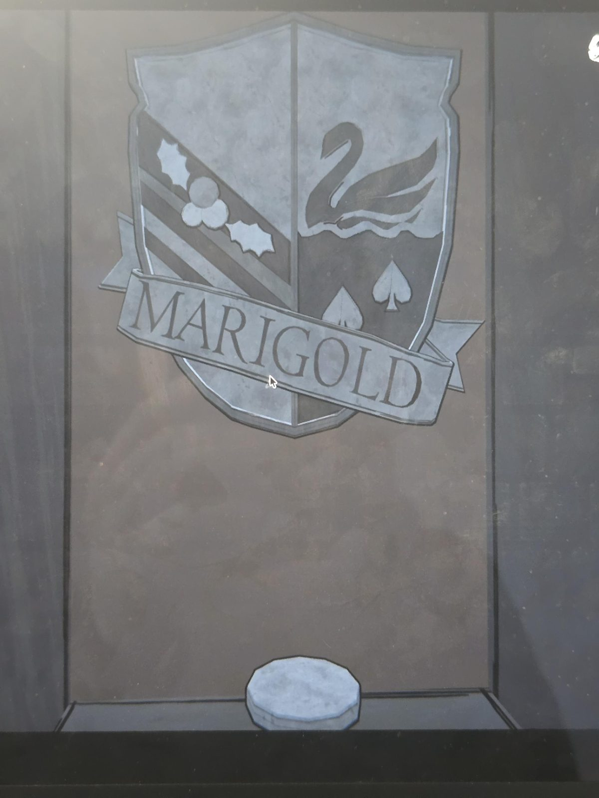
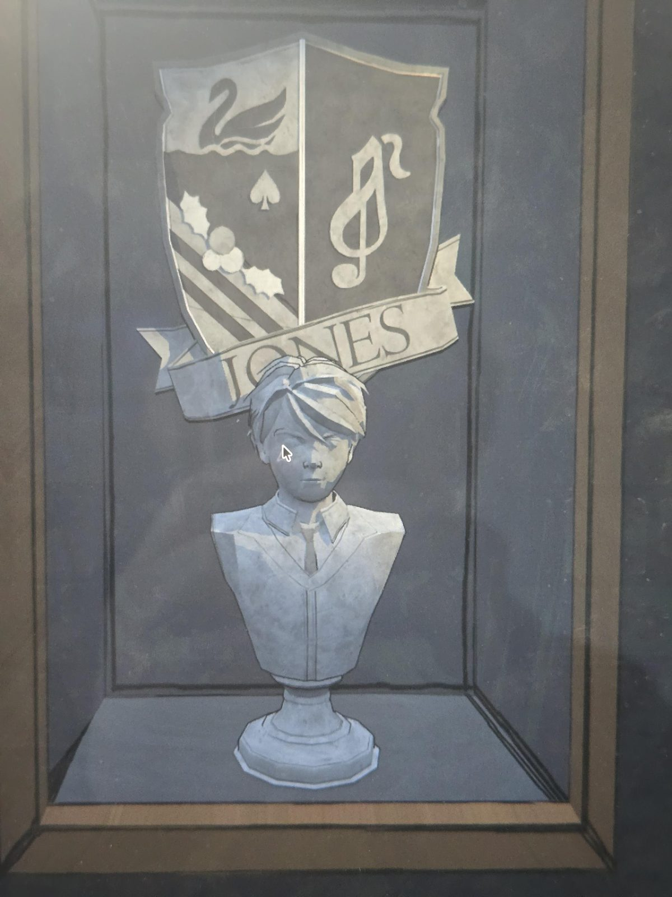
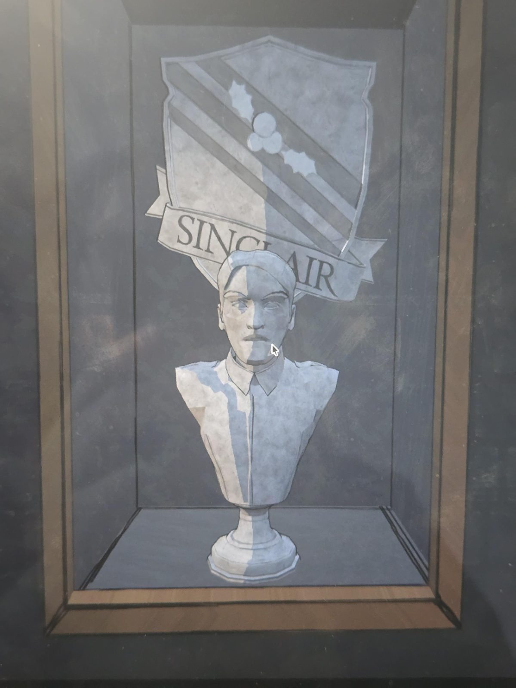
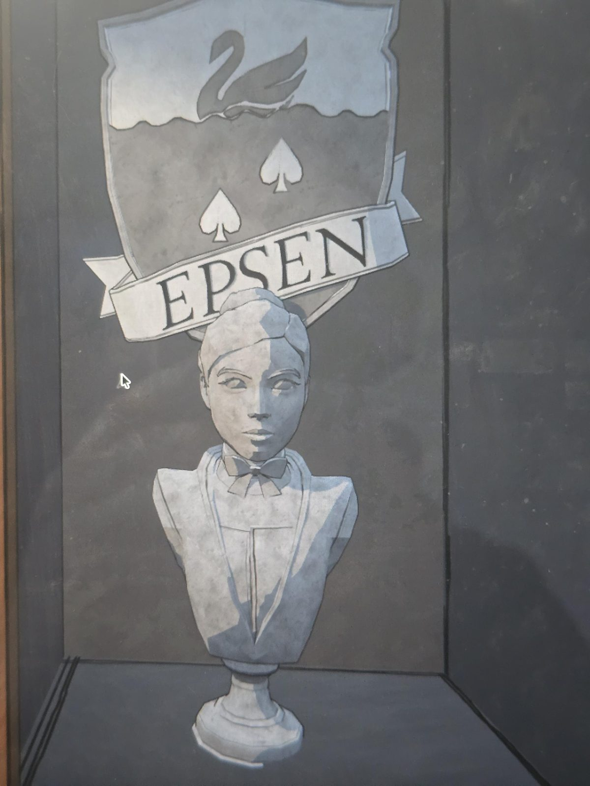

# Гербы и бюсты семей (Marigold, Jones, Sinclair, Epsen)
Room 46. Четыре витрины.

1. **Marigold**: только герб, пустая витрина с небольшим диском внизу (бюста нет). Герб поделён пополам: слева полосы с остролистом и ягодами (как у Sinclair), справа лебедь над водой и два пика (как у Epsen).
2. **Jones**: бюст мальчика в школьной форме с галстуком. Герб: лебедь над водой и пика (Epsen), полосы с остролистом (Sinclair) и **скрипичный ключ**.
3. **Sinclair**: бюст мужчины. Герб: диагональные полосы с остролистом и ягодами.
4. **Epsen**: бюст женщины с бабочкой. Герб: лебедь над водой и две пики.

## Заметка
- Герб Marigold = Sinclair + Epsen, герб Jones = Epsen + Sinclair + скрипичный ключ (по виду на фото). Это согласуется с [семейным древом](../../../root-cellar/docs/mount-holly-family-tree/ru.md) (Саймон Х. Синклер и Клара Эпсен; Мэри Мэттью Джонс, мать Саймона Джонса), но кто такая Marigold и почему бюста нет, не установлено (догадки, не проверено).
- Скрипичный ключ ср. [нотный стих в Music Room](../../../music-room/docs/treble-clef-denoted-in-verse/ru.md).

## Photos / Фото
   
