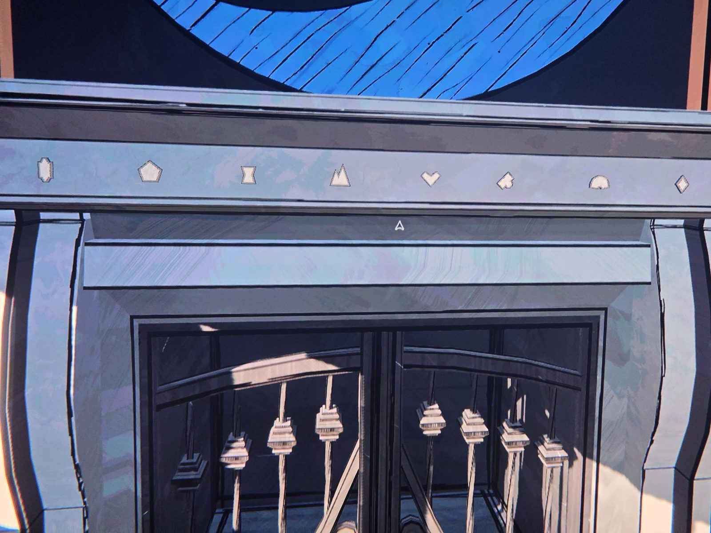

Символы на камине (слева направо): вытянутый шестиугольник, пятиугольник, песочные часы, гора, «сердце/галочка», значок как трефа, полукруг-купол, ромб.
Это символы 8 царств (как на школьных листах по географии). Роль порядка на камине пока неизвестна — см. open-questions.

## Photos / Фото

