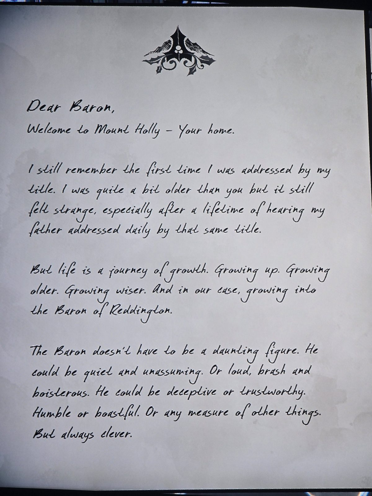
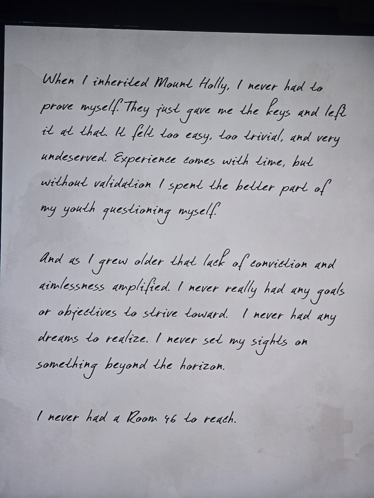
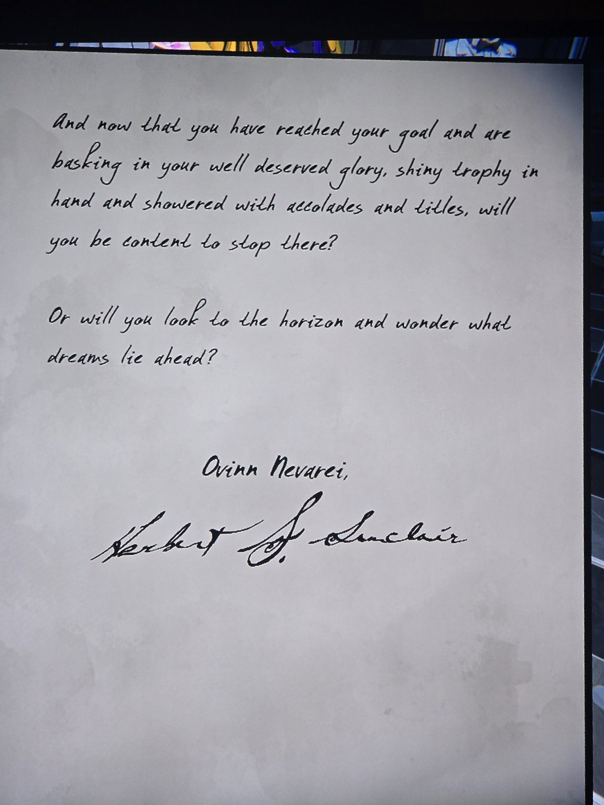

Дорогой барон,
добро пожаловать в Маунт-Холли — твой дом.
Помню, как ко мне впервые обратились по титулу. Я был старше тебя, но всё равно было странно — всю жизнь так обращались к отцу.
Но жизнь — путь роста: взрослеем, стареем, мудреем, а в нашем случае дорастаем до барона Реддингтона.
Барон не обязан быть грозным. Может быть тихим или шумным, обманщиком или человеком слова, скромником или хвастуном. Но всегда умным.

Мне Маунт-Холли просто вручили, без испытаний. Это казалось незаслуженным, и юность я провёл в сомнениях.
С возрастом неуверенность и бесцельность росли. У меня не было целей, мечты, взгляда за горизонт.
**У меня никогда не было своей Комнаты 46.**

Теперь, когда ты достиг цели, с трофеем в руке и титулами, — остановишься?
Или посмотришь за горизонт и задумаешься, какие мечты впереди?
*Ovinn Nevarei* (фраза на местном языке, смысл неизвестен),
Герберт С. Синклер

## Photos / Фото

