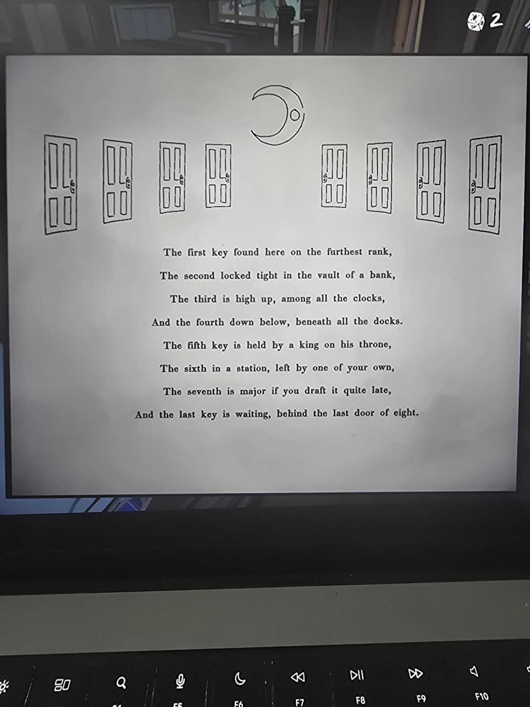

*(Eight doors drawn in a row, four on each side of a crescent moon.)*

The first key found here on the furthest rank,
The second locked tight in the vault of a bank,
The third is high up, among all the clocks,
And the fourth down below, beneath all the docks.
The fifth key is held by a king on his throne,
The sixth in a station, left by one of your own,
The seventh is major if you draft it quite late,
And the last key is waiting, behind the last door of eight.

## Photos

