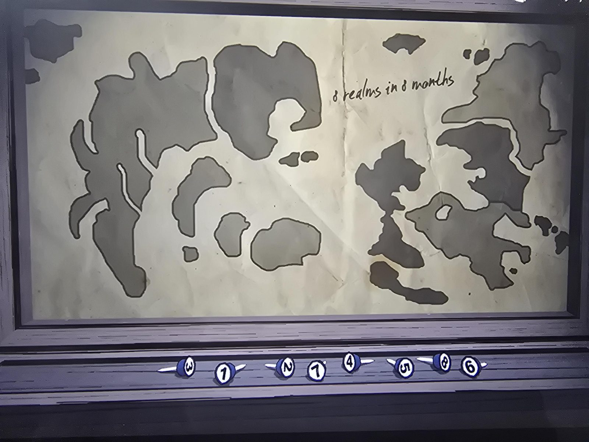

# Карта «8 realms in 8 months» с булавками
Room 46. Рамка с картой островов и материков, справа сверху от руки: **«8 realms in 8 months»** («8 королевств за 8 месяцев»). Под рамкой восемь булавок с цифрами, слева направо: **3, 1, 2, 7, 4, 5, 8, 6** (на момент снимка).

## Заметка
- Головоломка: по словам пользователя, «загадка с картой». Решение не записано; булавки, видимо, нужно расставить/поставить в нужном порядке.
- Ср. [Realm Sigils](../../../the-precipice/docs/realm-sigils-book/ru.md) и [Grade 4](../../../classroom/docs/grade-4-geography-board/ru.md): те же 8 регионов (предположение).

## Photos / Фото

