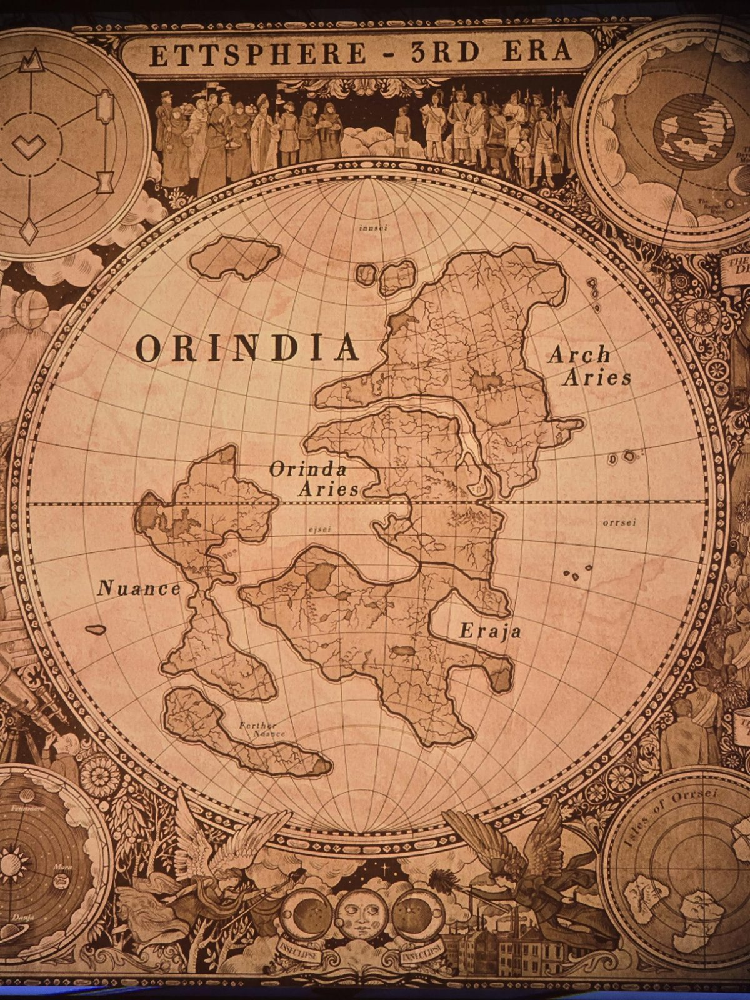
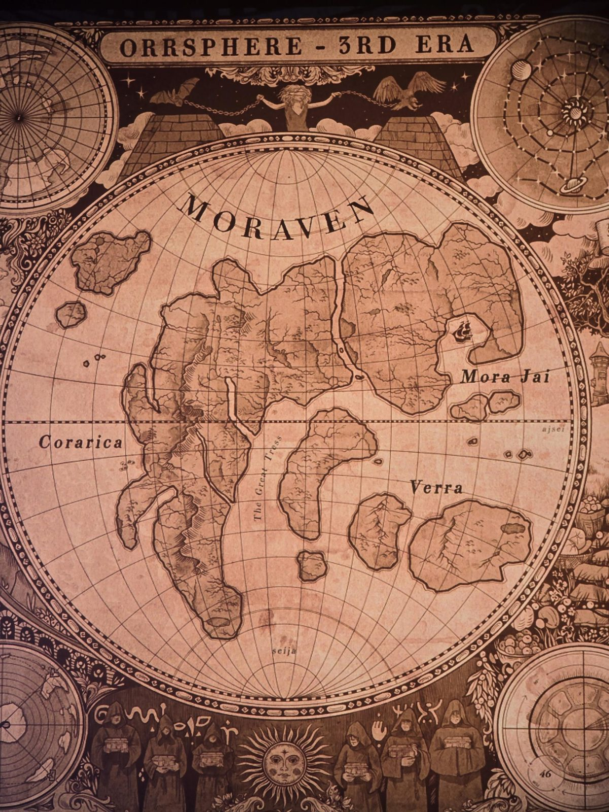

# Две настенные карты (Room 46)
1. **ETTSPHERE, 3-я эра** (3RD ERA): материк **ORINDIA**; области Arch Aries, Orinda Aries, Nuance, Further Nuance, Eraja; моря innsei, ejsei, orrsei. В углу врезка со схемой знаков (гора, самоцвет, сердце, песочные часы, ромб). Такая же карта в Classroom: [Grade 4, Ettsphere](../../../classroom/docs/grade-4-map-ettsphere/ru.md).
2. **ORRSPHERE, 3-я эра**: материк **MORAVEN**; области Mora Jai, Corarica, Verra; «The Great Tress»; моря ajsei, seija. В углу врезки «46». См. [Grade 4, Orrsphere](../../../classroom/docs/grade-4-map-orrsphere/ru.md).

## Photos / Фото

