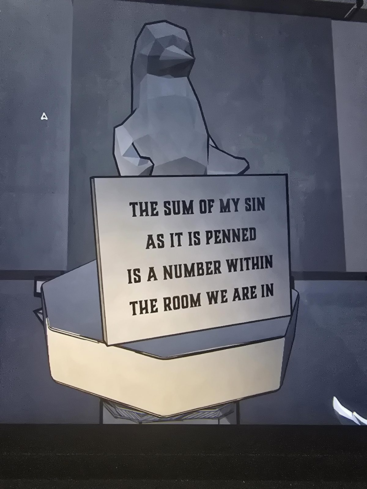
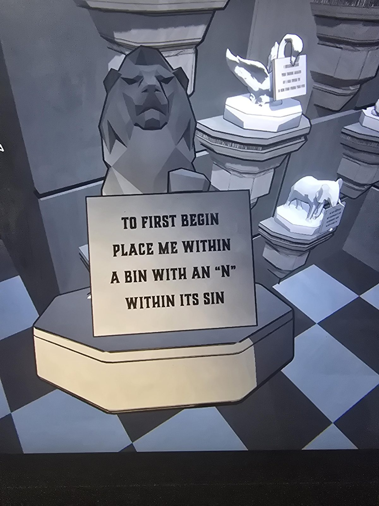
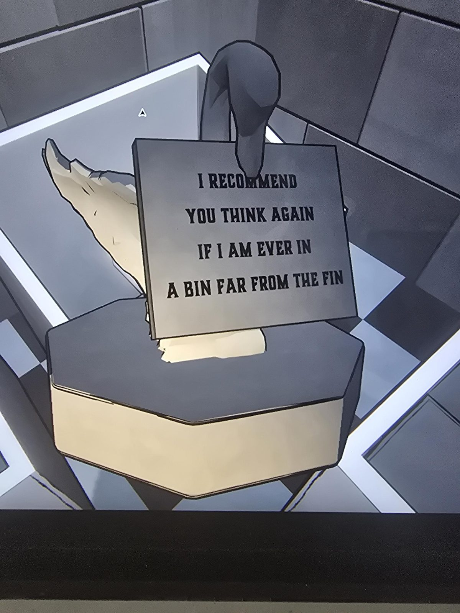
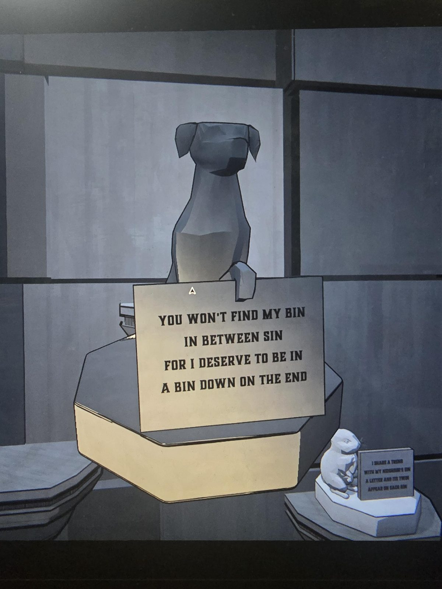
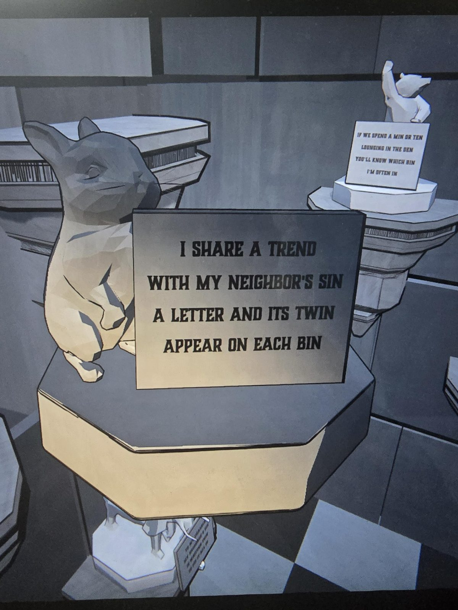
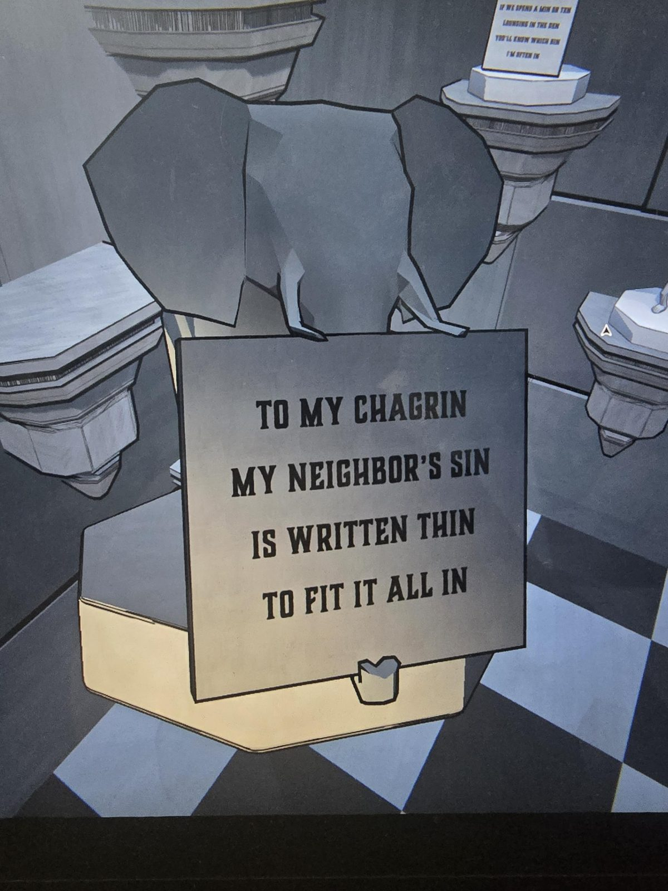
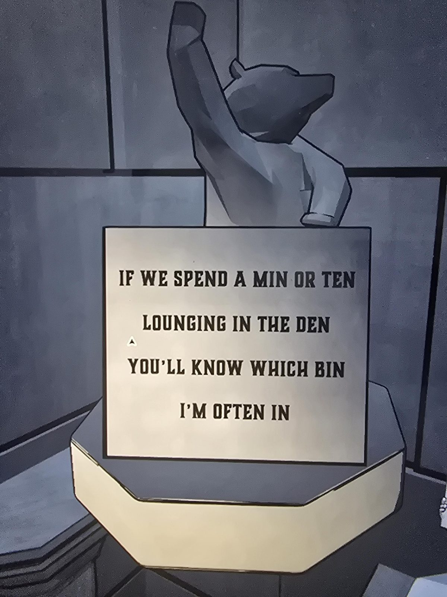
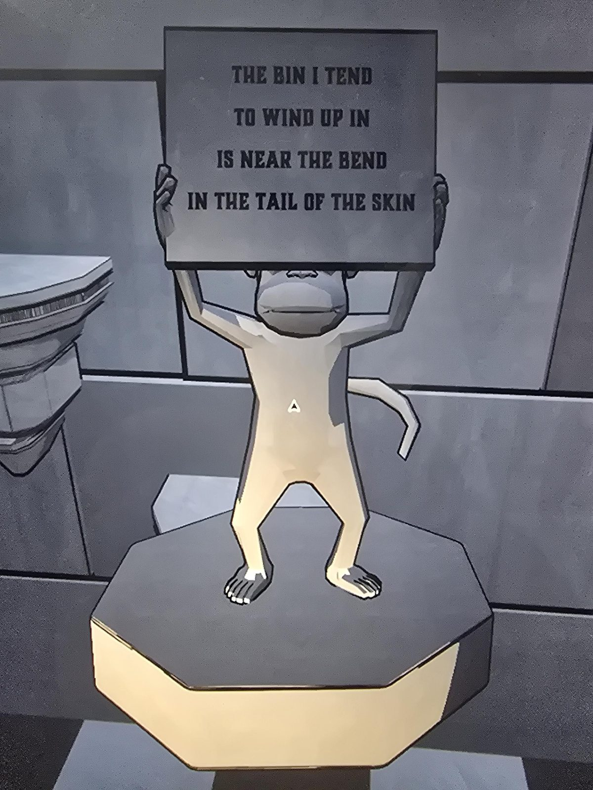

# Room 8: статуэтки животных с табличками
Room 8 (ключ из [Gallery](../../../gallery/docs/painting-puzzles/ru.md)). Восемь животных на постаментах, у каждого табличка-стишок. Нужно поставить каждое в одну из 8 корзин (bins) с названием греха. Корзины: HUBRIS, ENVY, LUST, WRATH, GLUTTONY, SLOTH, AVARICE (+ ещё одна, см. заметку); порядок на картине ниже.

## Тексты табличек (рифмы bin/sin/in сохранены в en.md)
1. **Пингвин:** «Сумма моего греха, как он написан, число, и она есть в комнате, где мы». → **GLUTTONY**
2. **Лев:** «Для начала поставь меня в корзину, в названии греха которой есть "N"». → **ENVY**
3. **Лебедь:** «Советую подумать снова, если я окажусь в корзине далеко от плавника (fin)». → **LUST**
4. **Собака:** «Моей корзины не найдёшь между грехами, я заслужила корзину на краю». → корзина не указана (см. заметку)
5. **Кролик:** «Я делю с грехом соседа тенденцию: на каждой корзине есть буква и её близнец». → **AVARICE**
6. **Слон:** «К моему огорчению, грех соседа написан тонко, чтобы всё влезло». → **WRATH**
7. **Медведь:** «Если мы проведём минуту-десять в берлоге (den), узнаешь, в какой корзине я часто». → **SLOTH**
8. **Обезьяна:** «Корзина, где я обычно оказываюсь, возле изгиба (bend), в хвосте шкуры (skin)». → **HUBRIS**

## Решение (со слов пользователя; проверено в игре, награда получена)
Пингвин GLUTTONY, Лев ENVY, Лебедь LUST, Кролик AVARICE, Слон WRATH, Медведь SLOTH, Обезьяна HUBRIS. Собака: MUNDANITY (со слов пользователя; восьмая корзина).

Награда: **2 Allowance Token** и **Trophy 8** (трофей из [списка в Entrance Hall](../../../entrance-hall/docs/trophies-of-mt-holly/ru.md)).

## Заметка
- Корзины на [картине Gallery](../../../gallery/docs/painting-puzzles/ru.md) (слева направо): HUBRIS, ENVY, LUST, WRATH, GLUTTONY, SLOTH, AVARICE (читаются 7, у Wrath и Gluttony надписи частично закрыты колоннами).
- Собака идёт в корзину MUNDANITY (со слов пользователя). Почему именно туда, не расписано.
- Расшифровки (число букв в GLUTTONY = 8 = номер комнаты, N в ENVY и т. д.) не расписывал, ответы взяты у пользователя.

## Photos / Фото
   
   
