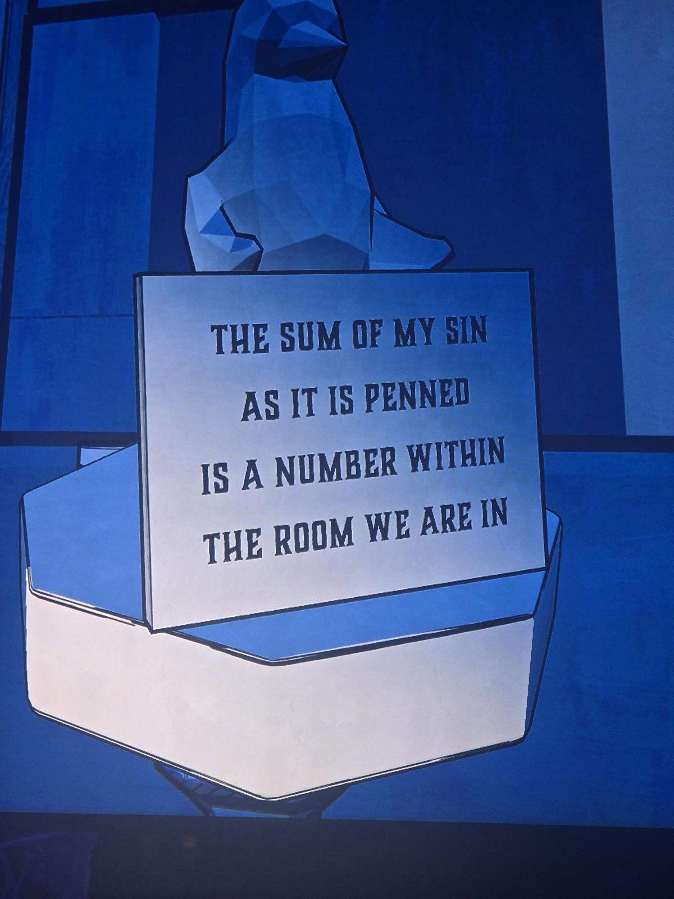
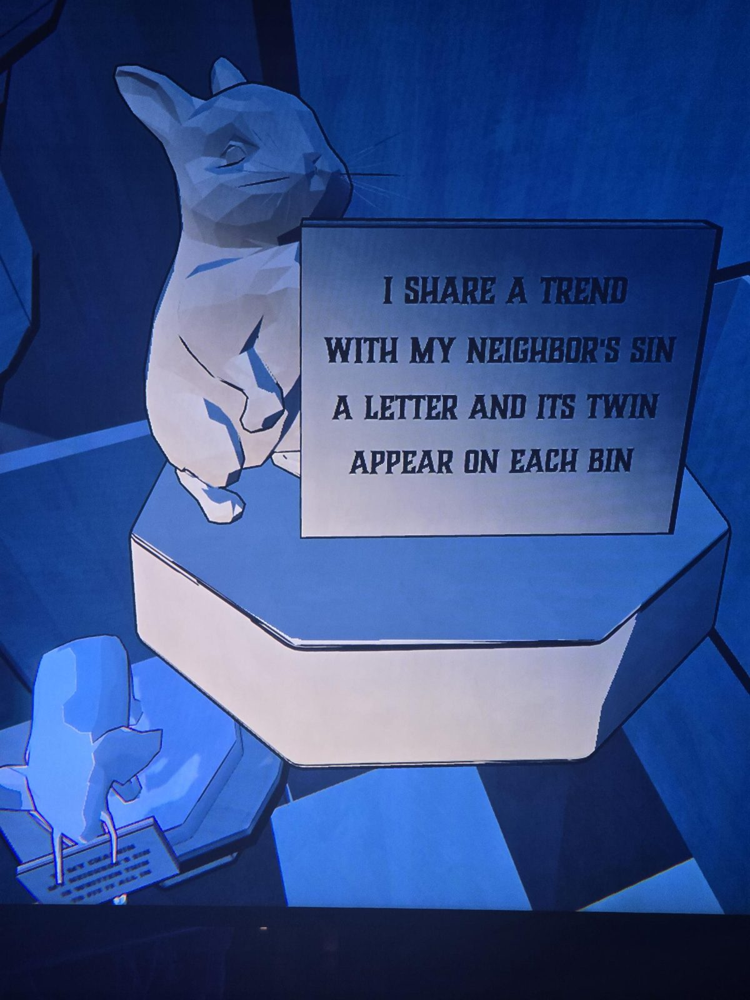
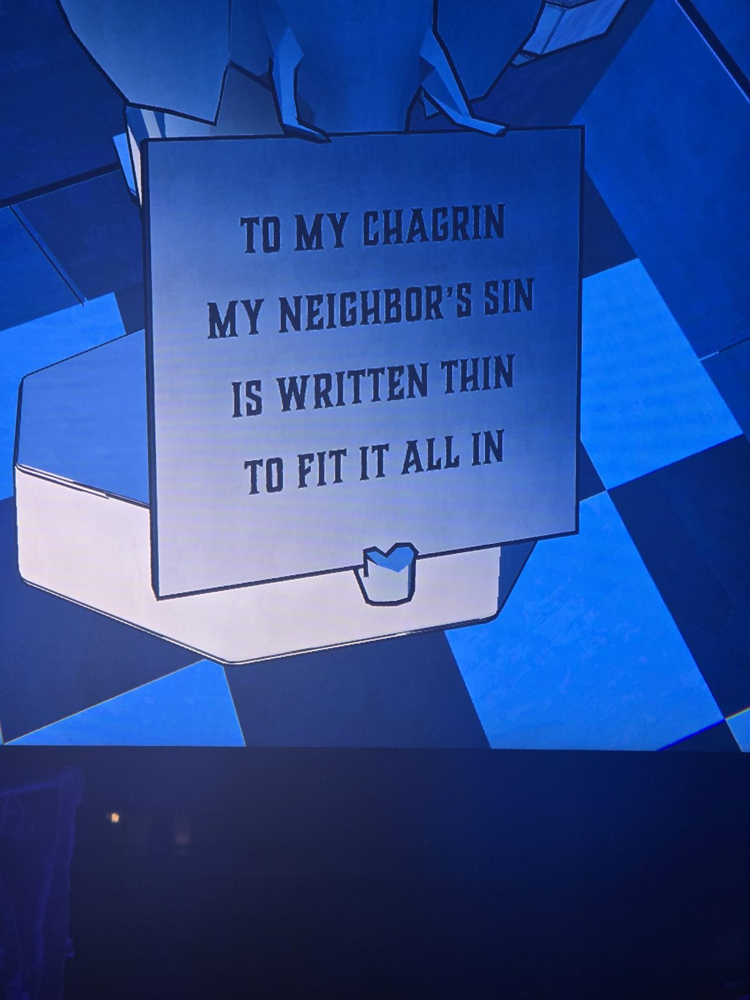
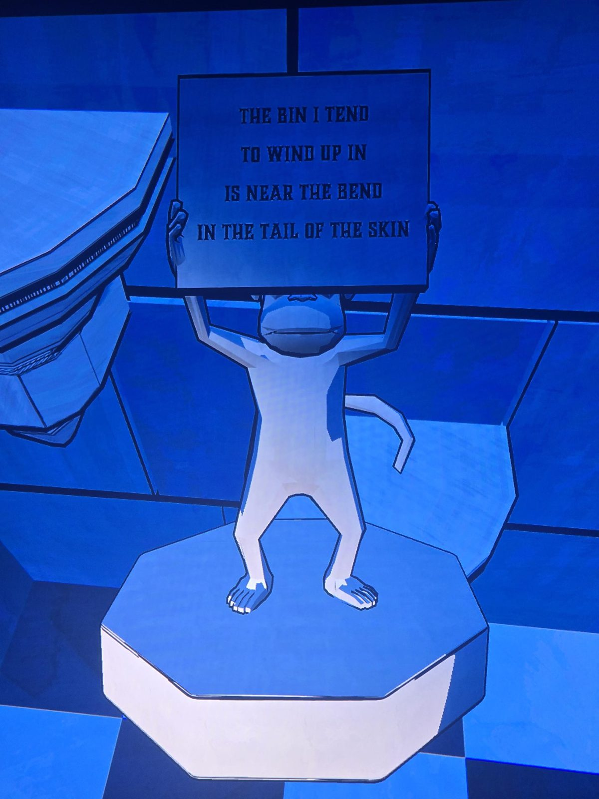

(penguin) THE SUM OF MY SIN AS IT IS PENNED IS A NUMBER WITHIN THE ROOM WE ARE IN
(rabbit) I SHARE A TREND WITH MY NEIGHBOR'S SIN — A LETTER AND ITS TWIN APPEAR ON EACH BIN
(statue holding sign, bin with heart) TO MY CHAGRIN MY NEIGHBOR'S SIN IS WRITTEN THIN TO FIT IT ALL IN
(monkey) THE BIN I TEND TO WIND UP IN IS NEAR THE BEND IN THE TAIL OF THE SKIN

## Photos / Фото

