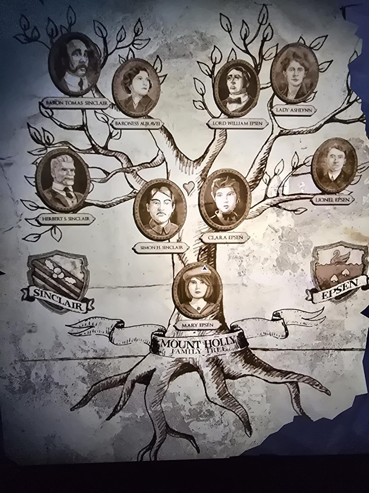

# Семейное древо Маунт-Холли
Порванный лист в Root Cellar (внешняя комната).

```
Барон Томас Синклер + Баронесса Ауравей        Лорд Уильям Эпсен + Леди Эшлинн
          │                                              │
   ┌──────┴───────┐                               ┌──────┴──────┐
Герберт С.    Саймон Х. Синклер  ♥  Клара Эпсен          Лайонел Эпсен
Синклер              └────────┬────────┘
                         Мэри Эпсен
```

Гербы: **SINCLAIR** — остролист с ягодами на косой полосе; **EPSEN** — лебедь над водой и три пики.

## Заметка
- **Мэри** — дочь **Саймона Х. Синклера** и **Клары Эпсен**, племянница Герберта. На древе она «Мэри **Эпсен**» (фамилия матери); в газете — Мэри Мэттью **Джонс** (по мужу Дэниелу).
- **Саймон Х. Синклер** — младший брат Герберта (тот самый «Саймон» из [дневника в Bunk Room](../../../bunk-room/docs/brothers-diary-today-is-a-good-day/ru.md)). Наш герой **Simon P. Jones** — его внук, назван в честь деда.
- **Женщина с подвеской-луной** ([портрет в Bedroom](../../../bedroom/docs/portrait-woman-moon-pendant/ru.md)) — **баронесса Ауравей**.
- По внешности (догадки, сверено с древом):
  - **Девушка с родинкой** ([Walk-in Closet](../../../walk-in-closet/docs/photo-young-woman-mole/ru.md), [Office](../../../office/docs/double-portrait-soldier-woman/ru.md), [Darkroom](../../../darkroom/docs/developed-prints/ru.md)) похожа на **Клару Эпсен** (волосы наверх, тёмный бант).
  - **Военный с усами** в двойной рамке Office похож на **Саймона Х. Синклера** (китель) → двойная рамка = Саймон и Клара.
  - **Седой мужчина с пышными усами** ([Parlor](../../../parlor/docs/portrait-old-man/ru.md), автопортрет в Darkroom) — **Герберт С. Синклер**.
- В [Her Ladyship's Chamber](../../../her-ladyships-chamber/solutions.md) два портрета (мужчина в очках, женщина с короткой причёской) — скорее всего **лорд Уильям и леди Эшлинн Эпсен**, и медальон с **Саймоном Х. Синклером**.
- **Кортни** («кузина Мэри», зовёт Герберта «дядей») на древе нет — возможно, дочь Лайонела Эпсена. Догадка.
- Герб Эпсенов — лебедь (ср. пароль **SWAN**SONG, «Swim Bird»).

## Photos / Фото

