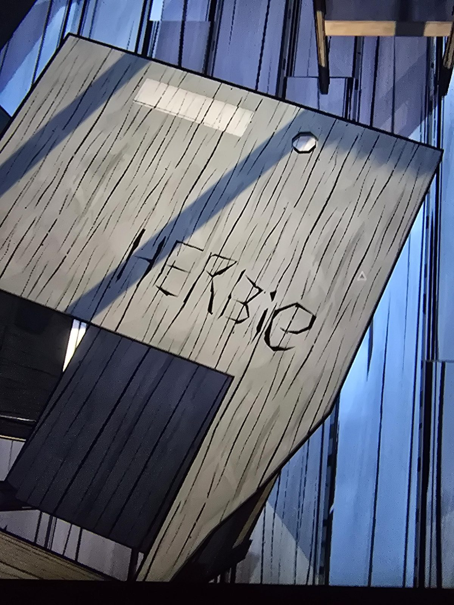

# Надпись на парте: «HERBIE»
На крышке старой школьной парты в Schoolhouse вырезано **HERBIE**.

## Заметка
- Херби — детское прозвище Герберта (ср. [дневник братьев](../../../bunk-room/docs/brothers-diary-today-is-a-good-day/ru.md)). Значит, Герберт учился в этой школе.

## Photos / Фото

