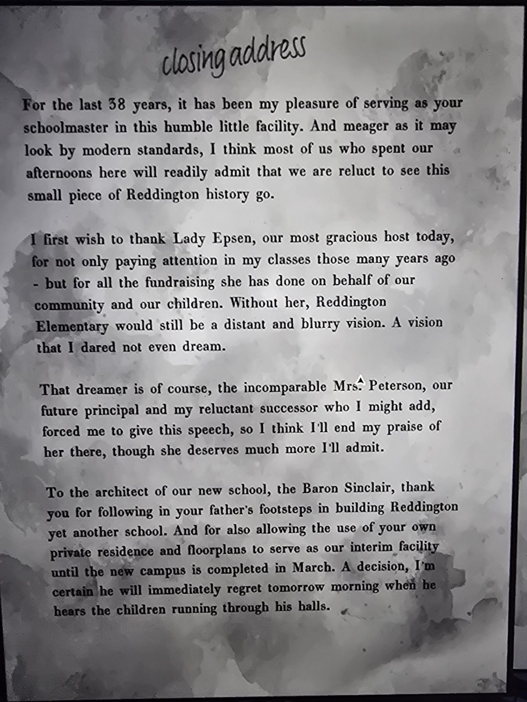
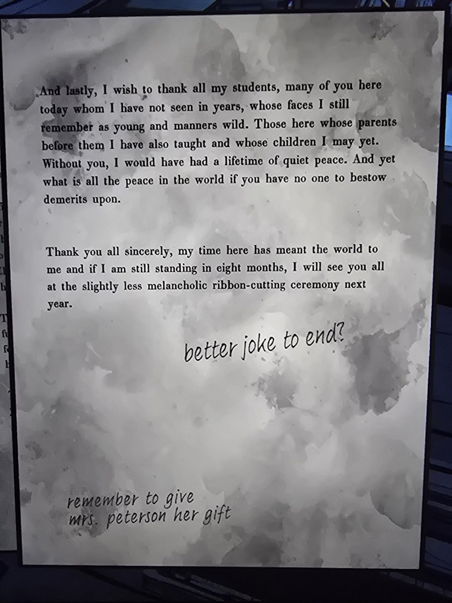

# Прощальная речь школьного учителя
Два листа в Schoolhouse (внешняя комната). Черновик речи с пометками от руки.

*прощальная речь*

**38 лет** я имел удовольствие быть вашим учителем в этом скромном маленьком здании. И пусть по современным меркам оно выглядит бедно, думаю, большинство из нас, кто проводил здесь дни, признают, что нам жаль расставаться с этим кусочком истории Реддингтона.

Прежде всего благодарю **леди Эпсен**, нашу любезнейшую хозяйку сегодня, — не только за то, что она была внимательна на моих уроках много лет назад, но и за весь сбор средств, который она провела ради нашей общины и детей. Без неё **начальная школа Реддингтона** так и осталась бы далёкой туманной мечтой.

А мечтательница — конечно, несравненная **миссис Петерсон**, наш будущий директор и моя неохотная преемница, которая, к слову, заставила меня произнести эту речь, так что на этом похвалы ей закончу, хоть она заслуживает большего.

**Архитектору нашей новой школы, барону Синклеру**, — спасибо, что пошли по стопам отца и построили Реддингтону ещё одну школу. И что предоставили **свой собственный дом и его планы комнат** под **временную школу**, пока новый кампус не достроят **в марте**. Решение, о котором он, уверен, пожалеет уже завтра утром, когда услышит, как дети бегают по его коридорам.

---

И наконец, спасибо всем моим ученикам — многих из вас я не видел годами, но помню юными и буйными. Тех, чьих родителей я тоже учил и чьих детей, может, ещё буду учить. Без вас у меня была бы целая жизнь тихого покоя. Но что толку во всём покое мира, если некому ставить замечания?

Спасибо всем от души: время здесь значило для меня всё, и если через восемь месяцев я ещё буду на ногах, увидимся на чуть менее грустной церемонии перерезания ленточки в следующем году.

*от руки:* «шутку получше в конце?» · «не забыть отдать миссис Петерсон подарок»

## Заметка
- Это закрытие **школы Маунт-Холли** (по путеводителю — **1966**). Барон Синклер (Герберт) — архитектор новой школы; его отец (барон Томас) тоже строил школы.
- **Особняк временно служил школой** — отсюда комнаты вроде Classroom.
- «Леди Эпсен» — вероятно, **Клара** (Эпсен по рождению; училась у этого учителя).
- Новые лица: **миссис Петерсон** (будущий директор).

## Photos / Фото

