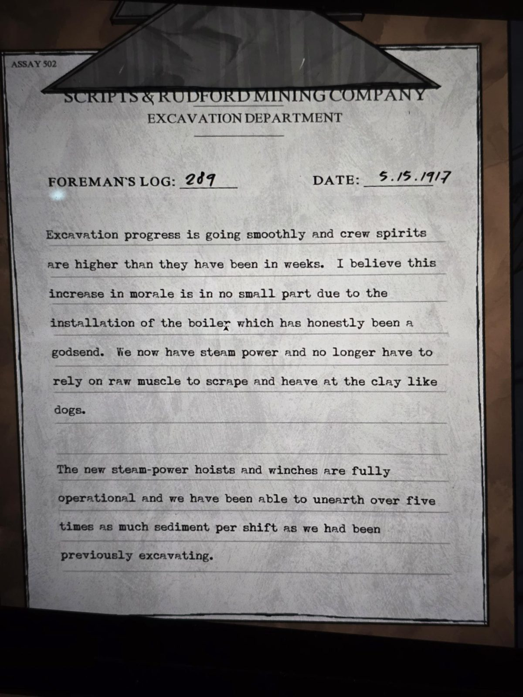

# Журнал бригадира №289 (5.15.1917 = 15 мая 1917)
Sealed Entrance. Бланк **Scripts & Rudford Mining Company**, отдел раскопок. В углу: ASSAY 502.

Раскопки идут гладко, настроение бригады выше, чем было за недели. Я считаю, что подъём духа в немалой степени вызван установкой **котла (boiler)**, который, честно говоря, оказался даром небес. Теперь у нас есть паровая энергия, и не нужно полагаться на голые мышцы, чтобы скрести и ворочать глину, как собаки.

Новые паровые подъёмники и лебёдки полностью работают, и мы можем извлекать более чем **в пять раз** больше осадка за смену, чем раньше.

## Заметка
- Серия: [журналы бригадира](../../../../documents/foreman-logs/README.md). Рядом лежит [патент на конденсатор высокого давления](../patent-high-pressure-condenser/ru.md).

## Photos / Фото

