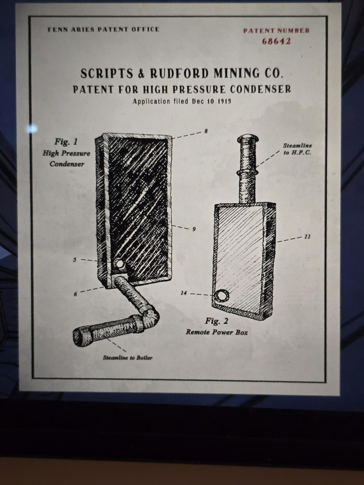

# Патент на конденсатор высокого давления (Sealed Entrance)
Sealed Entrance, проход между The Grounds и Basement. Патентное бюро Fenn Aries, **патент № 68642**, Scripts & Rudford Mining Co., заявка подана 10 декабря 1915.

- **Рис. 1 — High Pressure Condenser** (конденсатор высокого давления, H.P.C.): прямоугольный бак с отверстием в углу внизу; от него идёт труба с подписью **«Steamline to Boiler»** (паропровод к котлу). Выноски 5, 6, 8, 9.
- **Рис. 2 — Remote Power Box** (выносной блок питания): прямоугольный ящик с отверстием внизу и трубой сверху с подписью **«Steamline to H.P.C.»** (паропровод к конденсатору). Выноски 11, 14.

## Заметка
- Подсказка к красному ящику (блоку включения) в [The Underpass](../../../the-underpass/solutions.md). Журнал бригадира в той же комнате: [№289](../foreman-log-289-1917-05-15/ru.md); питание от котла: [Boiler Room](../../../../puzzles/boiler-power.md).

## Photos / Фото

