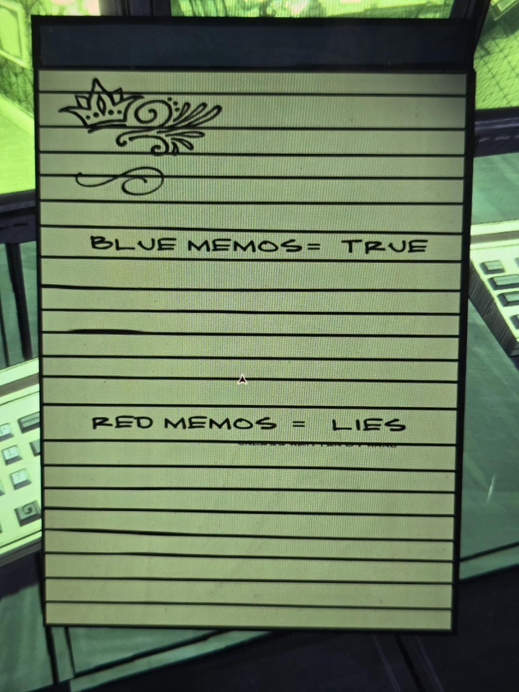
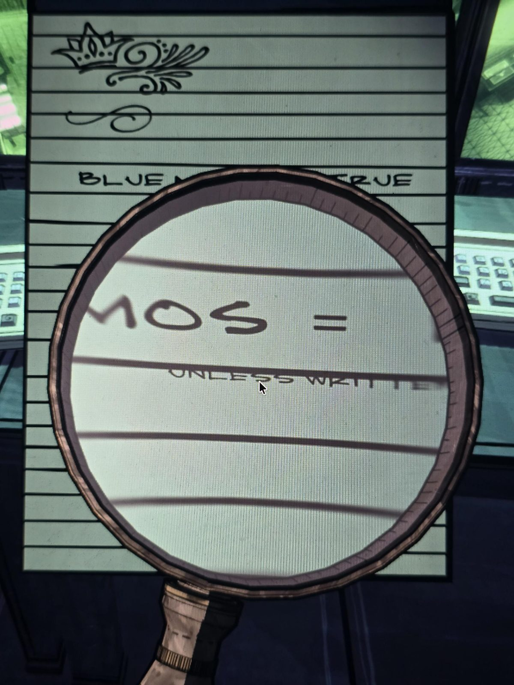
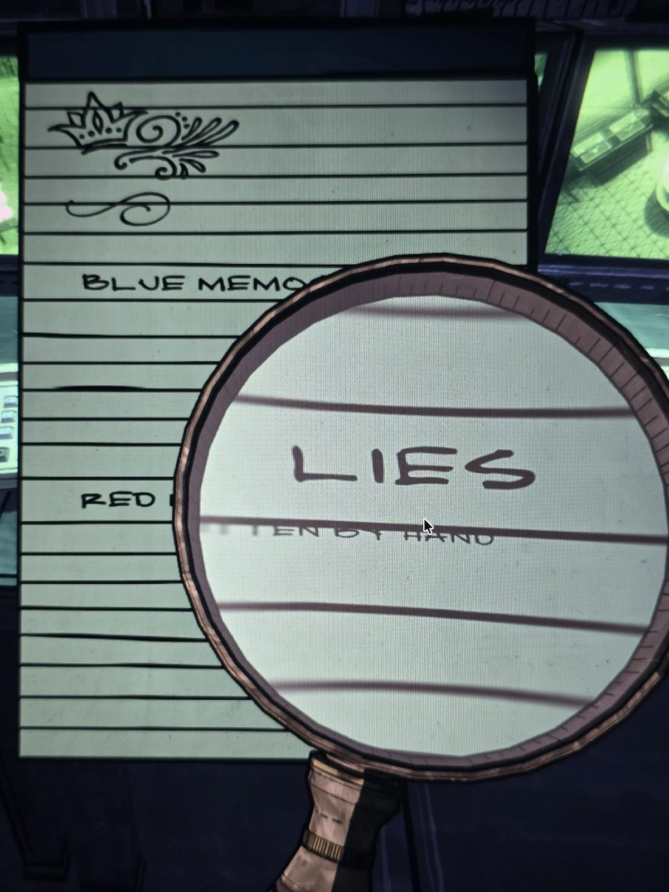

# Записка: синие и красные заметки
Блокнот в Security, вверху нарисована корона с завитком.

**СИНИЕ ЗАМЕТКИ = ПРАВДА**

**КРАСНЫЕ ЗАМЕТКИ = ЛОЖЬ**

Под строкой про красные — мелкий текст (через лупу): **UNLESS WRITTEN BY HAND** — «если только не написаны от руки».

## Заметка
- Похоже на ключ к каким-то запискам (memos) синего и красного цвета. Где они, пока неизвестно.
- **Итоговое правило:** синие записки — правда; красные — ложь, **кроме написанных от руки** (рукописные красные — правда). Ещё по Darkroom: «…een (Green?) memos в комнате Хартли всегда ложны».

## Photos / Фото

