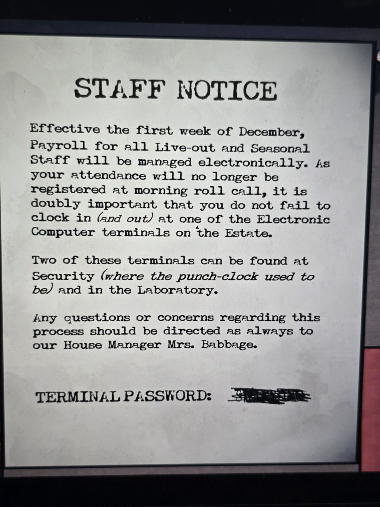

# Объявление для персонала: терминалы
Лежит в Security.

**ОБЪЯВЛЕНИЕ ДЛЯ ПЕРСОНАЛА**

С первой недели декабря расчёт зарплаты для всего приходящего и сезонного персонала будет вестись электронно. Поскольку посещаемость больше не будет отмечаться на утренней перекличке, вдвойне важно не забывать отмечаться на приход *(и уход)* на одном из **электронных компьютерных терминалов** поместья.

Два таких терминала находятся в **Security** *(там, где раньше были часы-табельщик)* и в **Laboratory**.

Все вопросы по этой процедуре, как всегда, к нашей управляющей домом **миссис Бэббидж**.

ПАРОЛЬ ТЕРМИНАЛА: *(зачёркнут/замазан)*

## Заметка
- Терминалы: Security и Laboratory. Пароль на листке замазан, значит, его надо найти где-то ещё.
- Персонаж: **миссис Бэббидж** (House Manager). Фамилия — отсылка к Чарльзу Бэббиджу, создателю вычислительной машины.

## Photos / Фото

