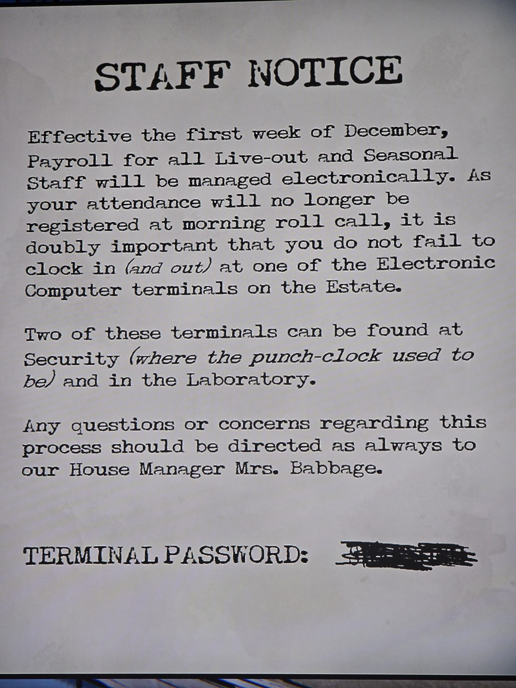

# Объявление для персонала (электронные терминалы)
С первой недели декабря зарплата приходящего и сезонного персонала ведётся электронно. Утренней переклички больше нет, поэтому обязательно отмечайте приход (и уход) на одном из электронных терминалов поместья.

Два терминала находятся в **Security** (где раньше стояли часы для отметок) и в **Laboratory**.

Вопросы — как всегда к управляющей домом миссис Бэббидж.

ПАРОЛЬ ТЕРМИНАЛА: зачёркнут, читается через **лупу**. Ответ: см. `rooms/security/solutions.md`.

## Photos / Фото

