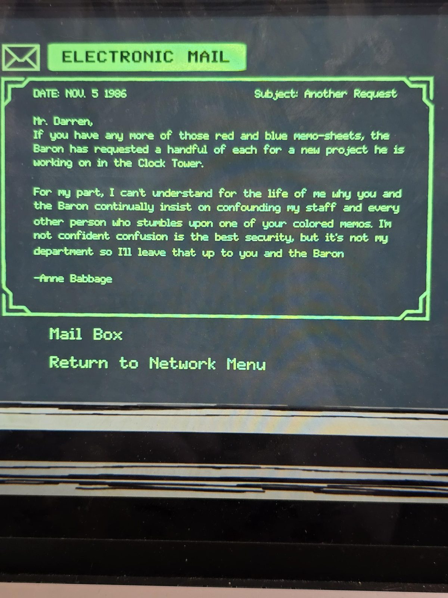
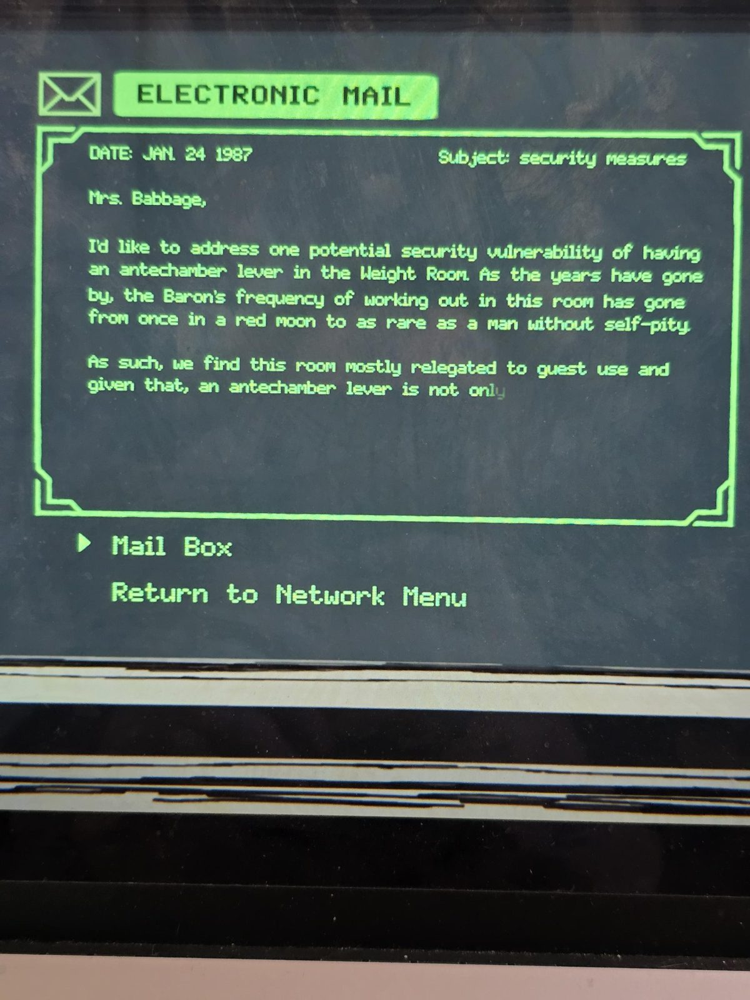
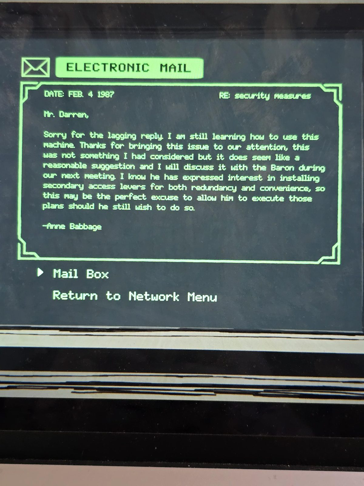
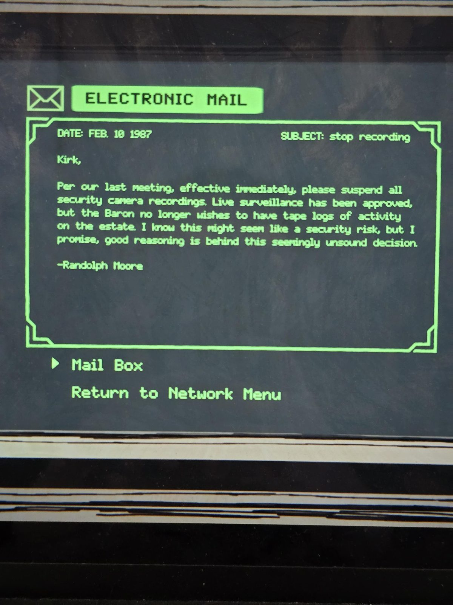

*Electronic Mail on the Security terminal, in date order (photo 01–04).*

**1.** DATE: NOV. 5 1986 — Subject: Another Request

Mr. Darren,
If you have any more of those red and blue memo-sheets, the Baron has requested a handful of each for a new project he is working on in the Clock Tower.

For my part, I can't understand for the life of me why you and the Baron continually insist on confounding my staff and every other person who stumbles upon one of your colored memos. I'm not confident confusion is the best security, but it's not my department so I'll leave that up to you and the Baron

-Anne Babbage

**2.** DATE: JAN. 24 1987 — Subject: security measures

Mrs. Babbage,

I'd like to address one potential security vulnerability of having an antechamber lever in the Weight Room. As the years have gone by, the Baron's frequency of working out in this room has gone from once in a red moon to as rare as a man without self-pity.

As such, we find this room mostly relegated to guest use and given that, an antechamber lever is not only
*(the message breaks off here, as on the screen)*

**3.** DATE: FEB. 4 1987 — RE: security measures

Mr. Darren,

Sorry for the lagging reply. I am still learning how to use this machine. Thanks for bringing this issue to our attention, this was not something I had considered but it does seem like a reasonable suggestion and I will discuss it with the Baron during our next meeting. I know he has expressed interest in installing secondary access levers for both redundancy and convenience, so this may be the perfect excuse to allow him to execute those plans should he still wish to do so.

-Anne Babbage

**4.** DATE: FEB. 10 1987 — SUBJECT: stop recording

Kirk,

Per our last meeting, effective immediately, please suspend all security camera recordings. Live surveillance has been approved, but the Baron no longer wishes to have tape logs of activity on the estate. I know this might seem like a security risk, but I promise, good reasoning is behind this seemingly unsound decision.

-Randolph Moore

## Photos / Фото

