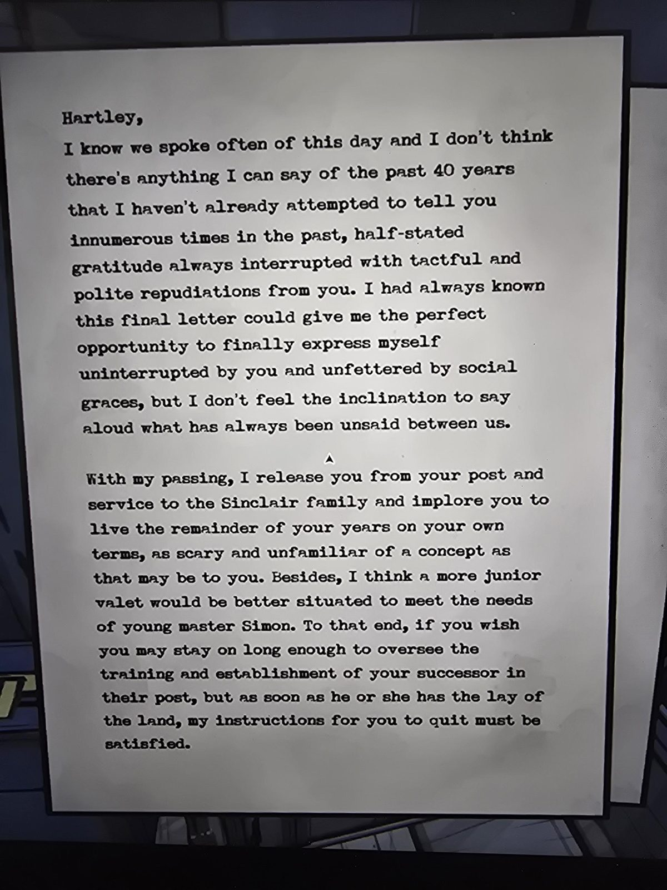
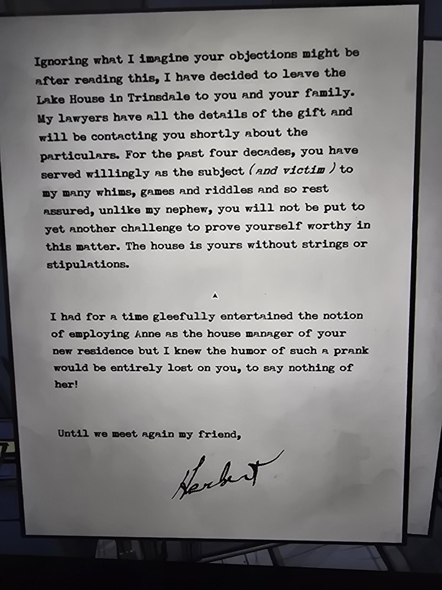

# Письмо Герберта Хартли
Машинописное письмо с подписью **Герберта** (Servant's Quarters). Адресат: **Хартли**, камердинер Герберта.

Хартли,
я знаю, мы часто говорили об этом дне, и не думаю, что про прошедшие 40 лет я могу сказать что-то, чего не пытался сказать вам бессчётное число раз: полувысказанная благодарность всегда прерывалась вашими тактичными и вежливыми возражениями. Я всегда знал, что это последнее письмо даст мне идеальную возможность наконец высказаться, не прерываемому вами и не стеснённому приличиями, но у меня нет желания произносить вслух то, что между нами всегда оставалось несказанным.

С моим уходом я освобождаю вас от вашего поста и службы семье Синклер и прошу вас прожить остаток лет **на своих условиях**, как бы страшно и непривычно это ни было. К тому же, думаю, более молодой камердинер лучше подойдёт для нужд **юного мастера Саймона**. Для этого вы можете, если хотите, остаться на время, достаточное, чтобы проследить за обучением и устройством вашего преемника, но как только он или она освоится, мои указания вам уйти должны быть выполнены.

Не обращая внимания на ваши возражения, которые я воображаю, я решил оставить **Lake House в Trinsdale** вам и вашей семье. У моих юристов все детали дара, они скоро свяжутся с вами. Последние четыре десятилетия вы охотно служили предметом (*и жертвой*) моих многочисленных причуд, игр и загадок, так что будьте спокойны: в отличие от моего племянника, вас не подвергнут очередному испытанию, чтобы доказать, что вы достойны. Дом ваш **без условий и оговорок**.

Какое-то время я с удовольствием обдумывал идею взять **Энн** управляющей в вашем новом доме, но понимал, что юмор такой шутки был бы совершенно потерян для вас, не говоря уже о ней!

До встречи, мой друг,
Герберт

## Заметка
- Письмо оставлено на случай смерти Герберта. Хартли служил ему около **40 лет**.
- Герберт упоминает «моего племянника» (подвергнутого испытаниям, как Хартли — играм и загадкам) и «юного мастера Саймона»; кто именно из Саймонов имеется в виду, не выяснено. См. [письмо Герберта в Tomb](../../../tomb/docs/herbert-letter/ru.md).
- **Энн** — вероятно, Энн Бэббидж, управляющая домом ([timeline](../../../../story/timeline.md)).
- Хартли — камердинер; связь с [Darkroom](../../../darkroom/docs/developed-prints/ru.md) (надпись про зелёные записки в его комнате).

## Photos / Фото

