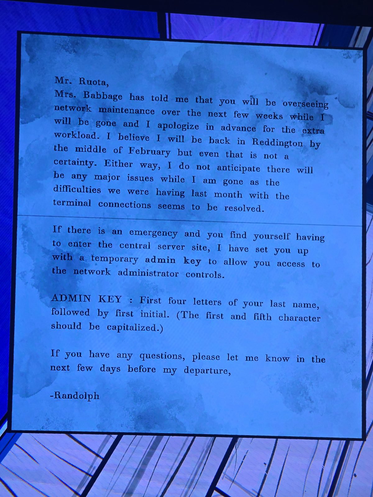

# Записка мистеру Руоте: ключ администратора
Servants' Quarters. Подпись: Рэндольф.

Мистер Руота,

миссис Бэббидж сказала мне, что в ближайшие недели, пока меня не будет, вы будете следить за сетью. Заранее прошу прощения за дополнительную нагрузку. Думаю, я вернусь в Реддингтон к середине февраля, но и это не точно. В любом случае серьёзных проблем не жду: трудности прошлого месяца с подключением терминалов, кажется, решены.

Если случится авария и вам придётся войти на центральный серверный узел, я оформил вам **временный ключ администратора** для доступа к управлению сетью.

**ADMIN KEY:** первые четыре буквы вашей фамилии, затем первая буква имени (первый и пятый символы заглавные).

Если будут вопросы, дайте знать в ближайшие дни до моего отъезда.
— Рэндольф

## Photos / Фото

