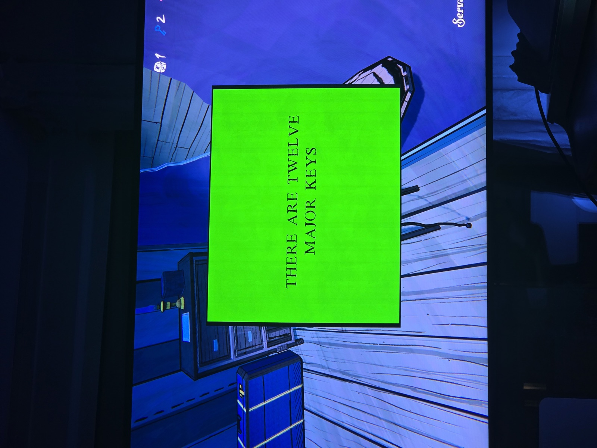

Зелёная карточка: «Существует двенадцать главных ключей».

*Где: Servant's Quarters (по подписи комнаты на экране). **Это ложь:** на отпечатке в Darkroom через лупу читается «Зелёные записки в комнате Хартли всегда ложны» (см. rooms/darkroom/docs/darkroom-prints). Значит, главных ключей **не** двенадцать.*

## Photos / Фото

