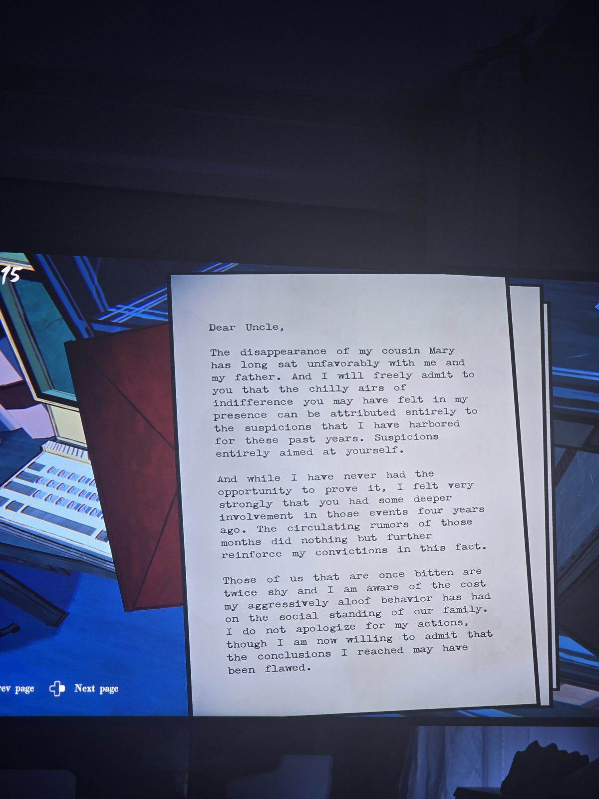
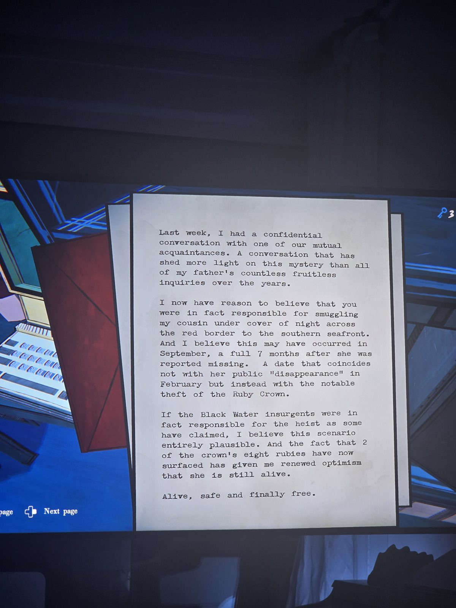
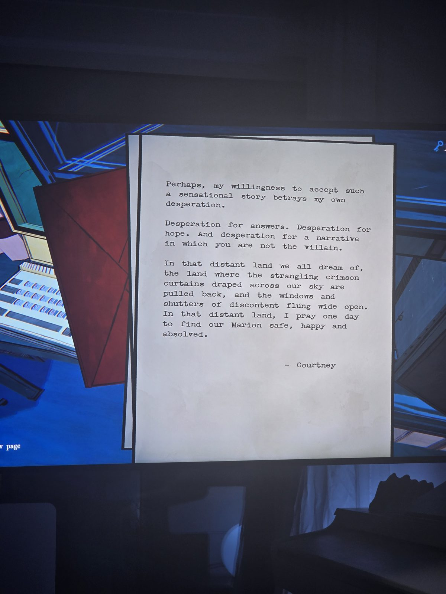

Дорогой дядя,
исчезновение кузины Мэри давно не даёт покоя мне и отцу. Холодность, которую ты мог чувствовать, объясняется моими подозрениями — направленными на тебя. Доказать я не мог, но был уверен, что ты глубже замешан в событиях четырёхлетней давности. Слухи только укрепляли уверенность.
Я не извиняюсь, но готов признать, что мог ошибаться.

На прошлой неделе у меня был доверительный разговор с общим знакомым. Он пролил больше света, чем все бесплодные расспросы отца.
Теперь я думаю, что это ты под покровом ночи **тайно переправил кузину через красную границу к южному побережью**. И было это в **сентябре**, через 7 месяцев после её «исчезновения» в феврале, — одновременно с **кражей Рубиновой короны**.
Если ограбление и правда устроили повстанцы Чёрной Воды, сценарий правдоподобен. А то, что **2 из 8 рубинов** короны всплыли, даёт надежду, что она жива.
Жива, в безопасности и свободна.

Возможно, моя готовность поверить в такую историю выдаёт отчаяние. Отчаяние в поисках ответов, надежды — и истории, где ты не злодей.
В той далёкой стране, о которой мы все мечтаем, где удушающие багровые занавеси с нашего неба сорваны, а окна недовольства распахнуты, я молюсь однажды найти нашу Мэрион в безопасности, счастливой и прощённой.
— Кортни

## Photos / Фото

