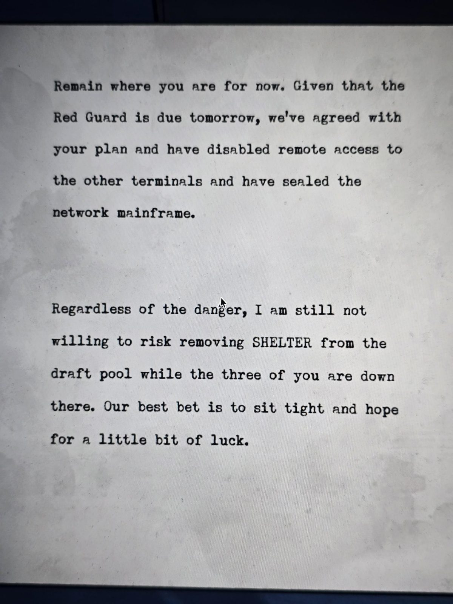

# Записка: «Красная гвардия прибудет завтра»
Машинописный лист в Shelter. Без подписи.

Пока оставайтесь на месте. Учитывая, что **Красная гвардия** прибудет завтра, мы согласились с вашим планом: **отключили удалённый доступ к остальным терминалам** и **опечатали сетевой мейнфрейм**.

Несмотря на опасность, я всё же не готов рисковать и **убирать SHELTER из пула планов**, пока вы **втроём** находитесь там внизу. Лучшее, что мы можем, — затаиться и надеяться на удачу.

## Заметка
- Трое человек прятались в убежище от Красной гвардии; комнату Shelter «можно убрать из пула» — то есть пул планов управляется людьми.
- Терминалы отключены, мейнфрейм опечатан — возможно, связано с паролем терминала и «почтой только через Security».
- Кто эти трое и кто пишет — неизвестно.

## Photos / Фото

