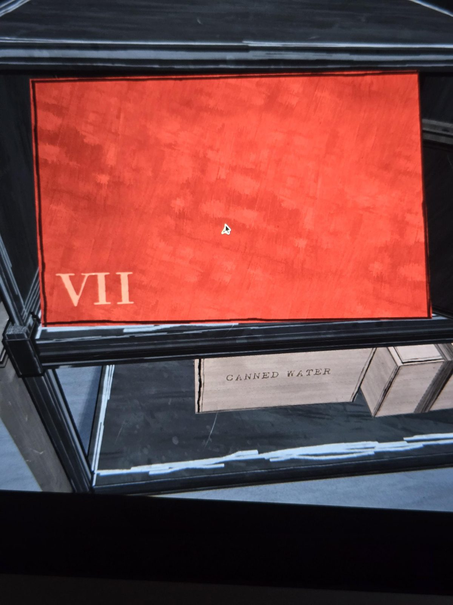
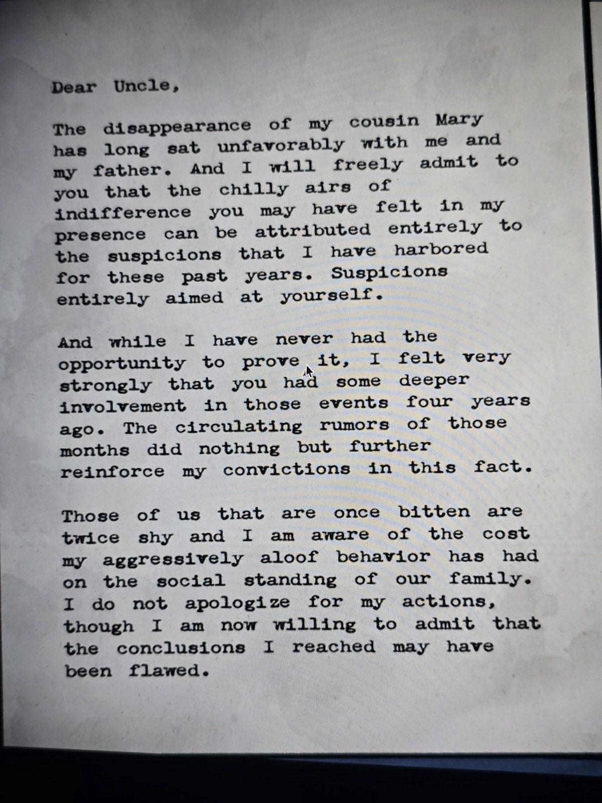
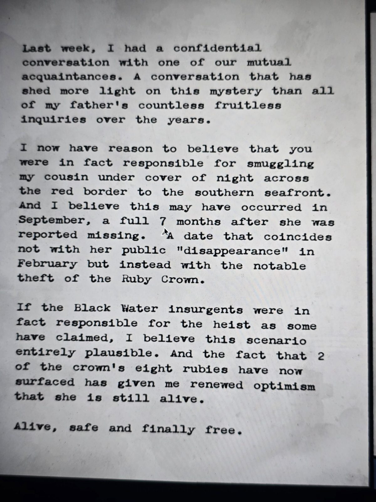
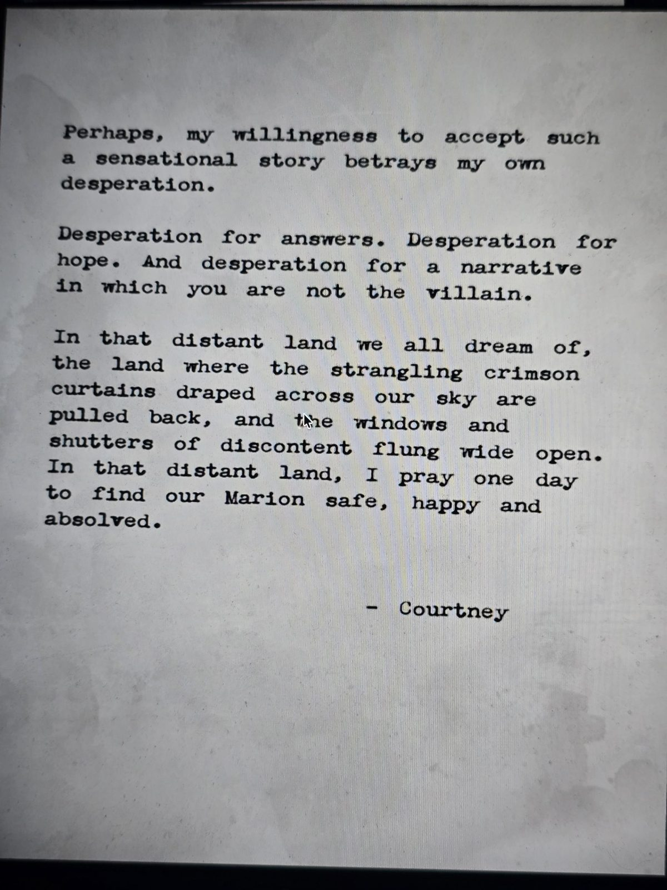

# Красное письмо «VII»: Кортни — Герберту
Найдено в **Time Lock Safe** в Shelter. Красный конверт с номером **VII** и письмо на трёх листах.

---

Дорогой дядя,

исчезновение моей **кузины Мэри** давно не даёт покоя мне и моему отцу. Признаюсь честно: холодное равнодушие, которое ты, возможно, ощущал в моём присутствии, объясняется исключительно подозрениями, которые я питала все эти годы. Подозрениями, направленными **на тебя**.

И хотя мне ни разу не представилось случая это доказать, я была твёрдо уверена, что ты глубже замешан в событиях **четырёхлетней давности**. Слухи тех месяцев лишь укрепляли мою убеждённость.

Обжёгшись на молоке, дуют на воду, и я понимаю, чего стоило положению нашей семьи в обществе моё демонстративно холодное поведение. Я не извиняюсь за свои поступки, но теперь готова признать, что мои выводы могли быть ошибочными.

---

На прошлой неделе у меня был конфиденциальный разговор с одним из наших общих знакомых. Этот разговор пролил на тайну больше света, чем все бесчисленные бесплодные расспросы моего отца за эти годы.

Теперь у меня есть основания полагать, что именно ты **под покровом ночи переправил мою кузину через красную границу на южное побережье**. И, думаю, это произошло **в сентябре — целых 7 месяцев после того, как её объявили пропавшей**. Эта дата совпадает не с её публичным «исчезновением» в феврале, а со знаменитой **кражей Рубиновой короны**.

Если за ограблением действительно стоят повстанцы **Чёрной Воды**, как утверждают некоторые, я считаю этот сценарий вполне правдоподобным. А то, что **2 из восьми рубинов короны** недавно всплыли, вселяет в меня новую надежду, что **она жива**.

Жива, в безопасности и наконец свободна.

---

Возможно, моя готовность поверить в такую сенсационную историю выдаёт моё собственное отчаяние.

Отчаянную жажду ответов. Отчаянную жажду надежды. И отчаянное желание истории, в которой **ты не злодей**.

В той далёкой стране, о которой мы все мечтаем, — стране, где душащие **багровые занавеси**, раскинутые по нашему небу, отдёрнуты, а окна и ставни недовольства распахнуты настежь, — в той далёкой стране я молюсь однажды найти нашу **Марион** живой, счастливой и оправданной.

— **Кортни**

## Заметка
- **Кортни** — племянница Герберта, кузина Мэри; её отец — брат Герберта (вероятно, Саймон-старший).
- Версия Кортни: Мэри не погибла. Через **7 месяцев** после «исчезновения» (февраль '87) — в **сентябре '87** — Герберт тайно вывез её через «красную границу» на юг. Это совпадает с **кражей Рубиновой короны** (2 сентября, [газета](../../../archives/docs/newspaper-clippings-album/ru.md)). Значит, Мэри, вероятно, участвовала в ограблении вместе с RLCF («Чёрная Вода»).
- Письмо написано «четыре года спустя» → около **1991**.
- В короне было **8 рубинов**, 2 всплыли. Ср. загадку про 8 (8 красных писем, 8 сейфов?).
- «Багровые занавеси на небе» — красный режим (Красная гвардия).

## Photos / Фото

