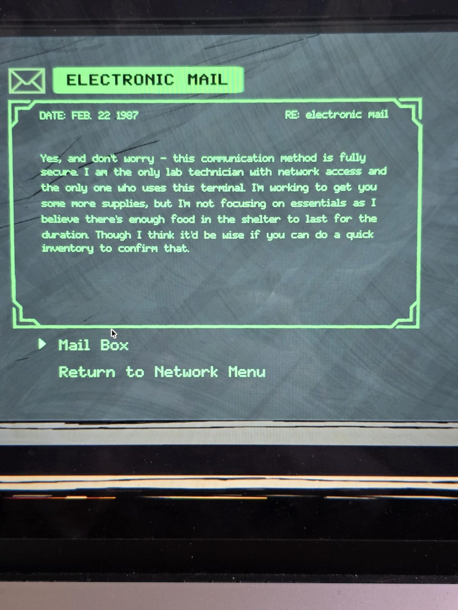
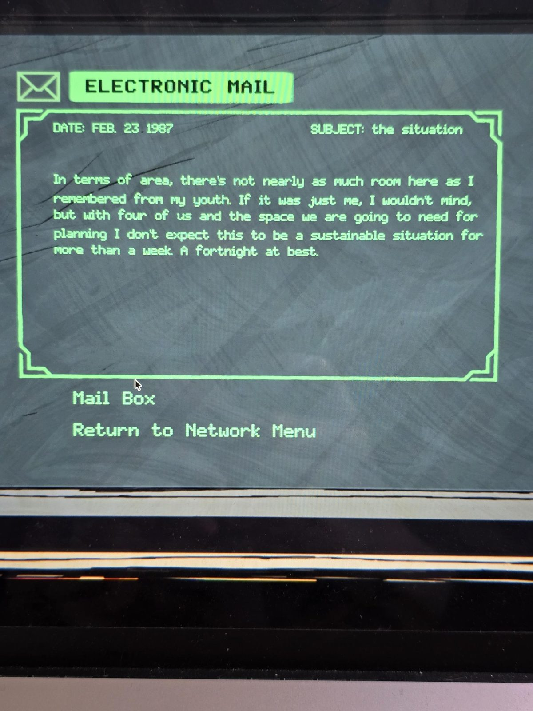
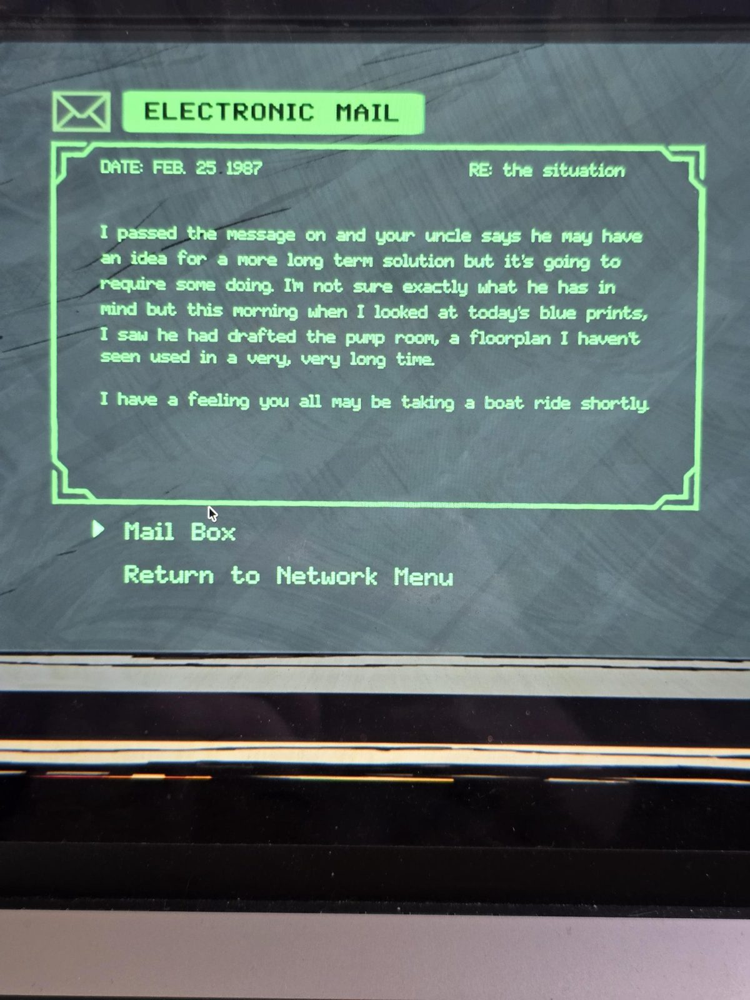
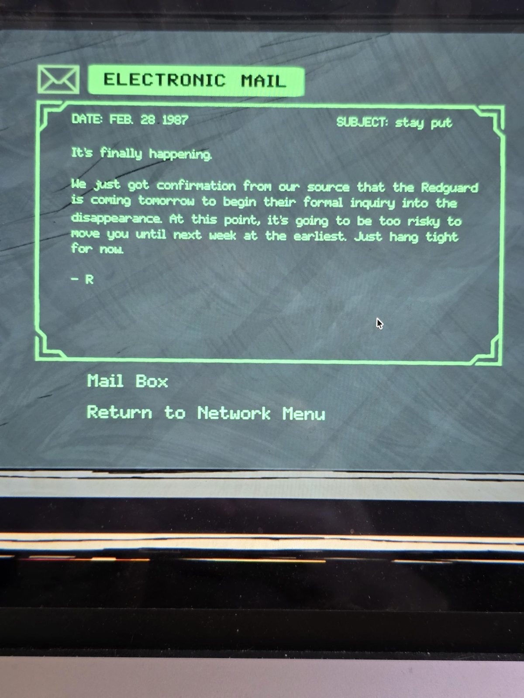

# Электронная почта на терминале Shelter (февраль 1987)
Терминал в [Shelter](../../solutions.md). Письма в порядке дат. На экране нет строк «от/кому»; в письме 4 подпись «R».

### 1. 22 февраля 1987 — RE: электронная почта
Да, и не беспокойся: этот способ связи полностью безопасен. Я единственный лаборант с доступом к сети и единственный, кто пользуется этим терминалом. Я пытаюсь достать вам ещё припасов, но не сосредотачиваюсь на необходимом: думаю, еды в убежище хватит на весь срок. Но было бы разумно, если бы вы сделали быструю **инвентаризацию**, чтобы это подтвердить.

### 2. 23 февраля 1987 — Ситуация
По площади здесь далеко не так просторно, как я помню с юности. Если бы я был один, не возражал бы, но нас **четверо**, и нужно место для планирования, так что вряд ли это продлится дольше недели. Максимум две.

### 3. 25 февраля 1987 — RE: ситуация
Я передал сообщение, и твой **дядя** говорит, что у него может быть идея более долгосрочного решения, но придётся постараться. Не знаю точно, что он задумал, но сегодня утром, глянув на сегодняшние **чертежи** (blue prints), я увидел, что он начертил **Pump Room** — план, который я не видел в деле очень-очень давно.

Чувствую, вам всем скоро предстоит **прогулка на лодке**.

### 4. 28 февраля 1987 — Не двигайтесь
Это наконец происходит.

Мы только что получили подтверждение от источника: **Красная гвардия приезжает завтра** начать официальное расследование **исчезновения**. Теперь двигать вас слишком рискованно — не раньше следующей недели. Пока затаитесь.
— R

## Заметка
- Автор писем 1–3 называет себя единственным лаборантом с доступом к сети; в письме 4 подпись **«R»** ([Рэндольф Мур](../../../mail-room/docs/randolph-moore-letter/ru.md)? не подтверждено).
- «Лодка» и Pump Room: см. [Reservoir](../../../abandoned-mine/reservoir/solutions.md) (при уровне воды 13 лодка переплывает резервуар).
- «Исчезновение» и Красная гвардия: см. [timeline](../../../../story/timeline.md) (Мэри пропала 20 февр. '87; 2 марта '87 Маргл берёт книгу в библиотеке). Связь не подтверждена.
- Кто «нас четверо» и «твой дядя», в письмах не сказано.

## Photos / Фото

