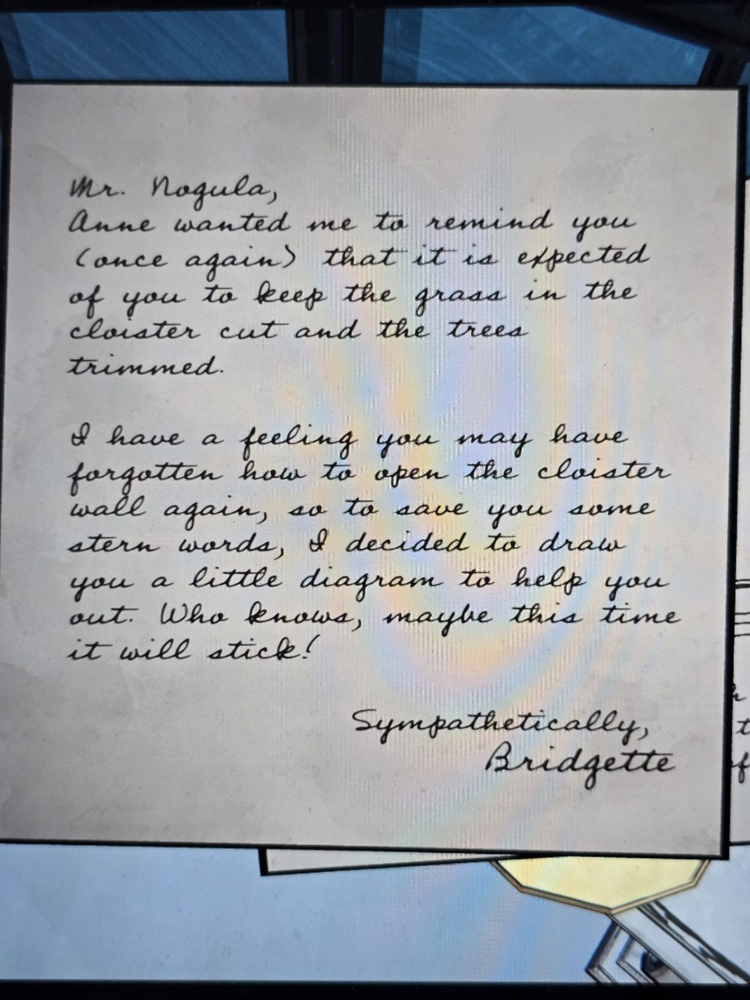
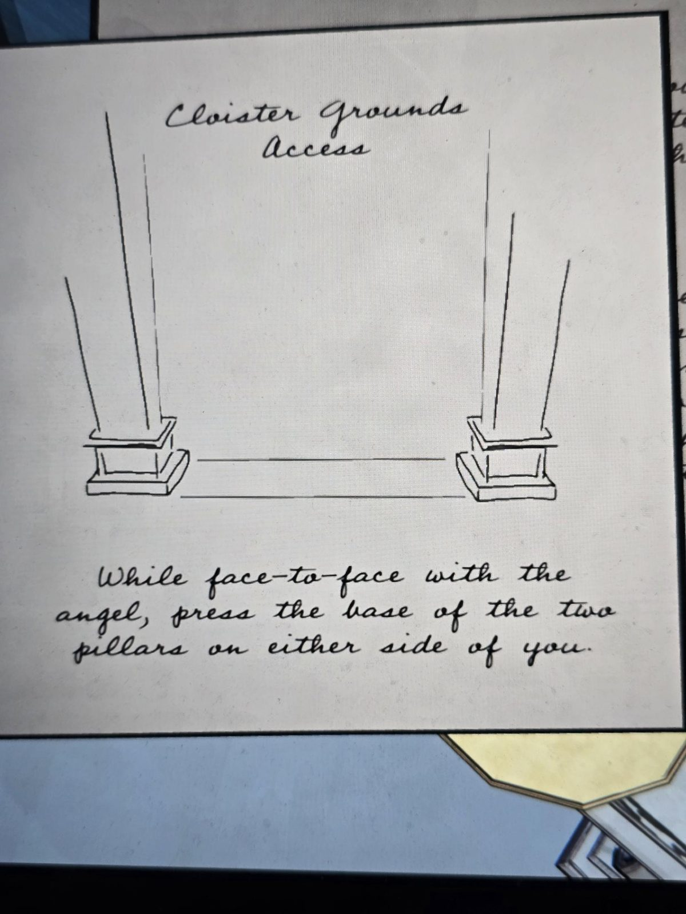

# Письмо Бриджит мистеру Ногуле (Solarium)
Solarium. Письмо от руки и схема.

Мистер Ногула,
Энн просила напомнить вам (в который раз), что от вас ожидают, что трава в cloister будет скошена, а деревья подстрижены.

У меня есть чувство, что вы снова могли забыть, как открыть стену cloister, так что, чтобы избавить вас от строгих слов, я решила нарисовать вам небольшую схему. Кто знает, может, на этот раз запомнится!

С сочувствием,
Бриджит

## Схема «Cloister Grounds Access» («Доступ к территории Cloister»)
Рисунок: две колонны с основаниями, слева и справа.
«Стоя лицом к лицу с ангелом, нажмите на основания двух колонн по обе стороны от вас.»

## Заметка
- Место: [Cloister](../../../cloister/solutions.md) (ангел = статуя). Ногула: [журнал садовника](../../../apple-orchard/docs/gardeners-logbook/ru.md). Бриджит: [записка про названия книг](../../../office/docs/book-titles-note-bridgette/ru.md).

## Photos / Фото

