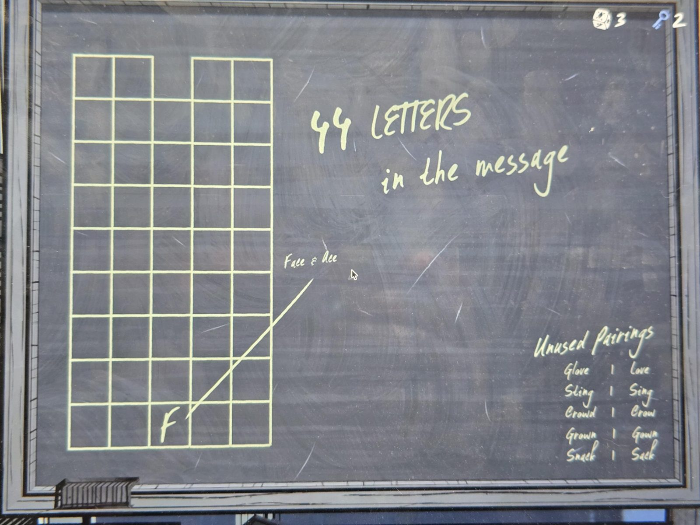

# Доска «44 буквы в сообщении»
Меловая доска в Study. Сетка 5 столбцов × 9 рядов (в верхнем ряду нет одной клетки), в нижнем ряду в третьей клетке уже написана **F**, от неё линия к подписи **«Face & Ace»**.

**44 LETTERS in the message** — 44 буквы в сообщении (45 клеток минус пустая 9.3, см. [таблицу](../../../../puzzles/picture-letters/README.md)).

**Unused Pairings** (неиспользованные пары):
| | |
|---|---|
| Glove | Love |
| Sling | Sing |
| Crowd | Crow |
| Grown | Gown |
| Snack | Sack |

## Заметка
- Подтверждает принцип: буква клетки = лишняя буква в паре (FACE/ACE → **F**, клетка 1.3). Нижний ряд сетки = ряд 1.
- «Неиспользованные пары» — слова, не попавшие в сообщение: Glove/Love (G), Sling/Sing (L), Crowd/Crow (D), Grown/Gown (R), Snack/Sack (N). Пары вроде CROWN/CROW (8.4) в таблице есть, эти — нет. Это значит, что где-то можно встретить такие пары как «отвлекающие»; сверять с таблицей.
- Вверху справа на фото: кубик 3, ключ 2.

## Photos / Фото

