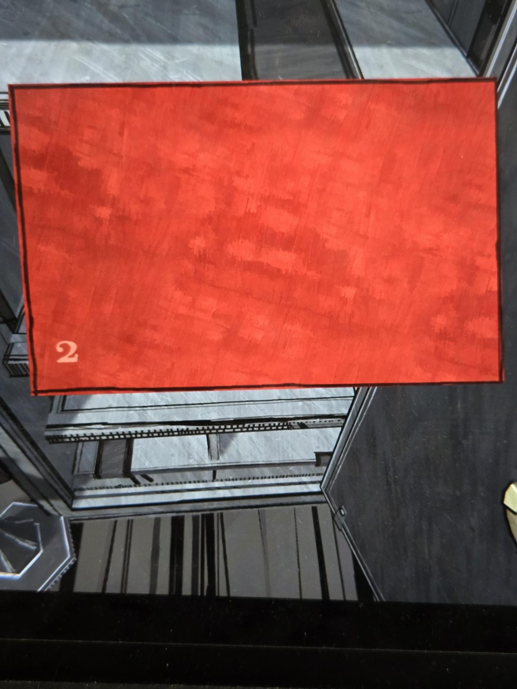
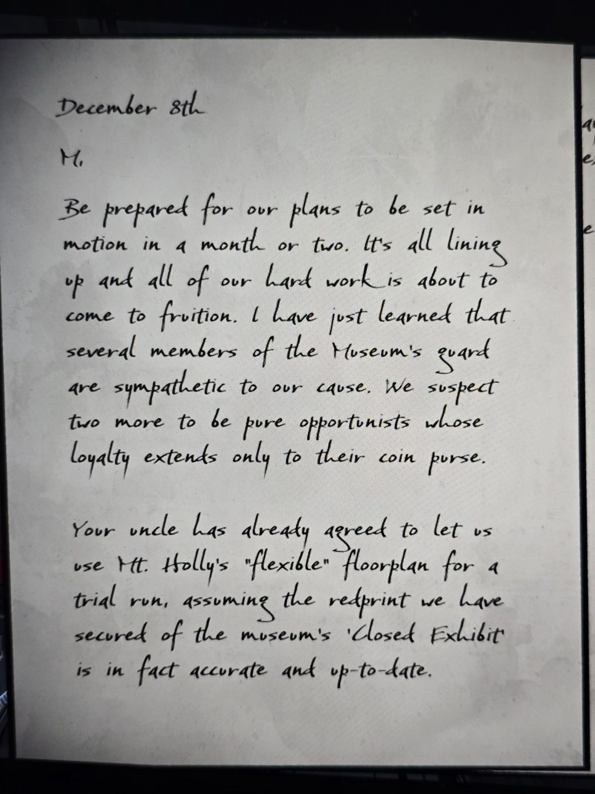
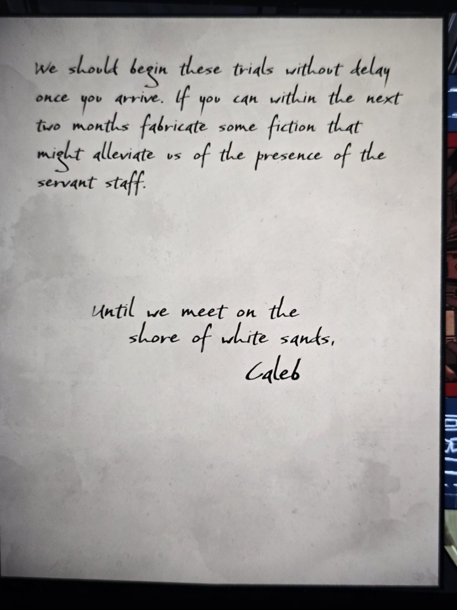

# Красное письмо 2: Калеб — «М.», 8 декабря
Сейф в [Study](../../solutions.md) (код 1208). Красный конверт с номером **2** и рукописное письмо, подписано **Caleb** (вероятно, Калеб Мэннинг, см. [timeline](../../../../story/timeline.md)). Соответствие конверта и письма определено по порядку снимков; прямо не подтверждено. Адресат «**M.**» (вероятно, Мэри, не подтверждено).

8 декабря

М.,

Будь готов: наши планы придут в движение через месяц-два. Всё складывается, и вся наша тяжёлая работа вот-вот принесёт плоды. Я только что узнал, что несколько человек из **охраны музея** сочувствуют нашему делу. Ещё двое, подозреваем, чистые оппортунисты, чья верность распространяется лишь на их кошелёк.

Твой дядя уже согласился позволить нам использовать **«гибкий» план Mt. Holly** для пробного запуска — если **«redprint»** «Закрытой экспозиции» (Closed Exhibit) музея, который мы раздобыли, действительно точен и актуален.

Начнём эти испытания без промедления, как только ты приедешь. Если сможешь в ближайшие два месяца придумать вымысел, который избавит нас от присутствия **обслуги**…

До встречи на берегу белых песков,
Калеб

## Заметка
- Связь с кражей Рубиновой короны из музея Fenn Aries (2 сентября '87, [timeline](../../../../story/timeline.md)) и с Красной гвардией; год письма не указан (вероятно, 1986, «через месяц-два»: февраль 1987?). Не подтверждено.
- «Гибкий план» дома = меняющийся план Mt. Holly; «redprint» (не «blueprint») — игра слов с красным.
- Серия [красных писем](../../../../documents/red-letters/README.md).

## Photos / Фото

