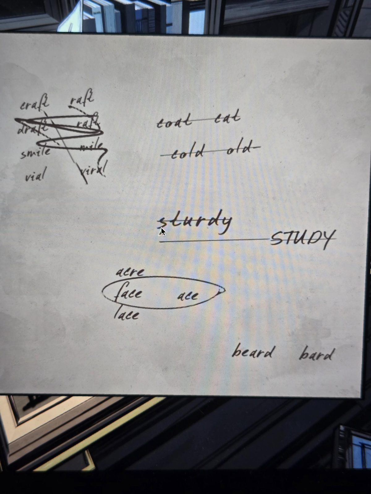

(handwritten scribbles; reading is approximate, some words crossed out)

craft · raft
draft · raft *(crossed out)*
smile · mile *(crossed out)*
vial · viral *(crossed out)*
(big diagonal strike over the left group)

coat · cat *(crossed out)*
cold · old *(crossed out)*

sturdy · STUDY *(both crossed out)*

acre
**face** · **ace** *(circled)*
lace

beard · bard

## Photos / Фото

