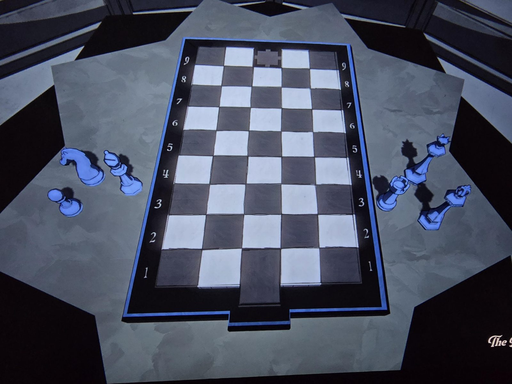

# Шахматная доска 9×5
Доска в The Precipice: **9 рядов × 5 столбцов** — как план дома. Ряды пронумерованы 1–9. Клетка **9.3** отмечена крестообразной плиткой (Antechamber?), снизу посередине выступ — как вход (Entrance Hall).

Рядом фигуры: слева **конь, слон, пешка**, справа **ферзь, ладья, король** (по одной каждого вида).

## Как решается
Поставить каждую фигуру на клетку, где в **текущем доме** стоит комната с такой же шахматной фигурой. Какие фигуры в каких комнатах — см. [шахматы](../../../../puzzles/chess/README.md).

## Photos / Фото

