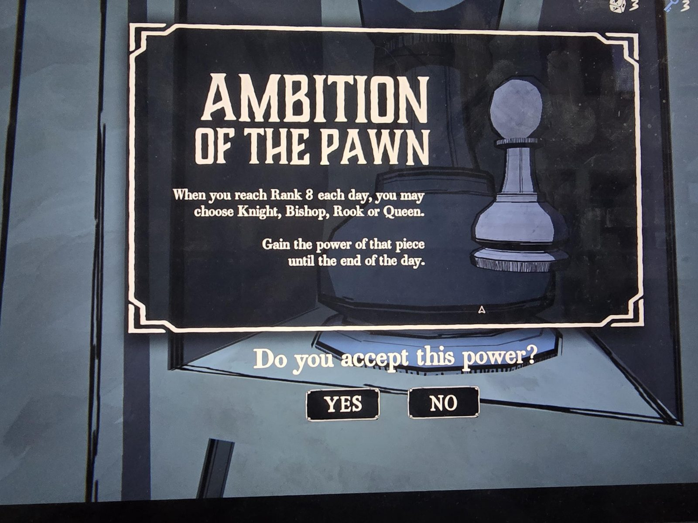
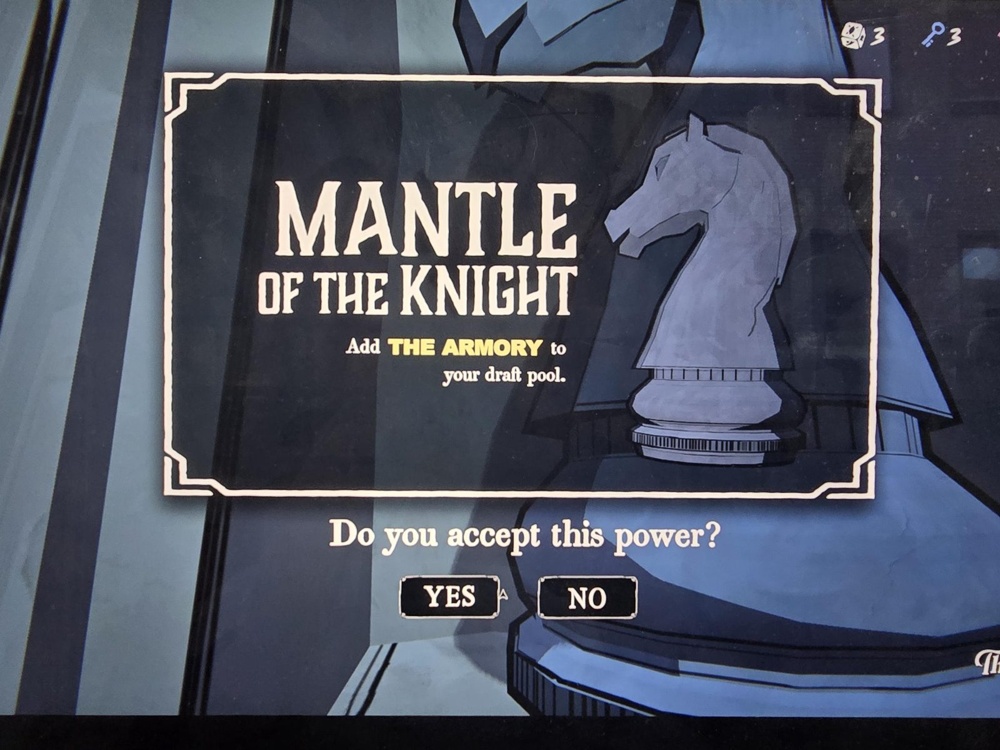
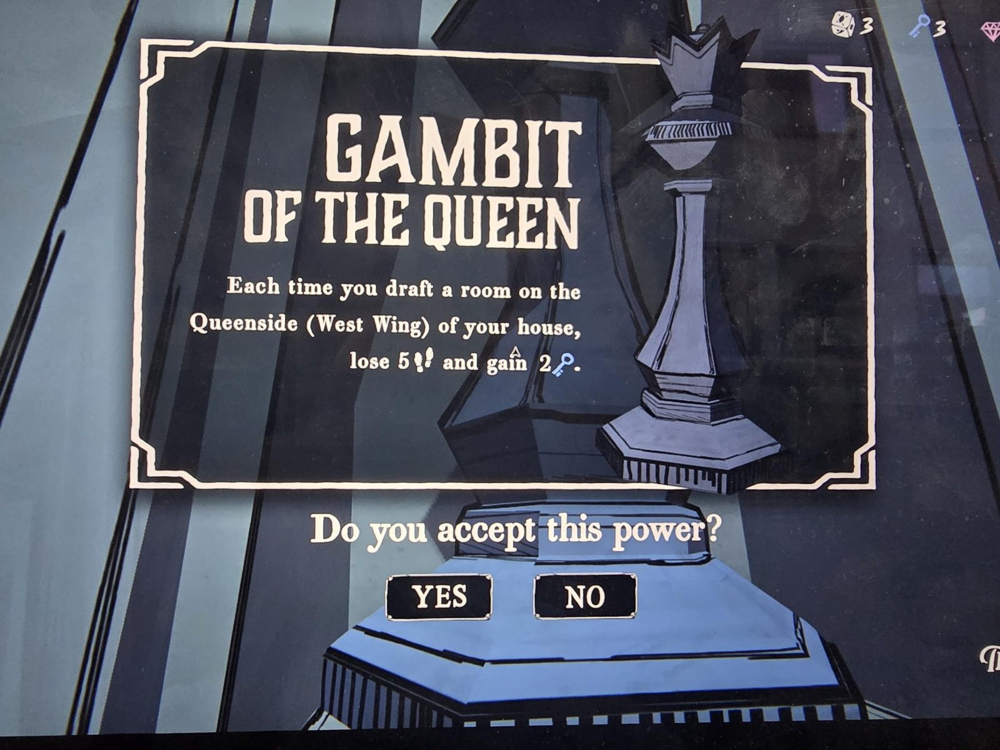
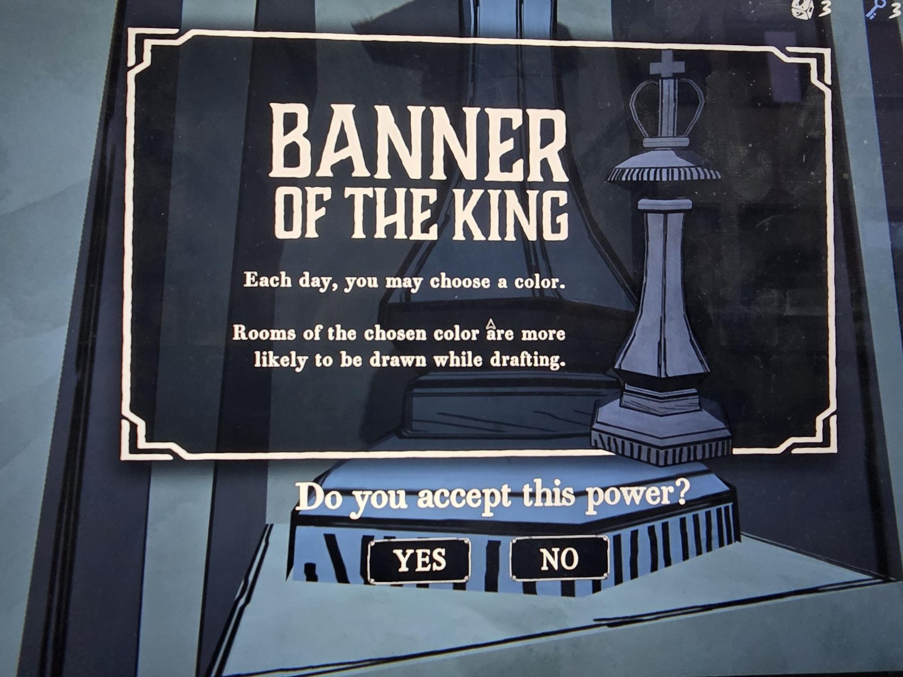
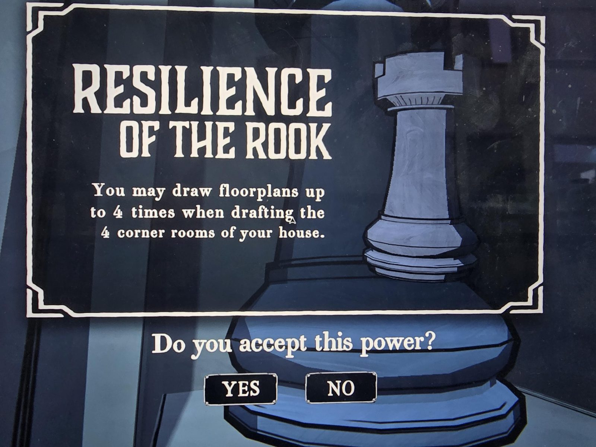
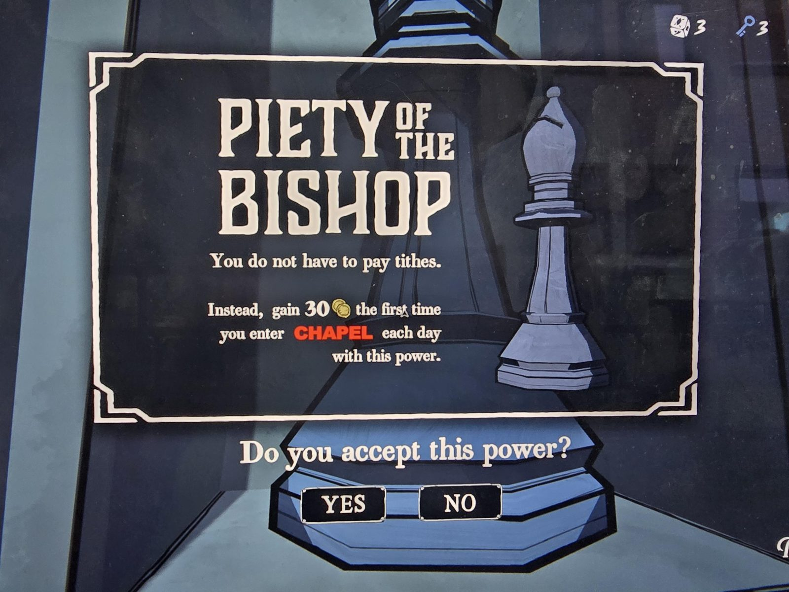

# Силы шахматных фигур (The Precipice)
Награда за решённую шахматную загадку [The Precipice](../chess-board/ru.md). Одновременно можно взять только одну силу. Чтобы поменять, нужно заново решить загадку.

1. **Честолюбие пешки (Ambition of the Pawn):** каждый день, когда вы достигаете ряда 8, можно выбрать коня, слона, ладью или ферзя. Вы получаете силу этой фигуры до конца дня.
2. **Мантия коня (Mantle of the Knight):** добавляет **The Armory** в пул драфта.
3. **Гамбит ферзя (Gambit of the Queen):** каждый раз, когда вы драфтите комнату на ферзевом фланге (Западное крыло), теряете 5 шагов и получаете 2 ключа.
4. **Знамя короля (Banner of the King):** каждый день можно выбрать цвет; комнаты выбранного цвета чаще выпадают при драфте.
5. **Стойкость ладьи (Resilience of the Rook):** можно тянуть планы этажей до 4 раз при драфте 4 угловых комнат дома.
6. **Благочестие слона (Piety of the Bishop):** не нужно платить десятину; вместо этого вы получаете 30 монет при первом входе в **Chapel** каждый день с этой силой.

## Photos / Фото
     
