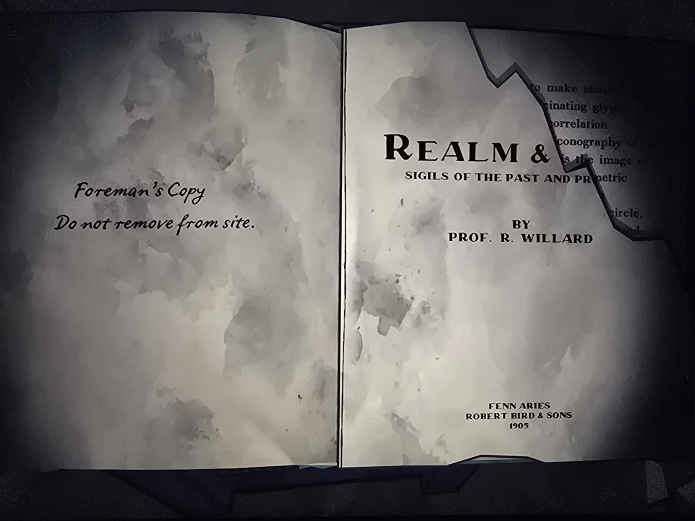
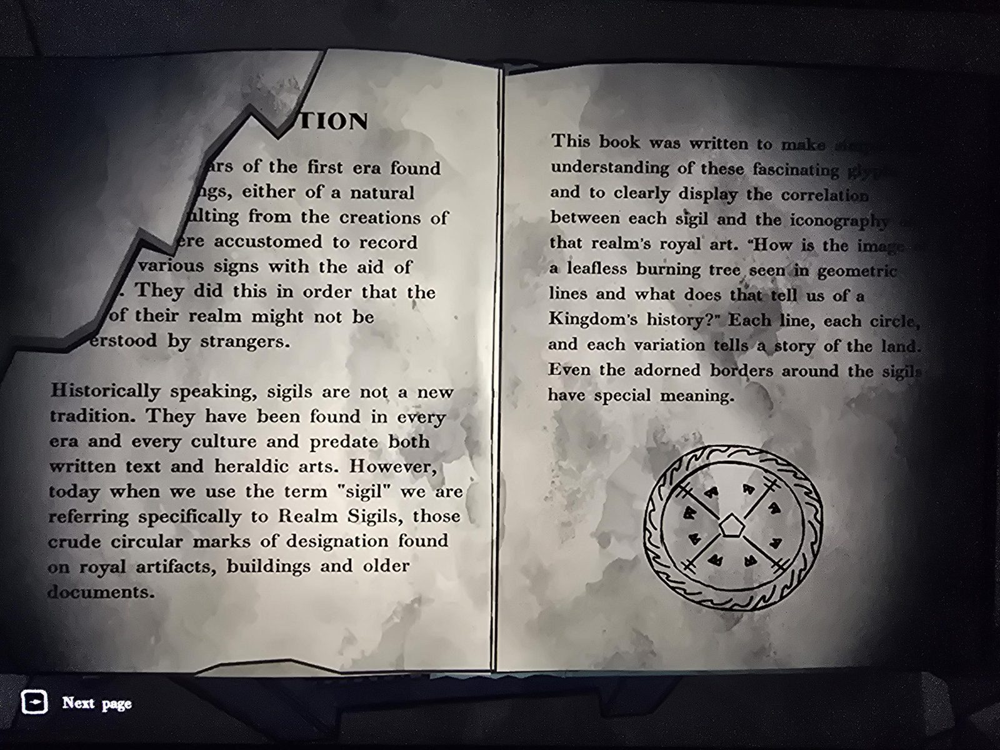
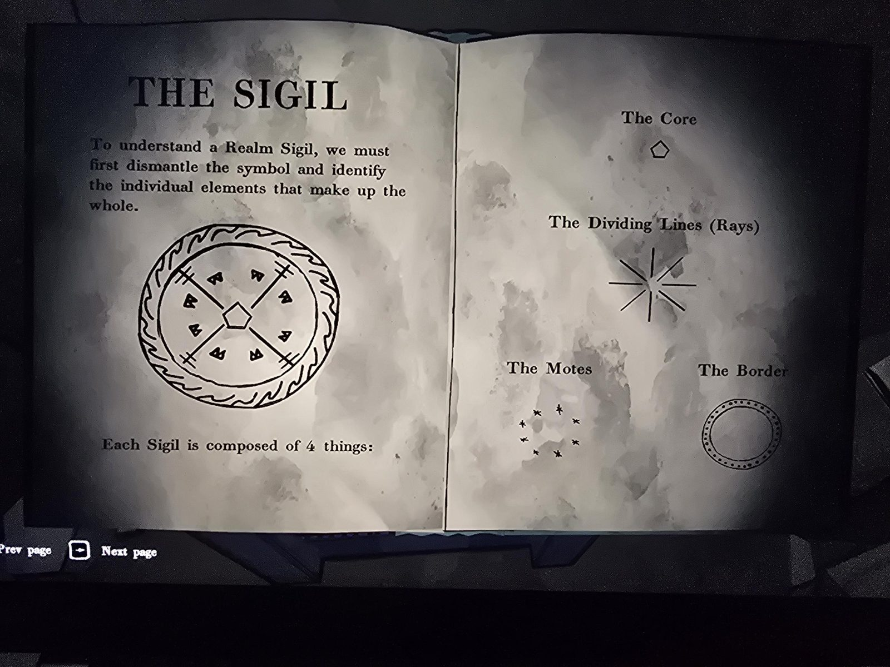
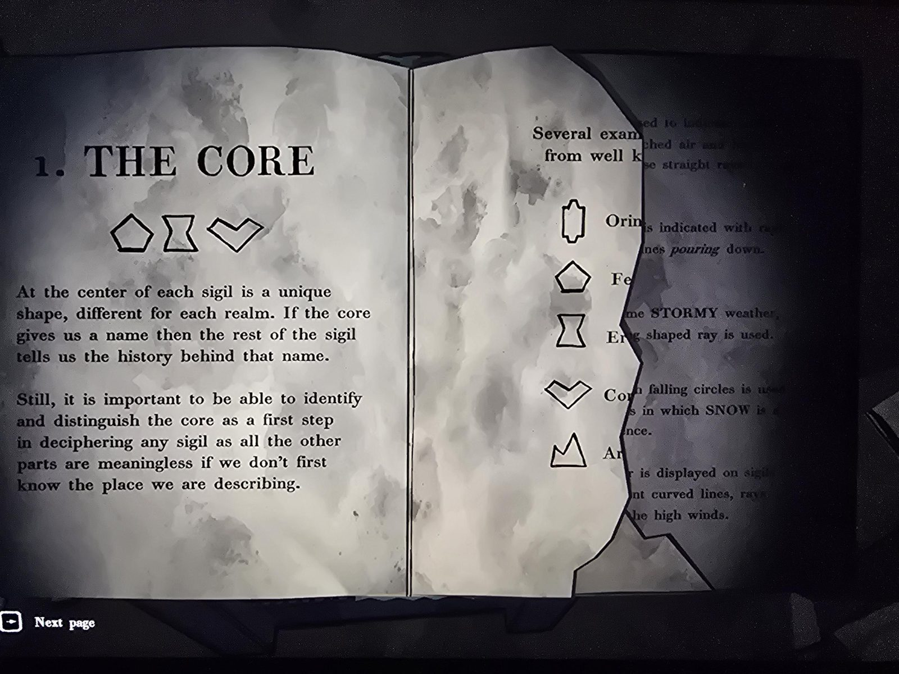
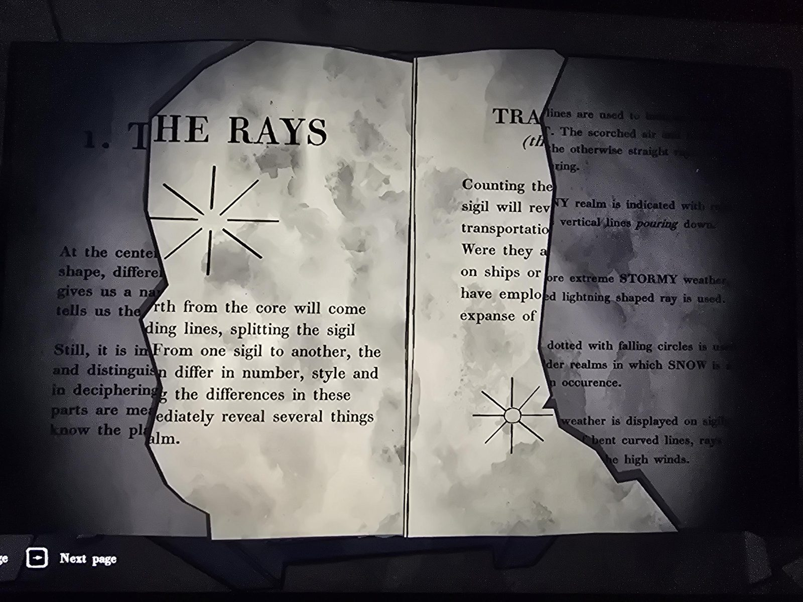
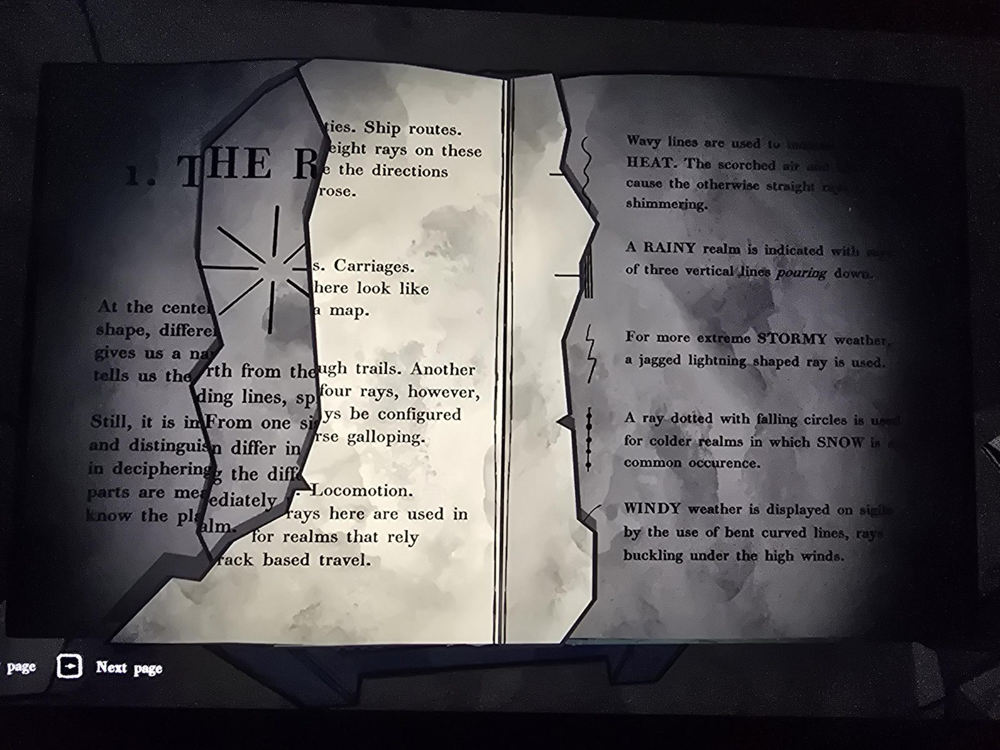
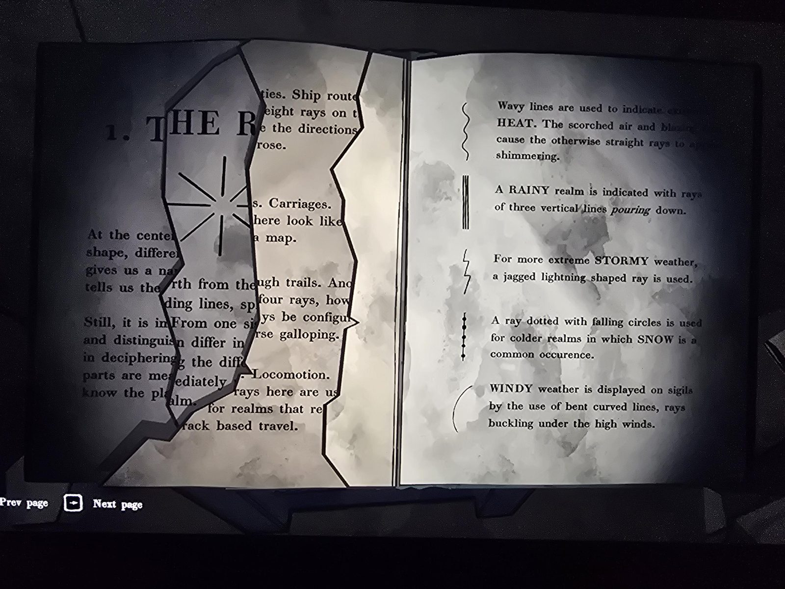
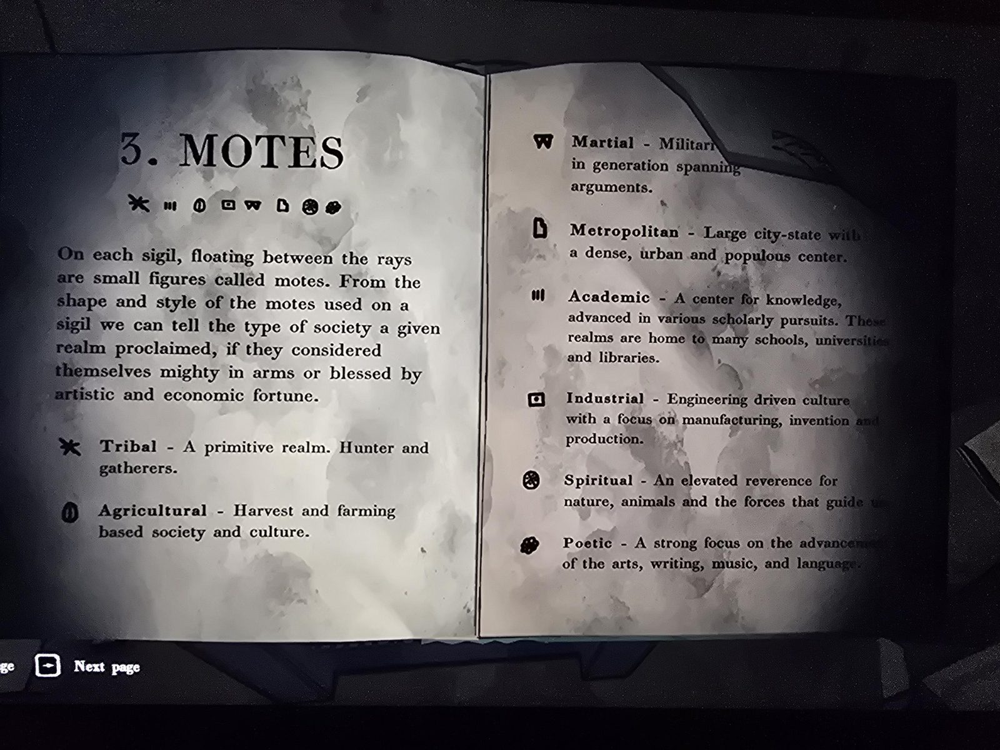
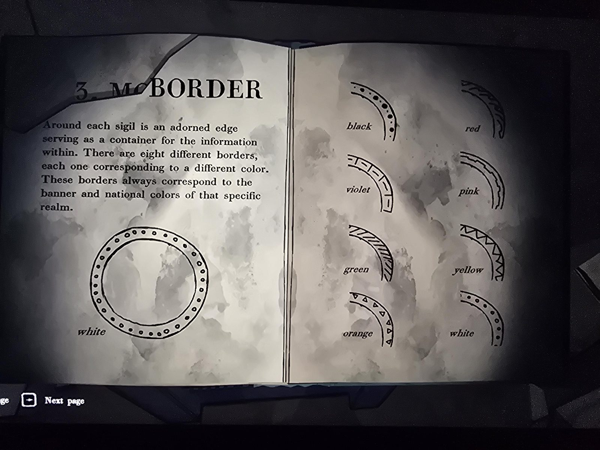
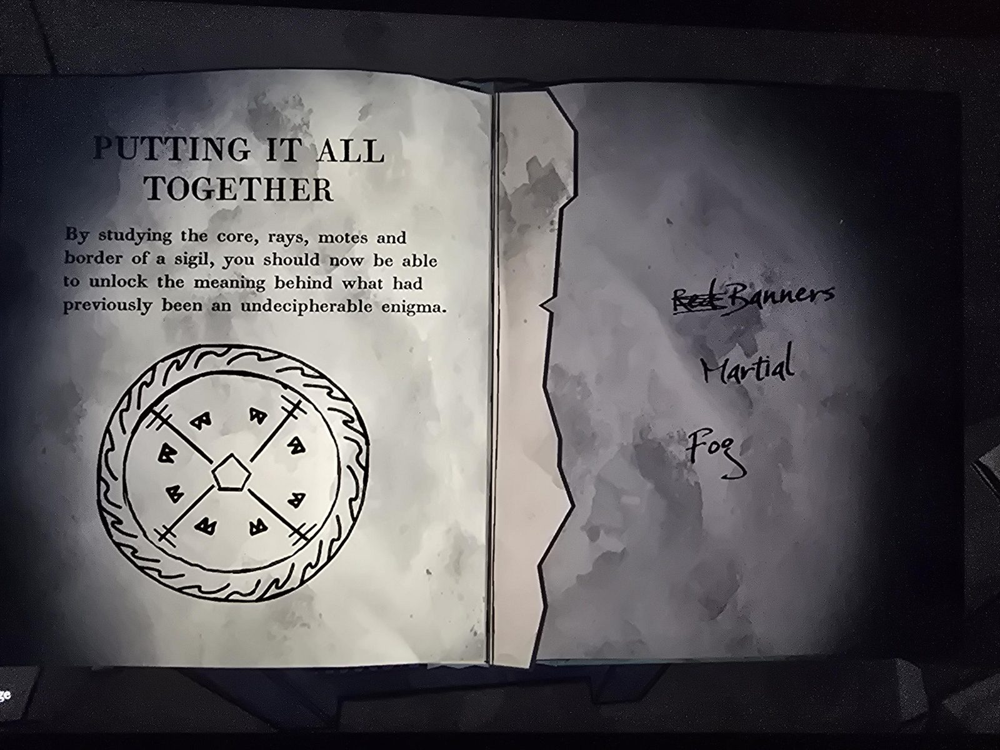

# Книга «Realm & … — Sigils of the Past and Present» (проф. Р. Уиллард, 1905)
Порванная книга в The Precipice. **Целая копия с недостающими названиями и текстом: [в Library](../../../library/books/realm-and-rune/ru.md).** На форзаце от руки: «**Экземпляр бригадира. Не выносить с объекта.**» Fenn Aries, Robert Bird & Sons, 1905. Часть текста оторвана — [...].

## Суть
**Печати королевств (Realm Sigils)** — круглые знаки на королевских артефактах, зданиях и старых документах. Каждая печать состоит из **4 частей**:

### 1. Ядро (Core) — **название королевства**
Уникальная фигура в центре. Сначала определить ядро, иначе остальное бессмысленно. Примеры (подписи оборваны):

| Фигура | Королевство |
|---|---|
| вытянутая фигура с выступами | **Orin[da]** |
| пятиугольник | **Fe[nn]** (Фенн-Эрис) |
| песочные часы | **Er[...]** |
| «галочка»/сердце | **Co[...]** |
| корона / «M» | **Ar[...]** |

### 2. Лучи (Rays) — **транспорт** (число лучей) и **погода** (форма лучей)
Транспорт (текст оборван):
- **8 лучей** — роза ветров → **корабли / морские пути**.
- лучи как дороги на карте → **кареты**.
- **4 луча** особой конфигурации → **верховая езда** («галопом»).
- лучи для «опоры на рельсы» → **поезда (локомоция)**.

Погода:
| Вид луча | Погода |
|---|---|
| волнистый | **ЖАРА** |
| три вертикальные линии | **ДОЖДЬ** |
| молния | **ГРОЗЫ** |
| с падающими кружками | **СНЕГ** |
| изогнутый | **ВЕТЕР** |

### 3. Мотки (Motes) — **тип общества**
Маленькие фигурки между лучами:
| Значок | Тип |
|---|---|
| ✱ (звёздочка) | **Tribal** — первобытное, охотники и собиратели |
| ⓪ (кружок с овалом) | **Agricultural** — земледельческое |
| **W** | **Martial** — воинственное |
| «лист с загнутым углом» | **Metropolitan** — крупный город-государство |
| III | **Academic** — наука, школы, университеты, библиотеки |
| квадрат с точкой | **Industrial** — инженерия, производство |
| кружок с точками | **Spiritual** — почитание природы и высших сил |
| «клякса» | **Poetic** — искусство, литература, музыка, язык |

### 4. Кайма (Border) — **цвет знамени** королевства
8 видов каймы = 8 цветов: **белый** (кружки), **чёрный** (точки), **красный** (языки пламени), **фиолетовый** (штрихи-сегменты), **розовый** (двойная ломаная), **зелёный** (косая штриховка), **жёлтый** (зигзаг), **оранжевый** (треугольнички).

### Пример
Печать: пятиугольник (Фенн), 4 луча с поперечинами, 8 мотков «W», кайма-пламя. Пометки бригадира от руки: ~~Red~~ **Banners** (красные знамёна), **Martial**, **Fog** (туман). → Фенн-Эрис: красные знамёна, воинственное, туман.

## Заметка
- Ключ к расшифровке печатей, которые, видимо, встретятся внизу.
- «Красные знамёна» Фенн-Эрис — ср. «красные флаги» в письме Герберта, Красная гвардия.
- Лучи с двойными поперечинами (= «Fog»?) в сохранившемся тексте не описаны — видимо, на оторванной части.

## Photos / Фото

