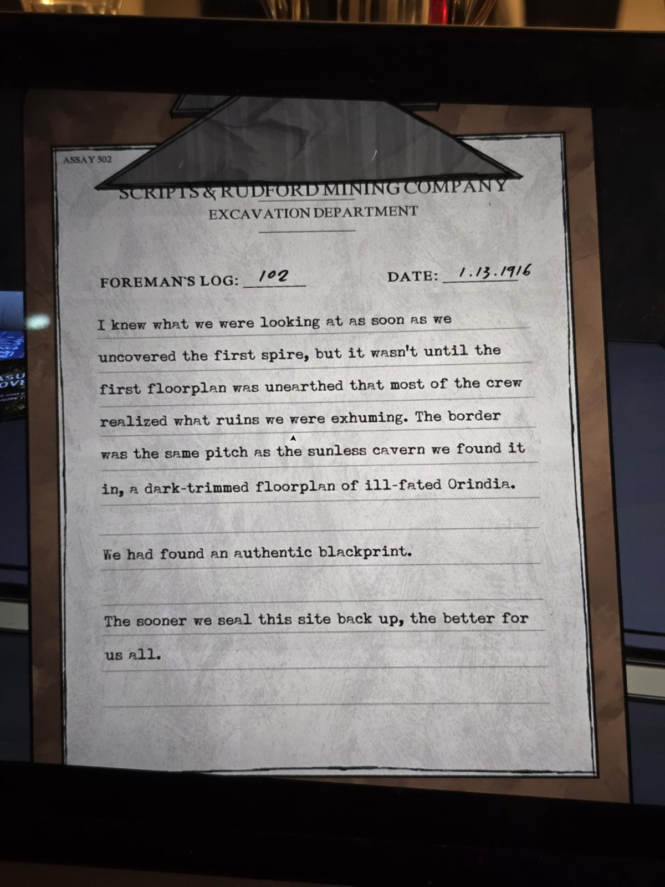

# Журнал бригадира №102 (1.13.1916 = 13 января 1916)
The Underpass. Бланк **Scripts & Rudford Mining Company**, отдел раскопок. В углу: ASSAY 502.

Я понял, на что смотрю, как только мы откопали первый **шпиль**, но только когда выкопали первый **план этажа**, большинство бригады осознало, какие руины мы эксгумируем. Кайма была тёмной, как смоль, под стать беспросветной пещере, в которой мы его нашли: план этажа злополучной **Orindia** с тёмной окантовкой.

Мы нашли подлинный **«блэкпринт» (blackprint)**.

Чем скорее мы снова запечатаем это место, тем лучше для всех нас.

## Заметка
- Серия: [журналы бригадира](../../../../documents/foreman-logs/README.md). Тёмная кайма плана перекликается с чёрным знаменем Orinda Aries ([королевства](../../../../puzzles/realms/README.md)).

## Photos / Фото

