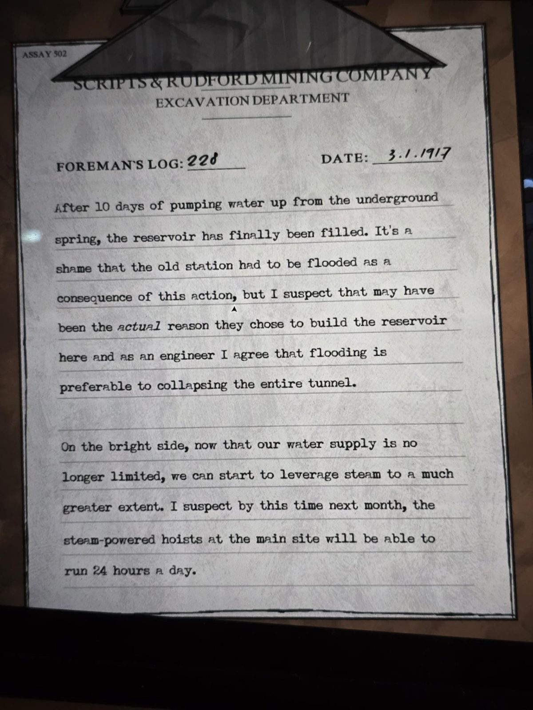

ASSAY 502

SCRIPTS & RUDFORD MINING COMPANY
EXCAVATION DEPARTMENT

FOREMAN'S LOG: 228          DATE: 3.1.1917

After 10 days of pumping water up from the underground spring, the reservoir has finally been filled. It's a shame that the old station had to be flooded as a consequence of this action, but I suspect that may have been the *actual* reason they chose to build the reservoir here and as an engineer I agree that flooding is preferable to collapsing the entire tunnel.

On the bright side, now that our water supply is no longer limited, we can start to leverage steam to a much greater extent. I suspect by this time next month, the steam-powered hoists at the main site will be able to run 24 hours a day.

## Photos / Фото

