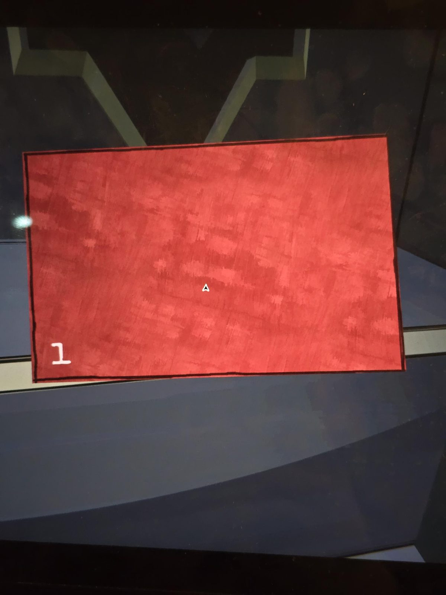
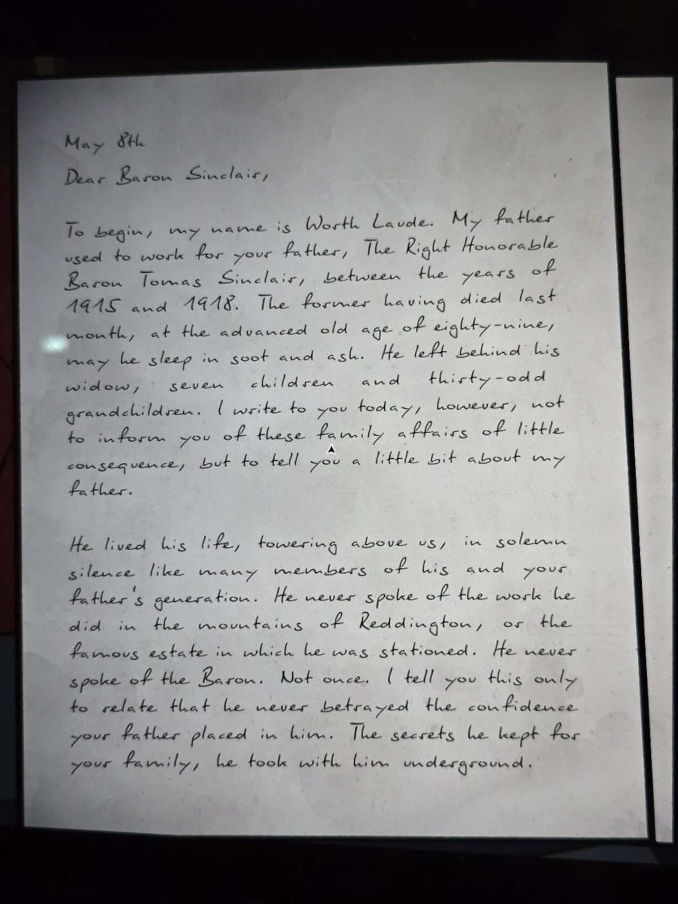
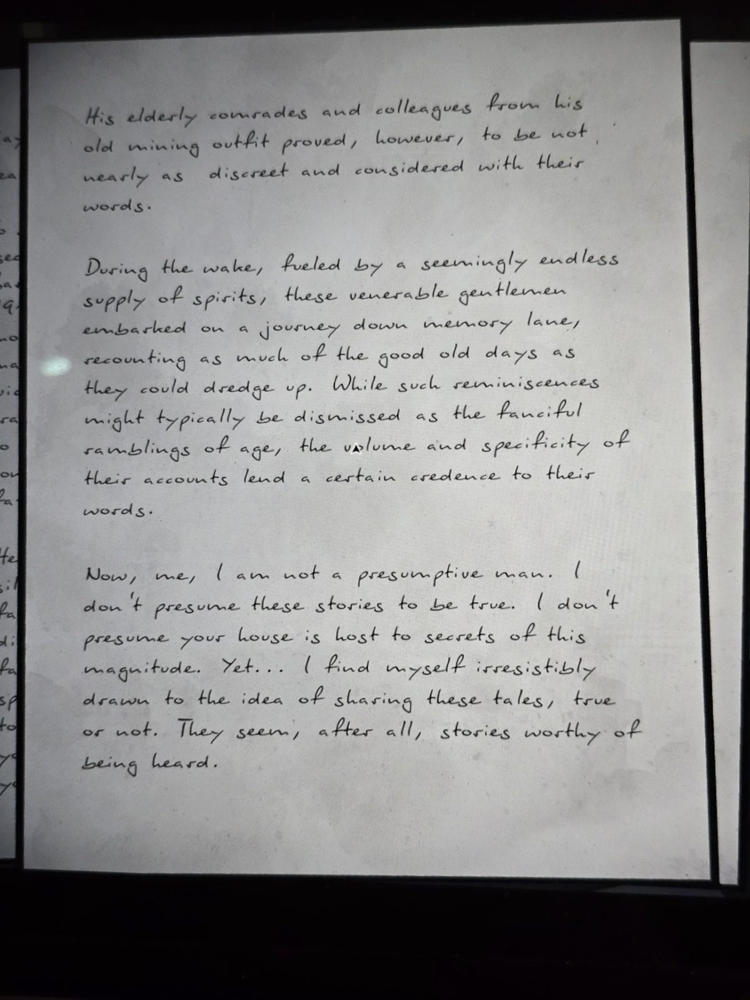
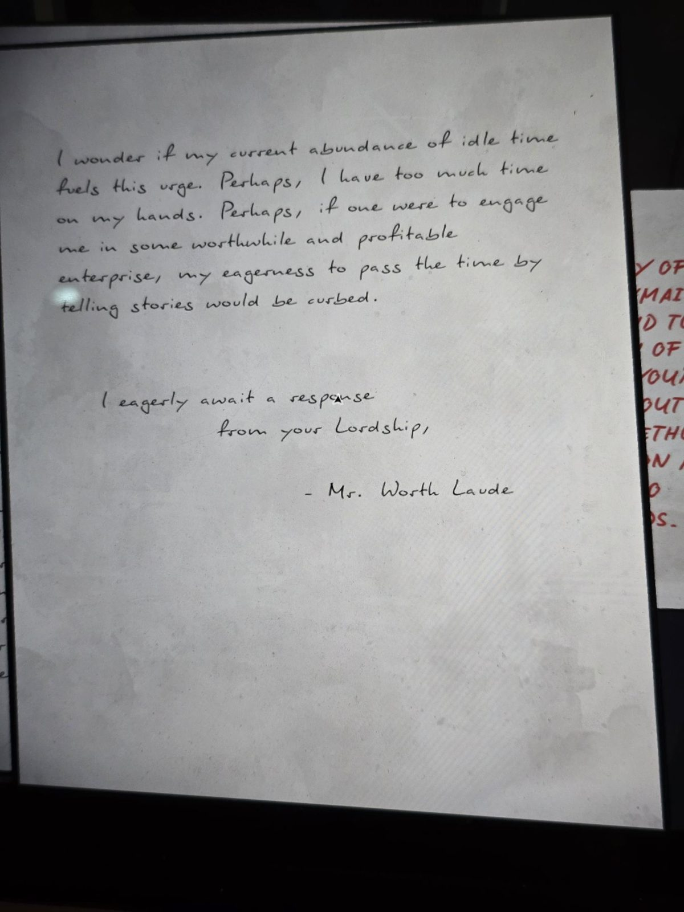
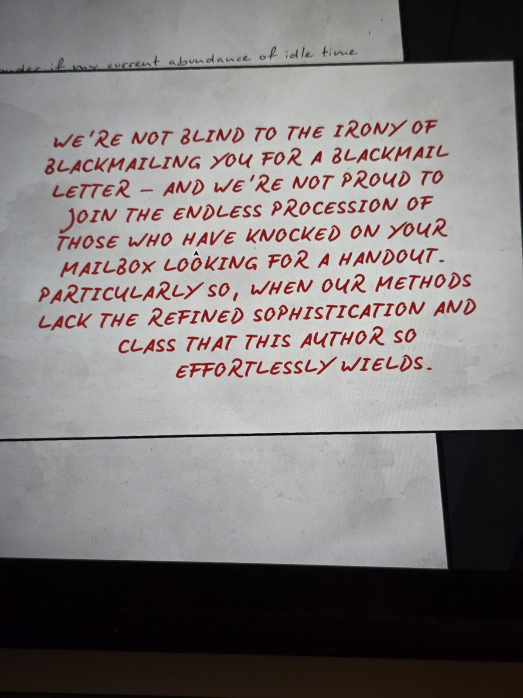

# Красное письмо 1: Ворт Лауд — барону Синклеру
The Underpass. Красный конверт с номером **1**; внутри письмо на трёх листах и красная рукописная записка (рукописная красная: **правда**).

## Перевод
8 мая
Дорогой барон Синклер,

Для начала: меня зовут **Ворт Лауд (Worth Laude)**. Мой отец работал на вашего отца, достопочтенного барона **Томаса Синклера**, с 1915 по 1918 год. Отец умер в прошлом месяце в преклонном возрасте восьмидесяти девяти лет, да почиет он в саже и пепле. Он оставил вдову, семерых детей и три десятка с лишним внуков. Но пишу я вам не затем, чтобы сообщать об этих малозначительных семейных делах, а чтобы немного рассказать о моём отце.

Он прожил жизнь, возвышаясь над нами, в торжественном молчании, как многие из его и вашего отцовского поколения. Он никогда не говорил о работе, которую делал в горах **Реддингтона**, и о знаменитом поместье, где он был расквартирован. Он никогда не говорил о бароне. Ни разу. Я говорю это лишь затем, чтобы сказать: он ни разу не предал доверие, которое ваш отец ему оказал. Секреты, которые он хранил для вашей семьи, он унёс с собой под землю.

---

Однако его престарелые товарищи и коллеги по старой горной артели оказались далеко не так сдержанны и обдуманны в словах.

На поминках, подпитываемые, казалось бы, бесконечным запасом спиртного, эти почтенные господа пустились в путешествие по тропе воспоминаний, пересказывая столько «доброго старого времени», сколько могли выкопать. Хотя такие воспоминания обычно списывают на причудливое бормотание старости, объём и конкретность их рассказов придают словам некоторую достоверность.

Я не человек самонадеянный. Я не считаю, что эти истории правдивы. Не считаю, что ваш дом хранит тайны такого масштаба. И всё же… меня неудержимо тянет поделиться этими рассказами, правдивыми или нет. В конце концов, они кажутся историями, достойными того, чтобы их услышали.

---

Интересно, не питает ли это стремление мой нынешний избыток свободного времени. Возможно, у меня слишком много времени. Возможно, если бы кто-то занял меня каким-нибудь стоящим и прибыльным делом, моя готовность коротать время рассказыванием историй поугасла бы.

С нетерпением жду ответа от вашей светлости,

— г-н Ворт Лауд

---

**Красная записка (от руки, заглавными):** «Мы не слепы к иронии того, что шантажируем вас из-за шантажного письма, и нам не гордо присоединяться к бесконечной веренице тех, кто стучался в ваш почтовый ящик в поисках подачки. Особенно когда нашим методам недостаёт утончённого изящества и класса, которыми так непринуждённо владеет автор этого письма.»

## Заметка
- Письмо датировано **8 мая**; на дверном навесном замке в The Underpass набирается [MAY 8](../../solutions.md).
- Красное письмо №1 в серии: [красные письма](../../../../documents/red-letters/README.md). Записка в конце похожа на тон вымогателей X ([письмо X](../../../office/docs/x-parting-letter-red-infinity/ru.md)).
- Отец автора работал на Томаса Синклера в 1915–1918, как и бригада [Scripts & Rudford](../../../../documents/foreman-logs/README.md); бригадир упоминает «секреты под землёй», которые отец «унёс с собой».

## Photos / Фото
    
