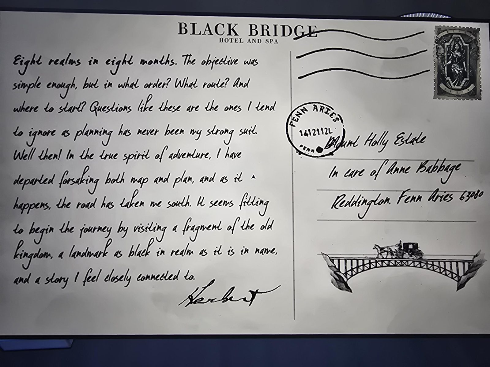

# Открытка Герберта из Black Bridge Hotel and Spa
Inner Sanctum 1: путь к открытке открыло решение механической загадки. Адрес: **Mount Holly Estate, c/o Anne Babbage, Reddington, Fenn Aries 63080**. Штемпель FENN ARIES, дата **неразборчива**. На картинке карета на мосту; рамка на марке похожа на ядро Orinda (фигура внутри, возможно статуя Orinda из Cloister; догадка).

«**Восемь королевств за восемь месяцев.** Цель была достаточно проста, но в каком порядке? Каким маршрутом? С чего начать? На такие вопросы я склонен не обращать внимания: планирование никогда не было моей сильной стороной. Что ж! В истинном духе приключений я отправился, отказавшись и от карты, и от плана, и так вышло, что дорога повела меня **на юг**. Подходящее начало путешествия: посетить **фрагмент старого королевства, место, такое же чёрное в королевстве, как и в названии**, и историю, с которой я чувствую близкую связь. — **Герберт**»

## Заметка
- «Чёрный в названии» = **Black Bridge** ([Blackbridge Grotto](../../../blackbridge-grotto/open-questions.md)); «чёрный в королевстве» = королевство с **чёрной каймой**, это **Orinda Aries** (чёрная кайма на [её печати](../../photos/orinda-sigil-mechanism-solved.jpg), «infamous black symbol» в [рекламе Mora Jai](../mora-jai-box-orinda-aries-advert/ru.md)). **Первое** королевство Герберта = Orinda Aries (со слов пользователя; для [карты в Room 46](../../../room-46/docs/realm-map-pins/ru.md)).
- «8 realms in 8 months» — тот же текст, что на [карте в Room 46](../../../room-46/docs/realm-map-pins/ru.md).

## Photos / Фото

