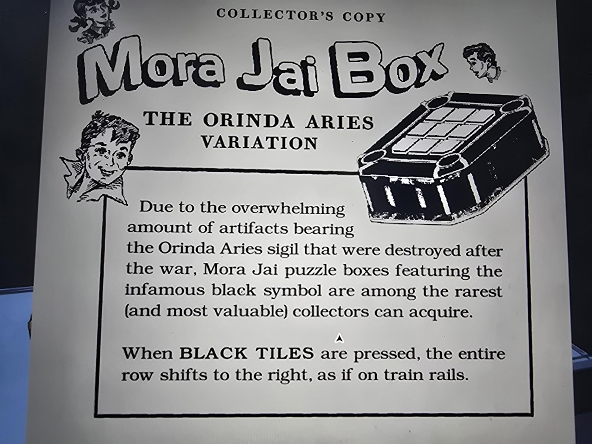

# Реклама Mora Jai Box: вариант Orinda Aries («Collector's Copy»)
Inner Sanctum 1. Рекламный лист с рисунком коробки.

«**Collector's Copy. Mora Jai Box: вариант Orinda Aries.** Из-за огромного числа артефактов с печатью Orinda Aries, уничтоженных после войны, коробки Mora Jai с этим **печально известным чёрным символом** — одни из самых редких (и ценных) для коллекционеров.

**Когда нажимают ЧЁРНЫЕ плитки, весь ряд сдвигается вправо, как по железнодорожным рельсам.**»

## Заметка
- Правило чёрной плитки внесено в [правила Mora Jai](../../../../../puzzles/mora-jai/README.md); сама коробка: [Inner Sanctum 1](../../../../../puzzles/mora-jai/inner-sanctum-1/ru.md).
- «Как по рельсам» = три луча (поезд) на печати Orinda, см. [Realm & Rune](../../../../library/books/realm-and-rune/ru.md).

## Photos / Фото

