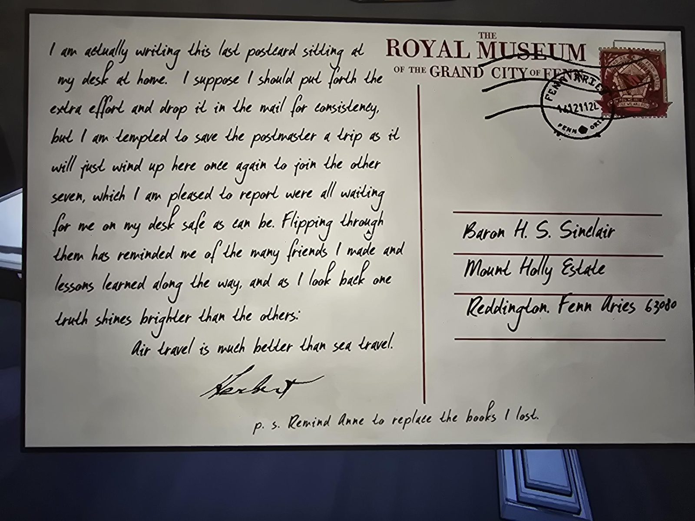

# Последняя открытка Герберта (Royal Museum of the Grand City of Fenn)
Inner Sanctum 2. Открытка с шапкой **«Королевский музей Великого города Фенн»**, рукописный текст. Адрес: **барон H. S. Sinclair, Mount Holly Estate, Reddington, Fenn Aries 63080**. Марка красная с пятиугольным гербом, штемпель FENN ARIES, дата **неразборчива**.

«Вообще-то я пишу эту **последнюю** открытку, сидя за своим столом **дома**. Полагаю, ради последовательности стоило бы приложить лишние усилия и бросить её в почтовый ящик, но меня подмывает избавить почтмейстера от поездки: она всё равно окажется здесь же, к **остальным семи**, которые, с радостью сообщаю, **ждали меня на письменном столе целыми и невредимыми**. Перелистывая их, я вспомнил о многих друзьях, которых обрёл, и об уроках, усвоенных по пути, и, оглядываясь назад, вижу, что одна истина сияет ярче остальных:

**Путешествовать по воздуху гораздо лучше, чем по морю.**

— **Герберт**

P. S. Напомни Энн заменить книги, которые я потерял.»

## Заметка
- Это **восьмая** открытка маршрута «8 королевств за 8 месяцев»: первая была из [Black Bridge](../../../inner-sanctum-1/docs/herbert-postcard-black-bridge/ru.md) (Inner Sanctum 1), остальные семь, по тексту, лежат у Герберта на столе.
- Адресована **барону Синклеру** (предыдущая открытка была на имя Энн Бэббидж).

## Photos / Фото

