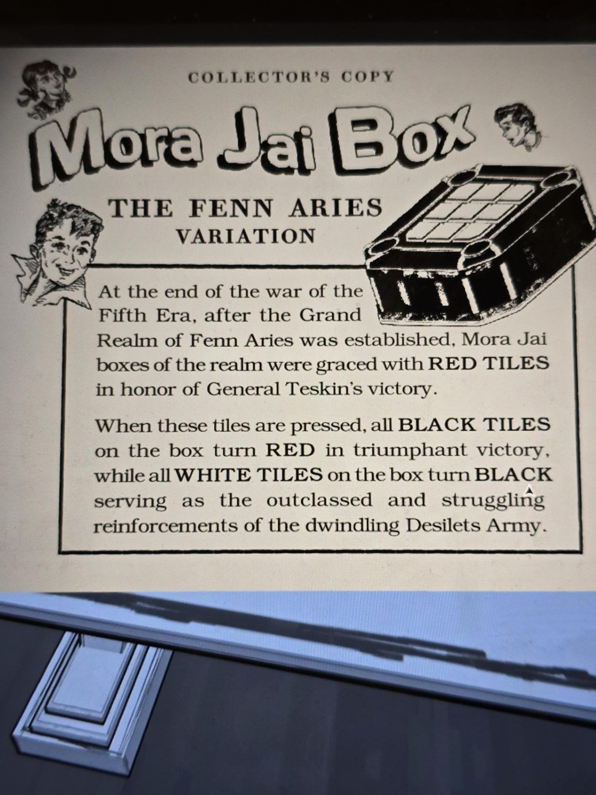

# Реклама Mora Jai Box: вариант Fenn Aries («Collector's Copy»)
Inner Sanctum 2. Рекламный лист с рисунком коробки.

«**Collector's Copy. Mora Jai Box: вариант Fenn Aries.** В конце войны Пятой эры, после основания Великого королевства Fenn Aries, коробки Mora Jai королевства были «удостоены» **КРАСНЫХ ПЛИТОК** в честь победы генерала Тескина.

**Когда эти плитки нажимают, все ЧЁРНЫЕ плитки на коробке становятся КРАСНЫМИ** в торжествующей победе, **а все БЕЛЫЕ плитки на коробке становятся ЧЁРНЫМИ**, служа неполноценным и бьющимся из последних сил подкреплением тающей армии Десилетов.»

## Заметка
- Правило красной плитки внесено в [правила Mora Jai](../../../../../puzzles/mora-jai/README.md); сама коробка: [Room 46](../../../../../puzzles/mora-jai/room-46/ru.md).

## Photos / Фото

