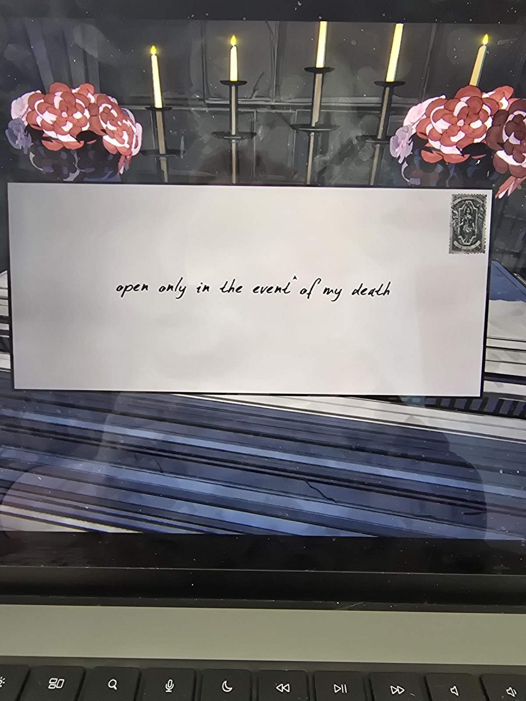
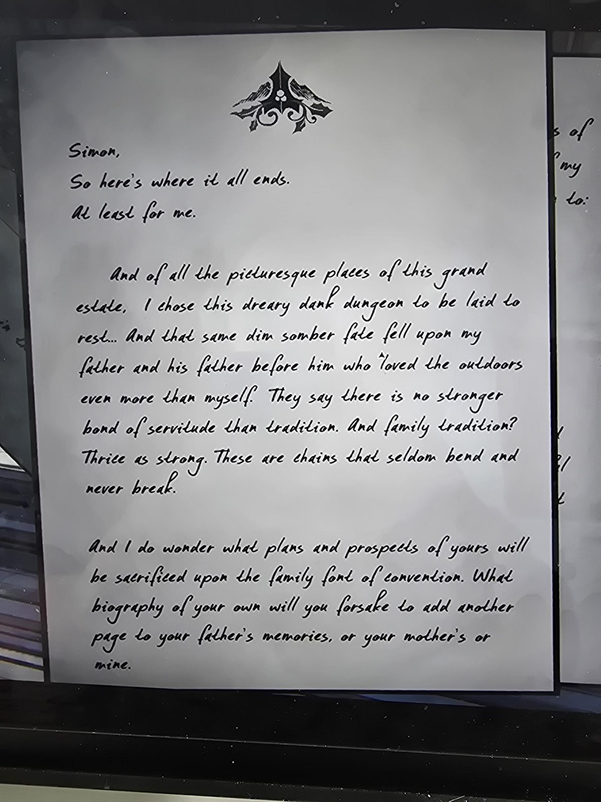
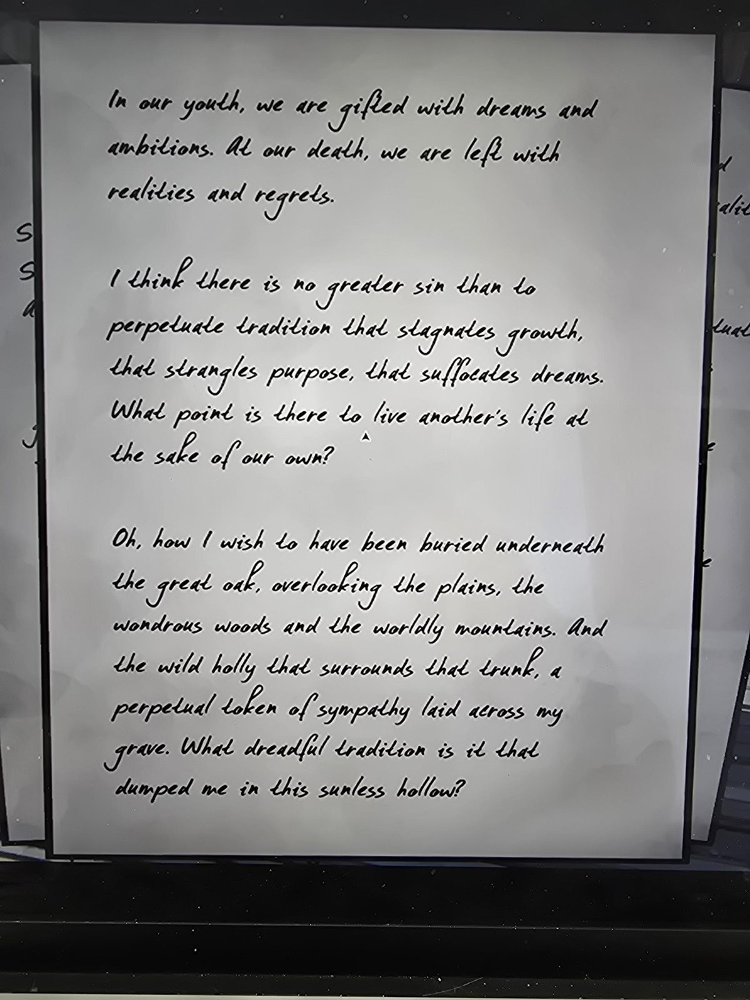
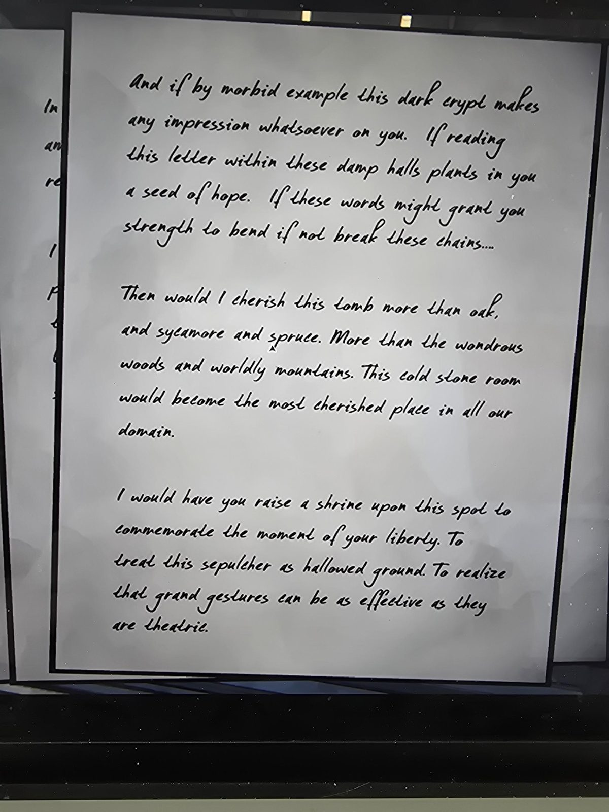
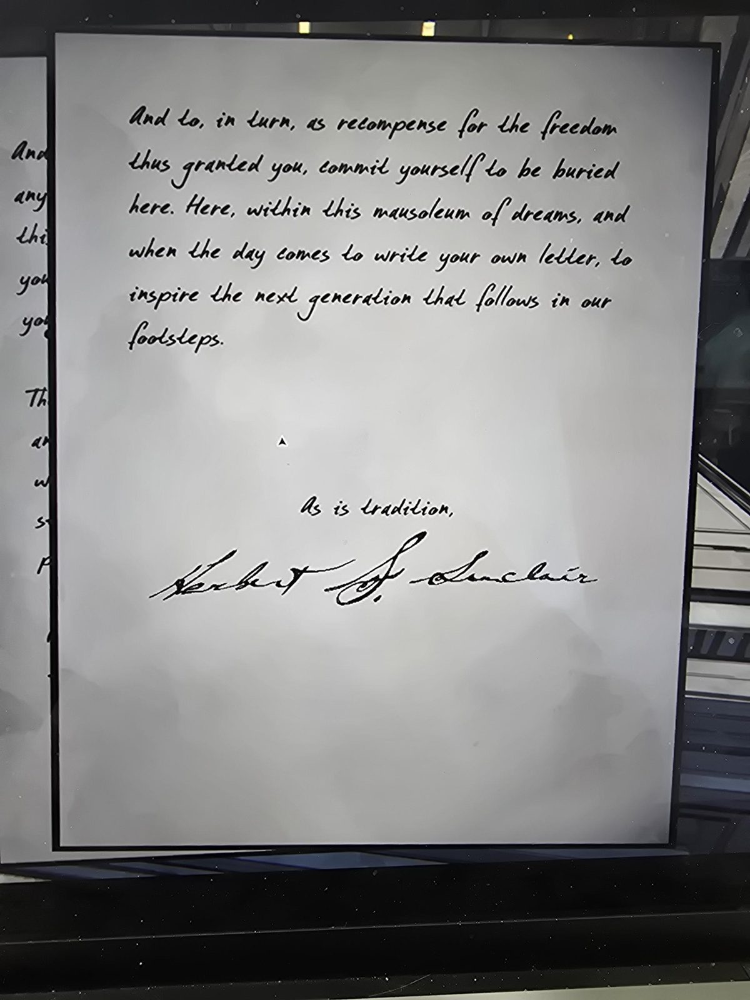

# Письмо Герберта на гробу (Tomb)
Лежит на гробе Герберта в Tomb. Конверт: «вскрыть только в случае моей смерти» (то же, что на конверте из Entrance Hall). Письмо на четырёх листах с гербом (остролист и горы).

## Перевод
Саймон,
вот где всё кончается. По крайней мере для меня.

Из всех живописных мест этого великого поместья я выбрал это унылое сырое подземелье, чтобы упокоиться… И та же тусклая мрачная участь постигла моего отца и его отца до него, которые любили природу даже больше меня. Говорят, нет более крепких оков, чем традиция. А семейная традиция? Втрое крепче. Эти цепи редко гнутся и никогда не рвутся.

И мне интересно, какие твои планы и перспективы будут принесены в жертву на семейной купели условностей. Какую собственную биографию ты бросишь, чтобы добавить ещё страницу к воспоминаниям твоего отца, или твоей матери, или моим.

---

В юности нам дарят мечты и амбиции. В смерти нам остаются реальность и сожаления.

Думаю, нет греха больше, чем продолжать традицию, которая душит рост, убивает цель, удушает мечты. Какой смысл жить чужой жизнью ценой своей собственной?

О, как я хотел бы быть похороненным под великим дубом, с видом на равнины, чудесные леса и мирские горы. И дикий остролист, что окружает ствол, вечный знак сочувствия на моей могиле. Что за ужасная традиция бросила меня в эту безсолнечную лощину?

---

И если этот мрачный склеп по морбидному примеру производит на тебя хоть какое-то впечатление. Если чтение этого письма в этих сырых залах сеет в тебе зерно надежды. Если эти слова дадут тебе силы согнуть, если не сломать, эти цепи…

Тогда я бы дорожил этой гробницей больше, чем дуб, платан и ель. Больше чем чудесные леса и мирские горы. Эта холодная каменная комната стала бы самым дорогим местом во всех наших владениях.

Я хотел бы, чтобы ты **воздвиг святилище (shrine)** на этом месте в память о моменте твоей свободы. Чтобы ты относился к этому склепу как к священной земле. Чтобы понял, что великие жесты могут быть так же действенны, как театральны.

---

И, в свою очередь, в оплату за дарованную тебе свободу, **обязуйся быть похороненным здесь**. Здесь, в этом мавзолее мечтаний, и когда придёт день писать собственное письмо, вдохновить следующее поколение, идущее по нашим стопам.

Как и положено по традиции,
Герберт С. Синклер

## Заметка
- Герберт похоронен в Tomb. Письмо **не про приказ, а про свободу**: он призывает Саймона разорвать семейную традицию (быть похороненным здесь и жить чужой жизнью), но в конце всё же просит быть похороненным здесь «в уплату за свободу».
- «Воздвигни святилище на этом месте» (raise a shrine): возможно, связано с внешней комнатой [Shrine](../../../shrine/solutions.md) (догадка, не проверена).
- Отец и дед Герберта тоже похоронены в таком склепе (по письму).
- Мечтал быть похороненным под великим дубом, окружённым диким остролистом.

## Photos / Фото

